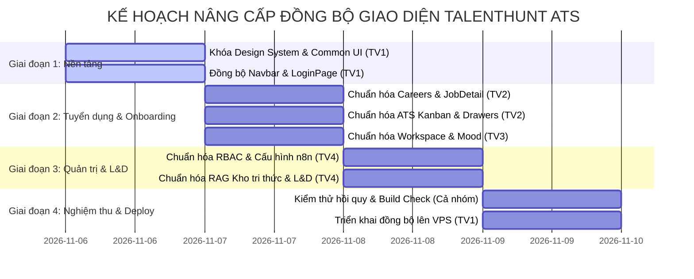

# 📘 BÁO CÁO THIẾT KẾ CHUẨN HÓA GIAO DIỆN & PHÂN CÔNG NHIỆM VỤ ĐỒNG BỘ TOÀN HỆ THỐNG TALENTHUNT ENTERPRISE ATS

* **Dự án:** Hệ thống Quản trị Tuyển dụng & Nhân sự Đa tác nhân (HR Tech AI & n8n Agentic ATS)
* **Phiên bản tài liệu:** v2.0 - Chuẩn hóa UI/UX Design System & Đồng bộ 100% Giao diện
* **Chủ nhiệm dự án / Kiến trúc sư trưởng:** Ngô Quốc Thắng (Tech Lead & Core DevSecOps)
* **Đối tượng tiếp nhận:** Toàn thể thành viên nhóm (TV1, TV2, TV3, TV4) & Các Trợ lý AI đồng hành (Cursor, Claude, ChatGPT, v0)
* **Ngày ban hành:** 05/11/2026

---

## 📑 MỤC LỤC CHI TIẾT
1. [NGUYÊN LÝ THIẾT KẾ HỆ THỐNG (ENTERPRISE DESIGN SYSTEM ARCHITECTURE)](#1-nguyên-lý-thiết-kế-hệ-thống-enterprise-design-system-architecture)
   - [1.1. Triết lý Thiết kế: Enterprise Minimalist & Tỷ lệ 70 - 20 - 10](#11-triết-lý-thiết-kế-enterprise-minimalist--tỷ-lệ-70---20---10)
   - [1.2. Bảng Mã Màu Chuẩn Quốc Tế (Unified Color Tokens)](#12-bảng-mã-màu-chuẩn-quốc-tế-unified-color-tokens)
   - [1.3. Quy Chuẩn Kiểu Chữ (Typography Scale)](#13-quy-chuẩn-kiểu-chữ-typography-scale)
   - [1.4. Quy Chuẩn Không Gian (8-Point Grid Spacing)](#14-quy-chuẩn-không-gian-8-point-grid-spacing)
   - [1.5. Quy Chuẩn Khối Hình, Bo Góc & Đổ Bóng (Geometry & Elevation)](#15-quy-chuẩn-khối-hình-bo-góc--đổ-bóng-geometry--elevation)
   - [1.6. Quy Chuẩn Trạng Thái Tương Tác (Component Interactive States)](#16-quy-chuẩn-trạng-thái-tương-tác-component-interactive-states)
2. [PHÂN TÍCH CHI TIẾT CẤU TRÚC GIAO DIỆN & BẢO VỆ TÍNH NĂNG THỰC TẾ (18 MÀN HÌNH)](#2-phân-tích-chi-tiết-cấu-trúc-giao-diện--bảo-vệ-tính-năng-thực-tế-18-màn-hình)
   - [Nhóm I: Khung Điều Hướng Chung & Cổng Xác Thực (2 màn hình)](#nhóm-i-khung-điều-hướng-chung--cổng-xác-thực)
   - [Nhóm II: Hành Trình Tuyển Dụng Công Khai - Candidate Journey (3 màn hình)](#nhóm-ii-hành-trình-tuyển-dụng-công-khai---candidate-journey)
   - [Nhóm III: Bàn Điều Hành Tuyển Dụng Recruiter ATS (5 màn hình/panel)](#nhóm-iii-bàn-điều-hành-tuyển-dụng-recruiter-ats)
   - [Nhóm IV: Phân Hệ Hội Nhập & Văn Hóa Doanh Nghiệp (4 màn hình/widget)](#nhóm-iv-phân-hệ-hội-nhập--văn-hóa-doanh-nghiệp)
   - [Nhóm V: Quản Trị Hệ Thống RBAC, Kho Tri Thức PDF & Đào Tạo L&D (4 màn hình/panel)](#nhóm-v-quản-trị-hệ-thống-rbac-kho-tri-thức-pdf--đào-tạo-ld)
3. [MA TRẬN PHÂN CÔNG NHIỆM VỤ RACI & HỒ SƠ CHI TIẾT TỪNG THÀNH VIÊN](#3-ma-trận-phân-công-nhiệm-vụ-raci--hồ-sơ-chi-tiết-từng-thành-viên)
   - [3.1. Bảng Ma Trận RACI Trách Nhiệm](#31-bảng-ma-trận-raci-trách-nhiệm)
   - [3.2. Nhiệm Vụ Thành Viên 1: Ngô Quốc Thắng (Trưởng Nhóm - Core Platform)](#32-nhiệm-vụ-thành-viên-1-ngô-quốc-thắng-trưởng-nhóm---core-platform)
   - [3.3. Nhiệm Vụ Thành Viên 2: Fullstack Engineer - Phân Hệ Tuyển Dụng ATS](#33-nhiệm-vụ-thành-viên-2-fullstack-engineer---phân-hệ-tuyển-dụng-ats)
   - [3.4. Nhiệm Vụ Thành Viên 3: Fullstack Engineer - Phân Hệ Onboarding & Văn Hóa](#34-nhiệm-vụ-thành-viên-3-fullstack-engineer---phân-hệ-onboarding--văn-hóa)
   - [3.5. Nhiệm Vụ Thành Viên 4: Fullstack Engineer - Phân Hệ Quản Trị RBAC & L&D](#35-nhiệm-vụ-thành-viên-4-fullstack-engineer---phân-hệ-quản-trị-rbac--ld)
4. [LỘ TRÌNH THỰC HIỆN 4 GIAI ĐOẠN (SPRINT ROADMAP & TIÊU CHÍ NGHIỆM THU)](#4-lộ-trình-thực-hiện-4-giai-đoạn-sprint-roadmap--tiêu-chí-nghiệm-thu)
5. [KHUNG LỆNH CHUẨN HÓA DÀNH CHO CÁC TRỢ LÝ AI KHÁC (AI COMPANION PROMPT)](#5-khung-lệnh-chuẩn-hóa-dành-cho-các-trợ-lý-ai-khác-ai-companion-prompt)

---

# 1. NGUYÊN LÝ THIẾT KẾ HỆ THỐNG (ENTERPRISE DESIGN SYSTEM ARCHITECTURE)

## 1.1. Triết lý Thiết kế: Enterprise Minimalist & Tỷ lệ 70 - 20 - 10
Hệ thống **TalentHunt Enterprise ATS** được định vị là phần mềm phục vụ tác vụ doanh nghiệp chuyên sâu (B2B Enterprise SaaS). Do đó, giao diện phải giải quyết triệt để vấn đề: **Giảm thiểu tải nhận thức (Cognitive Load)** cho Recruiter và HR Manager khi xử lý hàng trăm hồ sơ mỗi ngày, đồng thời mang lại trải nghiệm tin cậy, minh bạch cho ứng viên.

Hệ thống tuân thủ nghiêm ngặt **Quy luật Tỷ lệ Màu sắc 70 - 20 - 10**:
* **70% Màu Nền & Mặt phẳng (Neutral Surface & Canvas):** Màu Trắng thuần (`#FFFFFF`) và Xám tro nhạt (`#F8FAFC`). Đảm bảo không gian thông thoáng, mắt người dùng không bị mỏi khi nhìn màn hình liên tục 8 tiếng.
* **20% Cấu trúc & Phân cấp Thông tin (Slate Typography & Structural Lines):** Hệ màu Slate từ `#0F172A` (tiêu đề đen tuyền đậm nét) đến `#64748B` (chữ phụ tá) và `#E2E8F0` (đường viền hairline tinh xảo 1px).
* **10% Điểm nhấn Hành động & Trạng thái (Royal Blue Accent & Semantic Cues):** Màu Xanh Hoàng gia (`#2563EB`) là màu nhận diện thương hiệu chủ đạo cho các nút Primary Action (CTA), thanh tiến độ chính và liên kết điều hướng. Đi kèm với 3 màu ngữ nghĩa nghiệp vụ: Emerald (Tuyển dụng / Đã duyệt / Lương), Amber (Chờ phỏng vấn / Cảnh báo nhẹ), Rose (Bị từ chối / Nguy cơ kiệt sức / Xóa vĩnh viễn).

> ⚠️ **TUYỆT ĐỐI KHÔNG SỬ DỤNG MÀU TÍM INDIGO CŨ:** Mã màu tím `#6366f1` / `#4f46e5` tồn đọng từ các bản template cũ phải được chuyển đổi hoàn toàn sang dải Xanh Royal Blue `#2563EB` và Slate `#0F172A`.

---

## 1.2. Bảng Mã Màu Chuẩn Quốc Tế (Unified Color Tokens)

| Nhóm Màu | Tên Token Tailwind | Mã Hex Định Chuẩn | Mục Đích Sử Dụng Duy Nhất Trong Hệ Thống |
| :--- | :--- | :--- | :--- |
| **Canvas Background** | `bg-slate-50` | `#F8FAFC` | Nền chính của toàn bộ trang web (Body background) |
| **Surface Card** | `bg-white` | `#FFFFFF` | Nền của các Thẻ (Card), Bảng (Table), Modal, Drawer |
| **Card Sub-surface** | `bg-slate-100` | `#F1F5F9` | Nền của thanh tìm kiếm, ô nhập liệu vô hiệu hóa, header cột Kanban |
| **Primary Accent** | `bg-blue-600` | `#2563EB` | Nút bấm chính (CTA), Icon nhận diện, Tab đang hoạt động, Checkbox checked |
| **Primary Hover** | `hover:bg-blue-700`| `#1D4ED8` | Trạng thái rê chuột vào nút bấm chính |
| **Primary Subdued** | `bg-blue-50` | `#EFF6FF` | Nền thẻ đang chọn, Huy hiệu AI Match, Pill badge công nghệ |
| **Border Normal** | `border-slate-200`| `#E2E8F0` | Đường viền 1px bao quanh Card, Input, Table row |
| **Border Strong** | `border-slate-300`| `#CBD5E1` | Đường viền của Input khi hover hoặc Card khi được focus |
| **Text Heading** | `text-slate-900` | `#0F172A` | Tiêu đề màn hình (Page Title), Chức danh công việc, Tên ứng viên |
| **Text Body** | `text-slate-700` | `#334155` | Nội dung văn bản chính, nhãn form (Form labels), Giá trị bảng |
| **Text Muted** | `text-slate-500` | `#64748B` | Mô tả phụ, mốc thời gian (Timestamps), Placeholder |
| **Success / Money** | `text-emerald-600`| `#059669` / `#10B981` | Dải lương (Salary range), Badge "Đã tuyển", Điểm AI $\ge 85\%$ |
| **Warning / Pending**| `text-amber-600` | `#D97706` / `#F59E0B` | Badge "Chờ phỏng vấn", Điểm AI $60 - 84\%$, Hạn chót sắp tới |
| **Danger / Alert** | `text-rose-600` | `#E11D48` / `#EF4444` | Cảnh báo kiệt sức Burnout, Badge "Từ chối", Nút hủy/xóa |

---

## 1.3. Quy Chuẩn Kiểu Chữ (Typography Scale)

Toàn bộ ứng dụng sử dụng chuẩn font không chân hiện đại: `Inter, -apple-system, BlinkMacSystemFont, "Segoe UI", Roboto, sans-serif`.

```
Display Title   : text-2xl  (24px) | font-bold      | leading-tight | text-slate-900 (Tiêu đề trang)
Section Heading : text-lg   (18px) | font-semibold  | leading-snug  | text-slate-900 (Tiêu đề khối/card)
Card Title      : text-base (16px) | font-semibold  | leading-normal| text-slate-900 (Tên ứng viên/Job)
Body Regular    : text-sm   (14px) | font-normal    | leading-relaxed| text-slate-700 (Đoạn văn, mô tả)
Label / Form    : text-sm   (14px) | font-medium    | leading-none  | text-slate-700 (Nhãn trường nhập)
Caption / Badge : text-xs   (12px) | font-medium    | leading-tight | text-slate-600 (Huy hiệu, ngày tháng)
Micro Timestamp : text-[11px]     | font-normal    | leading-tight | text-slate-400 (Thời gian log)
```

---

## 1.4. Quy Chuẩn Không Gian (8-Point Grid Spacing)

Khoảng cách (Spacing & Padding) bắt buộc tuân theo bội số của 4px và 8px:
* **Container Padding:** `px-4 sm:px-6 lg:px-8` (Tối đa `max-w-7xl` căn giữa trang).
* **Card Padding:** `p-5` hoặc `p-6` cho Card chính; `p-3` hoặc `p-4` cho Thẻ con (Sub-item / Kanban card).
* **Gap giữa các thành phần:**
  * Giữa các cột lớn (Grid): `gap-6` (24px) hoặc `gap-8` (32px).
  * Giữa các phần tử form: `space-y-4` (16px).
  * Giữa Icon và Label: `gap-2` (8px).

---

## 1.5. Quy Chuẩn Khối Hình, Bo Góc & Đổ Bóng (Geometry & Elevation)

* **Card, Panel, Modal lớn:** `rounded-xl` (12px), `border border-slate-200`, `bg-white`, `shadow-sm` (`box-shadow: 0 1px 2px 0 rgb(0 0 0 / 0.05)`). Khi rê chuột (Hover card): `hover:border-slate-300 hover:shadow-md transition-all duration-150`.
* **Nút bấm (Button) & Trường nhập (Input):** `rounded-lg` (8px), chiều cao cố định chuẩn doanh nghiệp:
  * Nút tiêu chuẩn: `h-10 px-4 text-sm font-medium`.
  * Nút nhỏ (Compact / Table action): `h-8 px-3 text-xs font-medium`.
* **Huy hiệu (Badge) & Điểm trạng thái:** `rounded-full px-2.5 py-0.5 text-xs font-medium`.
* **Khung trượt (Drawer Panel):** Cố định cạnh phải `fixed inset-y-0 right-0 max-w-xl w-full bg-white shadow-2xl border-l border-slate-200 z-50`.

---

## 1.6. Quy Chuẩn Trạng Thái Tương Tác (Component Interactive States)

```css
/* Button Primary State */
Default : bg-blue-600 text-white shadow-sm
Hover   : bg-blue-700
Focus   : ring-2 ring-blue-500 ring-offset-2 outline-none
Disabled: bg-slate-200 text-slate-400 cursor-not-allowed border-transparent

/* Button Secondary / Outline State */
Default : bg-white border border-slate-300 text-slate-700 shadow-sm
Hover   : bg-slate-50 border-slate-400 text-slate-900
Focus   : ring-2 ring-slate-400 ring-offset-2 outline-none

/* Form Input State */
Default : bg-white border border-slate-300 text-slate-900 placeholder:text-slate-400 rounded-lg
Focus   : border-blue-600 ring-1 ring-blue-600 outline-none
Error   : border-rose-500 ring-1 ring-rose-500 text-slate-900
```

---

# 2. PHÂN TÍCH CHI TIẾT CẤU TRÚC GIAO DIỆN & BẢO VỆ TÍNH NĂNG THỰC TẾ (18 MÀN HÌNH)

Phần này phân tích độc lập và chi tiết từng màn hình trong hệ thống theo 4 khía cạnh:
1. **Phân tích Bảng màu & Phân cấp Thị giác**
2. **Cấu trúc Khung Layout & Grid Wireframe**
3. **Danh mục Tính năng & Điểm Kích hoạt (Trigger Points) Thực tế Hiện có**
4. **Cảnh báo Chống Bịa đặt (Anti-Hallucination Guardrails cho AI)**

---

## NHÓM I: KHUNG ĐIỀU HƯỚNG CHUNG & CỔNG XÁC THỰC

### MÀN HÌNH 01: THANH ĐIỀU HƯỚNG TOÀN CỤC (`Navbar.tsx`)
* **Vai trò:** Thanh định tuyến cố định trên đỉnh trang (Global Sticky Navigation), duy trì phiên làm việc và định tuyến theo vai trò (RBAC).

#### 1. Bảng màu & Thị giác:
* Nền: `bg-white/95 backdrop-blur-md` kết hợp đường viền đáy `border-b border-slate-200`.
* Logo: Icon `Briefcase` màu `bg-blue-600 text-white p-1.5 rounded-lg`, chữ "TalentHunt" `text-slate-900 font-bold`, kèm đuôi "ATS" `text-blue-600`.
* Menu links: Chữ `text-slate-600 hover:text-blue-600 font-medium text-sm transition-colors`. Khi Active: `text-blue-600 border-b-2 border-blue-600 font-semibold`.
* User Profile Pill: Nền `bg-slate-100 hover:bg-slate-200 text-slate-700 px-3 py-1.5 rounded-full`. Role Badge: `bg-blue-100 text-blue-700 text-xs px-2 py-0.5 rounded-full`.

#### 2. Cấu trúc Layout:
* Container: `w-full h-16 max-w-7xl mx-auto px-4 sm:px-6 lg:px-8 flex items-center justify-between`.
* Cụm trái: Logo + Tên thương hiệu + Divider mờ + Danh sách điều hướng chính (`Việc làm`, `Tuyển dụng ATS`, `Không gian làm việc`, `Quản trị`).
* Cụm phải: Bộ định tuyến thông minh theo Role + Thông tin tài khoản (`Tên`, `Avatar tròn`, `Role chip`) + Nút `Đăng xuất` (Icon LogOut `text-slate-500 hover:text-rose-600`).

#### 3. Danh mục Tính năng & Điểm Kích hoạt Thực tế:
* **Logo Click:** Chuyển về `/careers` nếu là khách, chuyển về `/admin/recruitment` nếu là HR/Admin.
* **Link Việc làm (`/careers`):** Mở cổng tuyển dụng ứng viên công khai.
* **Link Tuyển dụng ATS (`/admin/recruitment`):** Chỉ hiển thị cho Role `ADMIN`, `HR`.
* **Link Không gian làm việc (`/workspace`):** Chỉ hiển thị cho Role `EMPLOYEE`, `MANAGER`, `HR`.
* **Link Quản trị (`/admin/settings`):** Chỉ hiển thị cho Role `ADMIN`.
* **Nút Đăng nhập (khi chưa xác thực):** Điều hướng sang `/login`.
* **Nút Đăng xuất (`logout()`):** Xóa `accessToken` trong `localStorage`, reset AuthContext và chuyển hướng về `/login`.

#### 4. 🛑 Cảnh báo Chống Bịa đặt:
* **KHÔNG** thêm thanh tìm kiếm toàn cục trên Navbar (chỉ tìm kiếm cục bộ ở từng trang).
* **KHÔNG** thêm chuông thông báo Notification Dropdown nếu chưa có WebSocket server thông báo.
* **KHÔNG** thêm nút chuyển ngôn ngữ Đa ngôn ngữ (Hệ thống chạy chuẩn Tiếng Việt).

---

### MÀN HÌNH 02: CỔNG XÁC THỰC ĐĂNG NHẬP NHÂN SỰ (`LoginPage.tsx`)
* **Vai trò:** Cửa ngõ xác thực đăng nhập duy nhất vào khu vực nội bộ dành cho Recruiter, Hiring Manager và Administrator.

#### 1. Bảng màu & Thị giác:
* Nền: `bg-slate-50` kết hợp hoa văn chấm mờ tinh tế (Grid pattern mờ 5%).
* Hộp đăng nhập trung tâm: `bg-white rounded-2xl border border-slate-200 shadow-xl p-8 max-w-md w-full`.
* Nút Đăng nhập chính: `bg-blue-600 hover:bg-blue-700 text-white font-medium h-11 rounded-lg w-full shadow-sm`.
* Nút Đăng nhập Nhanh Mẫu (Demo Presets): Nền `bg-slate-50 hover:bg-slate-100 border border-slate-200 text-slate-700 rounded-lg py-2 px-3`.

#### 2. Cấu trúc Layout:
* Chiều cao toàn màn hình: `min-h-[calc(100vh-4rem)] flex items-center justify-center py-12 px-4`.
* Thứ tự từ trên xuống dưới:
  1. Icon khiên bảo mật + Tiêu đề "Đăng nhập Cổng Nhân sự" (`text-2xl font-bold text-slate-900`) + Dòng phụ đề "Hệ thống quản trị tài năng doanh nghiệp".
  2. Form Đăng nhập: 2 ô nhập liệu (`Email công ty`, `Mật khẩu` có nút ẩn/hiện mắt xem).
  3. Nút bấm chính "Đăng nhập vào hệ thống".
  4. Thông báo lỗi đỏ (`bg-rose-50 text-rose-700 border border-rose-200 p-3 rounded-lg text-sm`) khi sai tài khoản.
  5. Cụm nút tài khoản thử nghiệm nhanh (Quick Login Presets): Admin, HR Recruiter, Hiring Manager, Nhân viên mới.

#### 3. Danh mục Tính năng & Điểm Kích hoạt Thực tế:
* **Trường nhập Email:** `type="email"`, lưu vào state `email`.
* **Trường nhập Mật khẩu:** `type="password"`, lưu vào state `password`.
* **Hành động Submit:** Gọi API `POST /api/auth/login` với `{ email, password }`.
  - Thành công: Lưu token, kiểm tra role và điều hướng tự động:
    - `ADMIN` & `HR` $\rightarrow$ `/admin/recruitment`.
    - `MANAGER` & `EMPLOYEE` $\rightarrow$ `/workspace`.
* **4 Nút Demo Preset:** Tự động điền email & pass hợp lệ trong database (`admin@company.com`, `hr@company.com`, `manager@company.com`, `employee@company.com` / Pass: `admin123`).

#### 4. 🛑 Cảnh báo Chống Bịa đặt:
* **KHÔNG** vẽ các nút đăng nhập mạng xã hội: Facebook, Google, Apple, GitHub (Đây là phần mềm doanh nghiệp khép kín).
* **KHÔNG** làm liên kết "Quên mật khẩu" tự động gửi email nếu backend chưa có SMTP Mailer cho Forgot Password.
* **KHÔNG** tự ý đổi luồng xác thực thành OTP nếu chưa có tích hợp SMS Gateway.

---

## NHÓM II: HÀNH TRÌNH TUYỂN DỤNG CÔNG KHAI - CANDIDATE JOURNEY

### MÀN HÌNH 03: TRANG CHỦ TUYỂN DỤNG THƯƠNG HIỆU (`CareersPage.tsx`)
* **Vai trò:** Cổng việc làm tuyển mộ nhân tài công khai, quảng bá văn hóa doanh nghiệp và danh sách vị trí đang tuyển.

#### 1. Bảng màu & Thị giác:
* Hero Banner: Nền `bg-gradient-to-b from-blue-50/60 via-slate-50 to-slate-50 py-16 border-b border-slate-200`. Tiêu đề chính `text-slate-900 text-4xl font-extrabold tracking-tight`, điểm nhấn chữ xanh `text-blue-600`.
* Thanh tìm kiếm thông minh: Nền `bg-white border border-slate-300 rounded-xl shadow-lg p-2 flex items-center`.
* Thẻ Công việc (Job Card): Nền `bg-white border border-slate-200 rounded-xl p-6 hover:border-blue-500 hover:shadow-lg transition-all duration-200`.
* Mức lương (Salary Badge): `text-emerald-700 bg-emerald-50 border border-emerald-200 font-semibold px-3 py-1 rounded-md text-sm`.
* Thẻ tag kỹ năng: `bg-slate-100 text-slate-700 text-xs px-2.5 py-1 rounded-md font-medium`.

#### 2. Cấu trúc Layout:
* Hero Section: Tiêu đề + Khẩu hiệu tuyển dụng + Thanh tìm kiếm trung tâm (Ô tìm từ khóa + Dropdown chọn Phòng ban + Nút "Tìm kiếm").
* Statistics Strip (Thanh chỉ số nhanh): 3 khối nhỏ hiển thị số vị trí mở tuyển, quy mô công ty, văn phòng làm việc.
* Main Content Area: Lưới danh sách công việc `grid grid-cols-1 md:grid-cols-2 lg:grid-cols-3 gap-6`.
* Empty State: Khối hiển thị khi không tìm thấy công việc phù hợp (Icon tìm kiếm xám + Thông báo "Không có vị trí phù hợp" + Nút "Xóa bộ lọc").

#### 3. Danh mục Tính năng & Điểm Kích hoạt Thực tế:
* **Tìm kiếm theo từ khóa:** Lọc realtime theo Tiêu đề (`title`) và Mô tả (`description`).
* **Dropdown Lọc Phòng ban:** Lọc theo `Engineering`, `Product`, `Human Resources`, `Design`, `Marketing`, `All`.
* **Thẻ Công việc Click:** Điều hướng sang `/jobs/:jobId` (`JobDetailPage.tsx`).
* **Nút "Ứng tuyển ngay" trên thẻ:** Điều hướng trực tiếp sang `/jobs/:jobId#apply`.

#### 4. 🛑 Cảnh báo Chống Bịa đặt:
* **KHÔNG** thêm tính năng nộp CV hàng loạt hoặc giỏ việc làm (Job Cart).
* **KHÔNG** thêm mục đánh giá công ty từ nhân viên (Review/Glassdoor) nếu không có bảng dữ liệu tương ứng.
* **KHÔNG** thêm bản đồ Google Maps tương tác nếu chưa có API Key.

---

### MÀN HÌNH 04: CHI TIẾT VIỆC LÀM & NỘP HỒ SƠ CV (`JobDetailPage.tsx`)
* **Vai trò:** Cung cấp thông tin chi tiết về Bản mô tả công việc (JD), yêu cầu năng lực và biểu mẫu tiếp nhận hồ sơ ứng tuyển.

#### 1. Bảng màu & Thị giác:
* Header JD: `bg-white border-b border-slate-200 py-8`.
* Nút Nộp CV chính: `bg-blue-600 hover:bg-blue-700 text-white font-semibold px-6 py-3 rounded-xl shadow-md`.
* Vùng Kéo-thả CV (Dropzone): Viền nét đứt `border-2 border-dashed border-slate-300 hover:border-blue-500 bg-slate-50 hover:bg-blue-50/50 rounded-xl p-8 transition-colors text-center`.
* Thẻ tóm tắt thông tin nhanh (Quick Info Box): `bg-slate-50 border border-slate-200 rounded-xl p-5`.

#### 2. Cấu trúc Layout:
* Cột trái (Chi tiết JD - chiếm 65% độ rộng):
  * Tiêu đề công việc + Phòng ban + Địa điểm + Loại hình (Fulltime/Remote).
  * Mục "Mô tả công việc" (Bullet points rõ ràng).
  * Mục "Yêu cầu ứng viên" (Kỹ năng, số năm kinh nghiệm).
  * Mục "Quyền lợi & Đãi ngộ" (Bảo hiểm, thưởng dự án, trang thiết bị).
* Cột phải (Form Nộp Đơn Ứng Tuyển - chiếm 35% độ rộng hoặc Sticky Card):
  * Ô nhập: Họ và tên (`fullName`), Email (`email`), Số điện thoại (`phone`).
  * Khung Kéo thả / Chọn file CV (Định dạng `.pdf`, `.docx`, giới hạn $\le 10\text{MB}$).
  * Ô dán liên kết CV trực tuyến (`resumeUrl` dự phòng).
  * Nút Submit "Nộp hồ sơ ứng tuyển".
  * Thông báo thành công: Banner xanh hiện mã ứng viên `CAN-2025-XXXX`.

#### 3. Danh mục Tính năng & Điểm Kích hoạt Thực tế:
* **Tải dữ liệu Job:** Gọi `GET /api/jobs/:id`.
* **Kéo thả / Upload File CV:** Gọi API upload hoặc chuyển file thành text/url để gửi sang API `POST /api/applications`.
* **Hành động Submit:** Gọi `POST /api/applications` với payload `{ jobId, candidateName, candidateEmail, candidatePhone, resumeUrl }`.
* **Xử lý sau nộp:** Reset form, hiển thị thông báo thành công và mã hồ sơ.

#### 4. 🛑 Cảnh báo Chống Bịa đặt:
* **KHÔNG** bắt buộc ứng viên phải tạo tài khoản trước khi nộp CV (Cơ chế One-click Apply mở).
* **KHÔNG** vẽ thêm các câu hỏi trắc nghiệm phức tạp nếu backend chỉ tiếp nhận thông tin cơ bản và file CV.
* **KHÔNG** tích hợp cổng thanh toán phí ứng tuyển.

---

### MÀN HÌNH 05: PHẢN HỒI THƯ MỜI NHẬN VIỆC & KÝ SỐ E-SIGN 48H (`OfferResponsePage.tsx`)
* **Vai trò:** Cổng bảo mật dành riêng cho ứng viên nhận được Thư mời nhận việc (Offer Letter) từ ban giám đốc, hỗ trợ ký số trực tuyến và đếm ngược thời gian phản hồi.

#### 1. Bảng màu & Thị giác:
* Banner Đếm ngược 48 Giờ: Nền `bg-amber-50 border border-amber-300 text-amber-900 rounded-xl p-4 flex items-center justify-between`. Đồng hồ số: `font-mono text-xl font-bold text-amber-700`.
* Khung Hợp đồng / Thư mời: Nền `bg-white border border-slate-200 rounded-xl shadow-lg p-8`.
* Vùng Ký số Trực tuyến (e-Sign Pad): Nền `bg-slate-50 border-2 border-dashed border-slate-300 rounded-xl p-4 text-center`.
* Nút Chấp thuận & Ký số: `bg-emerald-600 hover:bg-emerald-700 text-white font-semibold px-6 py-3 rounded-lg shadow-sm`.
* Nút Từ chối Offer: `bg-white border border-rose-300 text-rose-600 hover:bg-rose-50 px-4 py-3 rounded-lg font-medium`.

#### 2. Cấu trúc Layout:
* Chiều rộng trang chuẩn đọc hợp đồng: `max-w-4xl mx-auto py-10 px-4 sm:px-6`.
* Đầu trang: Header chúc mừng trúng tuyển + Huy hiệu Trạng thái Offer.
* Khối đồng hồ đếm ngược: Hiển thị thời gian còn lại (Ví dụ: `Còn lại: 38 giờ 14 phút`).
* Chi tiết Đãi ngộ cốt lõi: Bảng 2 cột hiển thị Lương cơ bản, Thưởng gia nhập, Cổ phần ESOP, Ngày bắt đầu đi làm chính thức.
* Khung chữ ký số (Digital Signature Box): Canvas vẽ chữ ký hoặc ô xác nhận mã ký số.
* Cụm nút hành động cuối trang: Nút Chấp thuận màu xanh lá và Nút Từ chối viền đỏ.

#### 3. Danh mục Tính năng & Điểm Kích hoạt Thực tế:
* **Tải thông tin Offer:** Đọc token/id từ URL để nạp chi tiết mức lương và quyền lợi.
* **Nút "Chấp thuận & Ký hợp đồng":** Gửi trạng thái `ACCEPTED` lên hệ thống $\rightarrow$ Kích hoạt n8n tự tạo tài khoản nhân viên và danh sách Onboarding.
* **Nút "Từ chối Offer":** Mở hộp thoại xác nhận lý do từ chối $\rightarrow$ Gửi trạng thái `REJECTED`.

#### 4. 🛑 Cảnh báo Chống Bịa đặt:
* **KHÔNG** đưa vào các cổng thanh toán ký quỹ hay bắt đặt cọc làm việc.
* **KHÔNG** nhúng quy trình xác minh căn cước công dân eKYC ngân hàng nếu chưa có bên thứ ba cung cấp.

---

## NHÓM III: BÀN ĐIỀU HÀNH TUYỂN DỤNG RECRUITER ATS

### MÀN HÌNH 06: BÀN QUẢN TRỊ TUYỂN DỤNG ATS KANBAN (`RecruitmentAdminPage.tsx`)
* **Vai trò:** Trung tâm điều phối chính của đội ngũ Tuyển dụng & Nhân sự. Quản lý trạng thái các chiến dịch tuyển dụng và dòng chảy hồ sơ ứng viên theo thời gian thực.

#### 1. Bảng màu & Thị giác:
* Nền tổng thể: `bg-slate-50`.
* Cột Kanban: Nền `bg-slate-100/80 rounded-xl p-4 border border-slate-200/80`. Header cột có số lượng đếm ứng viên: Pill badge `bg-slate-200 text-slate-700 text-xs font-bold px-2 py-0.5 rounded-full`.
* Thẻ ứng viên (Candidate Card): Nền `bg-white rounded-lg p-4 border border-slate-200 shadow-sm hover:border-blue-400 hover:shadow-md cursor-grab transition-all`.
* Huy hiệu Điểm AI Match:
  * $\ge 80\%$: `bg-emerald-50 text-emerald-700 border border-emerald-200 font-bold`.
  * $60 - 79\%$: `bg-amber-50 text-amber-700 border border-amber-200 font-bold`.
  * $< 60\%$: `bg-slate-100 text-slate-600 border border-slate-200`.

#### 2. Cấu trúc Layout:
* Thanh công cụ trên cùng (Top Action Bar):
  * Tiêu đề "Quản trị Tuyển chọn & Tuyển dụng ATS".
  * Dropdown chọn Chiến dịch Tuyển dụng đang hoạt động (`Job Selector`).
  * Nút "+ Đăng tin tuyển dụng" (`bg-blue-600 hover:bg-blue-700 text-white px-4 py-2 rounded-lg font-medium flex items-center gap-2`).
  * Nút "Lịch Phỏng vấn" (`bg-white border border-slate-300 text-slate-700 hover:bg-slate-50`).
* Khu vực Kanban 4 Cột chuẩn hóa của hệ thống:
  1. Cột 1: **Mới nộp (Applied)** - Tiếp nhận CV mới từ cổng việc làm.
  2. Cột 2: **Sơ tuyển (Screening)** - Đang chấm điểm và phân loại AI.
  3. Cột 3: **Phỏng vấn (Interview)** - Đã lên lịch phỏng vấn kỹ thuật.
  4. Cột 4: **Nhận việc / Tuyển dụng (Hired / Offer)** - Đã phát hành Offer hoặc trúng tuyển.

#### 3. Danh mục Tính năng & Điểm Kích hoạt Thực tế:
* **Dropdown Chọn Vị trí (Job Filter):** Lọc ứng viên của riêng Job được chọn.
* **Kéo-thả Thẻ ứng viên (Drag & Drop):** Cập nhật trạng thái `status` của ứng viên trong cơ sở dữ liệu (`APPLIED` $\rightarrow$ `SCREENING` $\rightarrow$ `INTERVIEW` $\rightarrow$ `HIRED`).
* **Click Thẻ ứng viên:** Mở Drawer `CandidateDetail.tsx` trượt từ cạnh phải sang.
* **Click Nút "+ Đăng tin tuyển dụng":** Mở Modal `JobEditor.tsx`.
* **Click Nút "Lên lịch phỏng vấn" trên thẻ:** Mở modal/màn hình `InterviewSchedule.tsx`.
* **Click Nút "Tuyển dụng (Hire)":** Kích hoạt webhook `n8nService.triggerEmployeeHired` và chuyển sang trạng thái Hired.

#### 4. 🛑 Cảnh báo Chống Bịa đặt:
* **KHÔNG** tự vẽ thêm 10 cột trạng thái tùy biến kỳ lạ (Chỉ sử dụng 4-5 trạng thái tương thích với Enum backend).
* **KHÔNG** thêm nút xuất file Excel nếu API endpoint export chưa được hiện thực.
* **KHÔNG** làm tính năng gửi tin nhắn SMS hàng loạt.

---

### MÀN HÌNH 07: MODAL TẠO & SỬA TIN TUYỂN DỤNG AI (`JobEditor.tsx`)
* **Vai trò:** Biểu mẫu cấu hình chi tiết vị trí tuyển dụng mới và thiết lập bộ trọng số chấm điểm AI Resume Matcher.

#### 1. Bảng màu & Thị giác:
* Modal Backdrop: `bg-slate-900/40 backdrop-blur-sm fixed inset-0 z-50 flex items-center justify-center p-4`.
* Thân Modal: `bg-white rounded-2xl border border-slate-200 shadow-2xl max-w-2xl w-full max-h-[90vh] flex flex-col`.
* Nút AI Gợi ý JD: `bg-blue-50 text-blue-700 hover:bg-blue-100 border border-blue-200 text-xs px-3 py-1.5 rounded-lg flex items-center gap-1.5 font-medium`.
* Nút Lưu & Xuất bản: `bg-blue-600 hover:bg-blue-700 text-white font-medium px-5 py-2.5 rounded-lg shadow-sm`.

#### 2. Cấu trúc Layout:
* Header Modal: Tiêu đề "Tạo Vị trí Tuyển dụng Mới" + Nút đóng (Icon X).
* Body Modal (Cuộn mượt mà `overflow-y-auto p-6 space-y-4`):
  * Dòng 1: Tiêu đề công việc (`title`) + Nút "AI Tạo nhanh JD".
  * Dòng 2 (Grid 2 cột): Phòng ban (`department`) + Địa điểm làm việc (`location`).
  * Dòng 3 (Grid 2 cột): Mức lương tối thiểu (`salaryMin`) + Mức lương tối đa (`salaryMax`).
  * Dòng 4: Mô tả công việc chi tiết (`description` - Textarea 5 dòng).
  * Dòng 5: Yêu cầu kỹ năng bắt buộc (`requirements` - Textarea hoặc thẻ tags).
  * Dòng 6: Cấu hình tỷ trọng chấm điểm AI (Thanh trượt Kỹ năng chuyên môn, Kinh nghiệm, Trình độ ngoại ngữ).
* Footer Modal: `bg-slate-50 border-t border-slate-200 p-4 flex justify-end gap-3 rounded-b-2xl`. Nút Hủy và Nút Lưu.

#### 3. Danh mục Tính năng & Điểm Kích hoạt Thực tế:
* **Nút "AI Tạo nhanh JD":** Gọi hàm `geminiService.generateJobDescription(title, department)` $\rightarrow$ Tự động điền mô tả và yêu cầu mẫu vào các ô input.
* **Form Submit:** Gọi `POST /api/jobs` (khi tạo mới) hoặc `PUT /api/jobs/:id` (khi chỉnh sửa).
* **Đóng Modal:** Reset state form và đóng backdrop.

#### 4. 🛑 Cảnh báo Chống Bịa đặt:
* **KHÔNG** thêm tính năng tự động đăng tin lên VietnamWorks, TopCV hay LinkedIn (Hệ thống đăng tin cục bộ).
* **KHÔNG** làm trình biên tập văn bản HTML WYSIWYG nặng nề (Sử dụng Textarea chuẩn với cú pháp Markdown đơn giản).

---

### MÀN HÌNH 08: DRAWER CHI TIẾT ỨNG VIÊN & ĐIỂM AI MATCH (`CandidateDetail.tsx`)
* **Vai trò:** Khung trượt từ bên phải hiển thị toàn bộ hồ sơ ứng viên, bóc tách CV, phân tích mức độ phù hợp AI (AI Match) và lịch sử đánh giá.

#### 1. Bảng màu & Thị giác:
* Khung Drawer: `bg-white border-l border-slate-200 shadow-2xl fixed inset-y-0 right-0 max-w-xl w-full z-50 flex flex-col`.
* Vòng tròn Điểm AI Score: `text-blue-600 bg-blue-50 border-2 border-blue-600 font-extrabold text-2xl w-16 h-16 rounded-full flex items-center justify-center`.
* Thẻ Điểm mạnh (Strengths): Nền `bg-emerald-50 border border-emerald-200 text-emerald-800 rounded-lg p-3 text-xs`.
* Thẻ Cần lưu ý (Risks/Gaps): Nền `bg-amber-50 border border-amber-200 text-amber-800 rounded-lg p-3 text-xs`.

#### 2. Cấu trúc Layout:
* Header Drawer: Tên ứng viên (`text-xl font-bold text-slate-900`) + Email, SĐT + Nút đóng (X).
* Thân Drawer (Cuộn dọc `flex-1 overflow-y-auto p-6 space-y-6`):
  * Khối 1: Tóm tắt Đánh giá AI (Vòng tròn điểm % + Nhận định tổng quan).
  * Khối 2: Ma trận Phân tích Kỹ năng (Điểm mạnh & Khoảng trống năng lực).
  * Khối 3: Bản xem tệp CV gốc (Nút "Tải file CV gốc" và khung tóm tắt nội dung CV).
  * Khối 4: Gợi ý Câu hỏi Phỏng vấn do AI đề xuất.
* Footer Drawer: `bg-slate-50 border-t border-slate-200 p-4 flex gap-3`. Nút "Lên lịch phỏng vấn" + Nút "Phát hành Offer".

#### 3. Danh mục Tính năng & Điểm Kích hoạt Thực tế:
* **Chấm điểm lại bằng AI:** Nút "Chấm điểm lại" gọi `geminiService.scoreResume` để phân tích lại hồ sơ.
* **Gợi ý Câu hỏi Phỏng vấn:** Gọi `geminiService.generateInterviewQuestions`.
* **Nút "Lên lịch phỏng vấn":** Mở khối xếp lịch `InterviewSchedule.tsx`.
* **Nút "Đề xuất Tuyển dụng":** Kích hoạt phát hành offer hoặc mở `OfferPanel.tsx`.

#### 4. 🛑 Cảnh báo Chống Bịa đặt:
* **KHÔNG** làm tính năng tra cứu mạng xã hội tự động (Social background check).
* **KHÔNG** vẽ thêm video phỏng vấn tự quay nếu không có media streaming server.

---

### MÀN HÌNH 09: LỊCH PHỎNG VẤN TUẦN & ĐIỀU PHỐI MEET (`InterviewSchedule.tsx`)
* **Vai trò:** Lên lịch phỏng vấn kỹ thuật và tự động kích hoạt tạo sự kiện Google Calendar kèm link Google Meet qua n8n.

#### 1. Bảng màu & Thị giác:
* Khung Lịch: Nền `bg-white rounded-xl border border-slate-200 shadow-sm p-6`.
* Ô Lịch làm việc (Time Slot): `border border-slate-200 hover:border-blue-500 hover:bg-blue-50/50 rounded-lg p-2 text-center transition-colors cursor-pointer`.
* Slot đã có lịch: `bg-blue-100 border border-blue-300 text-blue-800 font-medium`.
* Nút Xác nhận Lịch: `bg-blue-600 hover:bg-blue-700 text-white font-medium px-4 py-2 rounded-lg`.

#### 2. Cấu trúc Layout:
* Cột trái: Form thiết lập cuộc họp (Ứng viên, Vị trí, Người phỏng vấn, Ngày giờ, Vòng phỏng vấn).
* Cột phải: Bảng lưới Lịch tuần (Weekly Grid - 7 ngày từ Thứ 2 đến Chủ nhật, các khung giờ sáng/chiều).
* Khối thông tin tích hợp: Biểu tượng Google Meet + Trạng thái kết nối n8n Webhook.

#### 3. Danh mục Tính năng & Điểm Kích hoạt Thực tế:
* **Chọn ngày & khung giờ:** Lưu `scheduledDate` và `timeSlot`.
* **Form Submit Lên lịch:** Gọi hàm `n8nService.triggerInterviewScheduled(payload)`.
  - n8n tự động: Sinh link Google Meet, ghi vào Google Calendar, gửi email mời phỏng vấn đến ứng viên.
* **Cập nhật trạng thái:** Chuyển ứng viên trên Kanban sang cột `INTERVIEW`.

#### 4. 🛑 Cảnh báo Chống Bịa đặt:
* **KHÔNG** tự lập trình hệ thống video call trong trình duyệt (WebRTC) (Hệ thống sử dụng đường dẫn Google Meet tự động sinh từ n8n).
* **KHÔNG** thêm tính năng gửi tin nhắn Zalo/SMS nếu chưa có webhook Zalo ZNS.

---

### MÀN HÌNH 10: KHỐI QUẢN LÝ PHÁT HÀNH THƯ MỜI 48H (`OfferPanel.tsx`)
* **Vai trò:** Bảng điều khiển nội bộ cho HR và Hiring Manager cấu hình chi tiết Thư mời nhận việc và gửi trực tiếp cho ứng viên với thời hạn phản hồi 48 giờ.

#### 1. Bảng màu & Thị giác:
* Khung Panel: `bg-white rounded-xl border border-slate-200 shadow-sm p-6`.
* Nhãn Hạn định 48 Giờ: `bg-amber-100 text-amber-800 px-3 py-1 rounded-full text-xs font-semibold flex items-center gap-1`.
* Nút Ký duyệt & Phát hành: `bg-emerald-600 hover:bg-emerald-700 text-white font-semibold px-5 py-2.5 rounded-lg shadow-sm`.

#### 2. Cấu trúc Layout:
* Phần 1: Tóm tắt thông tin ứng viên (Họ tên, Vị trí, Ngày phỏng vấn đạt yêu cầu).
* Phần 2: Máy tính đãi ngộ (Các ô nhập liệu: Lương cơ bản hàng tháng, Phụ cấp, Thưởng gia nhập, Số cổ phần ESOP, Ngày bắt đầu làm việc chính thức).
* Phần 3: Chữ ký phê duyệt nội bộ của Trưởng phòng kỹ thuật & Trưởng bộ phận Nhân sự.
* Phần 4: Nút "Phát hành Thư mời Nhận việc (Offer Letter)".

#### 3. Danh mục Tính năng & Điểm Kích hoạt Thực tế:
* **Tính toán tổng thu nhập hàng năm (Gross/Net ước tính):** Tự động cộng các khoản đãi ngộ.
* **Phát hành Offer:** Gọi API cập nhật trạng thái Offer và sinh đường link truy cập `/offer/:id` cho ứng viên.
* **Kích hoạt n8n Webhook:** Gửi email thông báo offer kèm link đăng nhập 48h đến hộp thư của ứng viên.

#### 4. 🛑 Cảnh báo Chống Bịa đặt:
* **KHÔNG** làm tính năng thương lượng lương chat trực tiếp với ứng viên trên panel (Quá trình trao đổi diễn ra qua email/điện thoại).
* **KHÔNG** tích hợp hệ thống bảo hiểm xã hội quốc gia.

---

## NHÓM IV: PHÂN HỆ HỘI NHẬP & VĂN HÓA DOANH NGHIỆP

### MÀN HÌNH 11: WORKSPACE NHÂN VIÊN - CHECK-IN CẢM XÚC & ONBOARDING 30D (`EmployeeWorkspacePage.tsx` - Employee View)
* **Vai trò:** Bàn làm việc cá nhân của nhân sự mới trong 30 ngày đầu thử việc, theo dõi tiến độ nhiệm vụ và điểm danh cảm xúc hàng ngày.

#### 1. Bảng màu & Thị giác:
* Nền tổng thể: `bg-slate-50`.
* Widget Check-in Cảm xúc (Daily Mood Tracker): Nền `bg-white rounded-xl border border-slate-200 p-6 shadow-sm`.
  * Nút Cảm xúc Tuyệt vời: `hover:bg-emerald-50 hover:border-emerald-300 text-emerald-600`.
  * Nút Cảm xúc Bình thường: `hover:bg-blue-50 hover:border-blue-300 text-blue-600`.
  * Nút Cảm xúc Căng thẳng: `hover:bg-rose-50 hover:border-rose-300 text-rose-600`.
* Thanh Tiến độ Thử việc (Progress Bar): Nền `bg-slate-200 rounded-full h-2.5`. Đoạn hoàn thành: `bg-blue-600 rounded-full transition-all duration-500`.

#### 2. Cấu trúc Layout:
* Dòng 1: Lời chào cá nhân hóa ("Chào buổi sáng, [Tên nhân viên]") + Widget Check-in cảm xúc hàng ngày.
* Dòng 2: Thanh tiến độ tổng quan lộ trình 30 ngày (Ví dụ: `Hoàn thành 3/6 nhiệm vụ - 50%`).
* Dòng 3 (Grid 2 cột):
  * Cột trái (Chiếm 60%): Danh sách nhiệm vụ Onboarding (Checkbox nhiệm vụ, tên nhiệm vụ, người hướng dẫn/Buddy, hạn chót).
  * Cột phải (Chiếm 40%): Thông tin Người đồng hành (Mentor/Buddy Card) + Liên kết nhanh tài liệu nội quy.

#### 3. Danh mục Tính năng & Điểm Kích hoạt Thực tế:
* **Gửi Đánh giá Tâm trạng (Mood Check-in):** Nhấn icon cảm xúc $\rightarrow$ Gọi API `POST /api/onboarding/mood` `{ rating: 'GREAT' | 'NORMAL' | 'STRESSED', note }`.
* **Tích chọn Checkbox Hoàn thành Nhiệm vụ:** Gọi API `PATCH /api/onboarding/tasks/:id/toggle` $\rightarrow$ Tự động cập nhật thanh tiến độ %.
* **Xem tài liệu hướng dẫn:** Click vào tài liệu để mở xem chi tiết.

#### 4. 🛑 Cảnh báo Chống Bịa đặt:
* **KHÔNG** làm tính năng chấm công GPS hoặc nhận diện khuôn mặt chấm công (Hệ thống tập trung vào nhiệm vụ Onboarding).
* **KHÔNG** thêm mạng xã hội nội bộ đăng bài viết câu like (Facebook workplace).

---

### MÀN HÌNH 12: WORKSPACE QUẢN LÝ - GIÁM SÁT SỨC KHỎE TINH THẦN ĐỘI NGŨ (`ManagerTeamMoodWidget.tsx`)
* **Vai trò:** Bảng điều khiển dành riêng cho Hiring Manager và HR để theo dõi chỉ số tinh thần của đội ngũ nhân sự, phát hiện sớm nguy cơ kiệt sức (Burnout).

#### 1. Bảng màu & Thị giác:
* Khung Widget: `bg-white rounded-xl border border-slate-200 shadow-sm p-6`.
* Hộp Cảnh báo Khẩn cấp (Burnout Alert Box): Nền `bg-rose-50 border border-rose-300 rounded-xl p-4 text-rose-900`.
* Chỉ số Tinh thần chung (Team Morale Index): `text-3xl font-extrabold text-slate-900` kèm chip xu hướng `bg-emerald-100 text-emerald-800 text-xs px-2 py-0.5 rounded-full`.

#### 2. Cấu trúc Layout:
* Hàng trên: Thống kê nhanh Tỷ lệ Vui vẻ, Bình thường và Căng thẳng trong tuần.
* Hàng giữa (Nếu có nhân viên căng thẳng kéo dài): Banner cảnh báo đỏ nổi bật với tên nhân viên và số ngày kiệt sức.
* Hàng dưới: Bảng danh sách thành viên đội ngũ + Trạng thái tâm trạng gần nhất + Nút hành động nhanh.

#### 3. Danh mục Tính năng & Điểm Kích hoạt Thực tế:
* **Đọc dữ liệu Mood toàn team:** Gọi API `GET /api/onboarding/team-mood`.
* **Nút "Hẹn 1-on-1 Gỡ Rối":** Tự động mở form hoặc kích hoạt n8n gửi thư mời gặp riêng người quản lý.
* **Cảnh báo Tự động sang Telegram:** Gọi `n8nService.triggerBurnoutAlert` khi phát hiện nhân viên căng thẳng liên tiếp 3 ngày.

#### 4. 🛑 Cảnh báo Chống Bịa đặt:
* **KHÔNG** hiển thị nhật ký tâm sự riêng tư của nhân viên (Chỉ hiển thị mức độ và ghi chú công việc cho phép).
* **KHÔNG** tích hợp thiết bị đo nhịp tim thông minh từ xa (Apple Watch/Fitbit).

---

### MÀN HÌNH 13: WORKSPACE QUẢN LÝ - THEO DÕI TIẾN ĐỘ THỬ VIỆC (`ManagerTeamOnboardingWidget.tsx`)
* **Vai trò:** Cho phép Quản lý trực tiếp giám sát danh sách nhân sự mới thuộc phòng ban của mình và tiến độ thực hiện checklist thử việc.

#### 1. Bảng màu & Thị giác:
* Thẻ Bảng: `bg-white rounded-xl border border-slate-200 shadow-sm overflow-hidden`.
* Header Bảng: `bg-slate-50 text-slate-600 text-xs font-semibold uppercase tracking-wider py-3 px-4 border-b border-slate-200`.
* Thanh tiến độ thành viên: `h-2 rounded-full bg-slate-100`, phần hoàn thành `bg-blue-600`.

#### 2. Cấu trúc Layout:
* Bảng dữ liệu gọn gàng:
  * Cột 1: Tên nhân viên & Chức danh.
  * Cột 2: Ngày bắt đầu làm việc (Start date).
  * Cột 3: Người hướng dẫn (Mentor/Buddy).
  * Cột 4: Tiến độ Checklist (% hoàn thành và số lượng task).
  * Cột 5: Trạng thái (Đang thử việc, Sắp hoàn thành, Đã đạt chuẩn).

#### 3. Danh mục Tính năng & Điểm Kích hoạt Thực tế:
* **Đọc tiến độ Onboarding:** Gọi API `GET /api/onboarding/team-progress`.
* **Nhắc nhở Nhiệm vụ:** Nút "Nhắc nhở" gửi thông báo nhẹ đến email nhân viên nếu chậm tiến độ.

#### 4. 🛑 Cảnh báo Chống Bịa đặt:
* **KHÔNG** làm hệ thống camera giám sát màn hình làm việc của nhân viên.
* **KHÔNG** thêm tính năng phạt trừ lương trên giao diện này.

---

### MÀN HÌNH 14: CHATBOX TRỢ LÝ SỔ TAY NỘI BỘ AI COPILOT (Copilot Chat Drawer)
* **Vai trò:** Trợ lý ảo AI hoạt động 24/7, hỗ trợ nhân viên giải đáp mọi thắc mắc về nội quy công ty, ngày phép, chính sách đãi ngộ dựa trên công nghệ RAG.

#### 1. Bảng màu & Thị giác:
* Khung Chat: Nền `bg-white border-l border-slate-200 shadow-2xl fixed inset-y-0 right-0 max-w-md w-full z-50 flex flex-col`.
* Bong bóng tin nhắn Người dùng: `bg-blue-600 text-white rounded-2xl rounded-tr-none px-4 py-2.5 text-sm`.
* Bong bóng tin nhắn AI Copilot: `bg-slate-100 text-slate-800 rounded-2xl rounded-tl-none px-4 py-2.5 text-sm border border-slate-200`.
* Hộp trích dẫn nguồn (Source Citation): `bg-white text-slate-600 text-xs p-2 rounded-lg border border-slate-200 mt-2 flex items-center gap-1.5`.

#### 2. Cấu trúc Layout:
* Header Chat: Icon Robot AI Xanh + Tiêu đề "TalentHunt AI Copilot" + Trạng thái "Đang sẵn sàng" (Chấm xanh lá) + Nút thu nhỏ/đóng.
* Thân Khung Chat: Danh sách tin nhắn cuộn dọc tự động (`overflow-y-auto p-4 space-y-4`).
* Gợi ý câu hỏi nhanh (Quick Prompts): 3 chip nhỏ trên khung chat ("Chính sách ngày phép năm?", "Chế độ bảo hiểm sức khỏe?", "Quy định làm việc từ xa?").
* Khung nhập liệu: Ô input văn bản bo tròn + Nút gửi (Icon PaperAirplane `bg-blue-600 text-white p-2 rounded-lg hover:bg-blue-700`).

#### 3. Danh mục Tính năng & Điểm Kích hoạt Thực tế:
* **Gửi tin nhắn hỏi đáp:** Gọi hàm `geminiService.chatCopilot(query, corporatePolicyContext)`.
* **Hiển thị nguồn đối chiếu:** Bóc tách tên tài liệu và số điều khoản quy chế được trích dẫn.
* **Xóa lịch sử hội thoại:** Nút làm mới phiên chat.

#### 4. 🛑 Cảnh báo Chống Bịa đặt:
* **KHÔNG** lập trình AI tán gẫu tự do ngoài phạm vi tài liệu công ty (AI phải bám sát chính sách doanh nghiệp).
* **KHÔNG** làm tính năng gửi tin nhắn thoại qua microphone nếu chưa cấu hình Whisper Speech-to-text.

---

## NHÓM V: QUẢN TRỊ HỆ THỐNG RBAC, KHO TRI THỨC PDF & ĐÀO TẠO L&D

### MÀN HÌNH 15: BẢNG QUẢN TRỊ PHÂN QUYỀN RBAC CONSOLE (`AdminSettingsPage.tsx` - Tab 1)
* **Vai trò:** Bảng điều khiển dành riêng cho Quản trị viên tối cao (SuperAdmin) quản lý danh sách tài khoản và phân bổ vai trò quyền hạn (Role-Based Access Control).

#### 1. Bảng màu & Thị giác:
* Khung Bảng: `bg-white rounded-xl border border-slate-200 shadow-sm overflow-hidden`.
* Header Bảng: `bg-slate-50 border-b border-slate-200 text-slate-600 text-xs font-semibold uppercase`.
* Dropdown Chọn Role: `bg-white border border-slate-300 text-slate-900 rounded-lg text-xs font-medium px-2.5 py-1.5 focus:border-blue-600 focus:ring-1 focus:ring-blue-600`.
* Role Chips:
  * `ADMIN`: `bg-rose-50 text-rose-700 border border-rose-200`.
  * `HR`: `bg-blue-50 text-blue-700 border border-blue-200`.
  * `MANAGER`: `bg-amber-50 text-amber-700 border border-amber-200`.
  * `EMPLOYEE`: `bg-slate-100 text-slate-700 border border-slate-200`.

#### 2. Cấu trúc Layout:
* Thanh điều khiển: Tiêu đề "Quản lý Người dùng & Phân quyền" + Ô tìm kiếm nhân viên + Bộ lọc theo phòng ban.
* Bảng dữ liệu nhân sự:
  * Cột 1: Thông tin nhân viên (Tên hiển thị, Email công ty, Avatar).
  * Cột 2: Phòng ban & Chức danh.
  * Cột 3: Trạng thái tài khoản (Đang hoạt động / Đã khóa).
  * Cột 4: Vai trò hệ thống (Dropdown chọn `ADMIN`, `HR`, `MANAGER`, `EMPLOYEE`).
  * Cột 5: Hành động (Lưu quyền mới, Khóa tài khoản).

#### 3. Danh mục Tính năng & Điểm Kích hoạt Thực tế:
* **Tải danh sách Users:** Gọi `GET /api/users`.
* **Cập nhật Phân quyền:** Khi thay đổi lựa chọn trong Dropdown $\rightarrow$ Gọi API `PATCH /api/users/:id/role` với `{ role: newRole }`.
* **Tìm kiếm nhân sự:** Lọc realtime danh sách theo họ tên và email.

#### 4. 🛑 Cảnh báo Chống Bịa đặt:
* **KHÔNG** làm tính năng phân quyền chi tiết đến từng nút bấm (Fine-grained micro-permissions) gây rối (Hệ thống quản lý theo 4 Roles chuẩn).
* **KHÔNG** cho phép SuperAdmin tự xóa tài khoản của chính mình.

---

### MÀN HÌNH 16: CẤU HÌNH KẾT NỐI HẠ TẦNG KỸ THUẬT (`AdminSettingsPage.tsx` - Tab 2)
* **Vai trò:** Nơi SuperAdmin quản lý các tham số kỹ thuật, API Key của Google Gemini và Webhook Endpoint của n8n Automation Server.

#### 1. Bảng màu & Thị giác:
* Thẻ Cấu hình: `bg-white rounded-xl border border-slate-200 shadow-sm p-6 max-w-3xl`.
* Ô nhập Mật khẩu / Key: `font-mono text-sm bg-slate-50 border border-slate-300 rounded-lg p-3 text-slate-900`.
* Nút Lưu cấu hình: `bg-blue-600 hover:bg-blue-700 text-white font-medium px-5 py-2.5 rounded-lg shadow-sm`.
* Nút Kiểm tra Kết nối (Ping Test): `bg-white border border-slate-300 text-slate-700 hover:bg-slate-50 font-medium px-4 py-2.5 rounded-lg`.

#### 2. Cấu trúc Layout:
* Phần 1: Cấu hình Trí tuệ Nhân tạo Google Gemini (Ô nhập `GEMINI_API_KEY` có nút ẩn/hiện mắt + Dropdown chọn Model: `gemini-1.5-pro`, `gemini-1.5-flash`).
* Phần 2: Cấu hình Máy chủ Tự động hóa n8n (Ô nhập `N8N_WEBHOOK_URL` + Trạng thái sẵn sàng của container).
* Phần 3: Trạng thái Sức khỏe Hệ thống (Database MySQL, n8n Engine, Gemini Quota).
* Cụm nút hành động: Nút "Kiểm tra kết nối" và Nút "Lưu Cấu Hình Kỹ Thuật".

#### 3. Danh mục Tính năng & Điểm Kích hoạt Thực tế:
* **Lưu Cấu hình:** Gọi API `POST /api/system-config` lưu thông số vào database.
* **Kiểm tra Kết nối:** Gửi gói ping kiểm tra tính hợp lệ của Gemini API Key và n8n Webhook.

#### 4. 🛑 Cảnh báo Chống Bịa đặt:
* **KHÔNG** thêm trường cấu hình cho OpenAI hay Anthropic nếu mã nguồn backend đang sử dụng Google Gemini SDK.
* **KHÔNG** làm tính năng reset database toàn bộ trên giao diện web (Thao tác này chỉ thực hiện qua CLI máy chủ).

---

### MÀN HÌNH 17: KHO TRI THỨC DOANH NGHIỆP & RAG PDF CHUNKS (`KnowledgeBasePanel.tsx`)
* **Vai trò:** Quản lý kho tài liệu quy chế nội bộ PDF của công ty, xem trạng thái bóc tách Chunks và chạy thử nghiệm truy vấn Semantic Search (Testing Sandbox).

#### 1. Bảng màu & Thị giác:
* Khung Panel: `bg-white rounded-xl border border-slate-200 shadow-sm p-6`.
* Badge Trạng thái Tài liệu: `bg-emerald-50 text-emerald-700 border border-emerald-200 text-xs font-semibold px-2.5 py-0.5 rounded-full`.
* Khung Testing Sandbox: `bg-slate-50 border border-slate-200 rounded-xl p-5`.
* Điểm Độ tương đồng (Cosine Similarity): `font-mono text-xs font-bold text-blue-700 bg-blue-50 px-2 py-0.5 rounded-md`.

#### 2. Cấu trúc Layout (Giao diện 2 cột cân xứng):
* Cột trái: Danh mục Tài liệu Quy chế PDF (`So_tay_nhan_vien_2026.pdf`, `Quy_che_khen_thuong_va_phuc_loi.pdf`):
  * Tên tệp + Dung lượng + Số đoạn bóc tách (Chunks count) + Trạng thái `READY`.
  * Nút "Đồng bộ lại Vector DB" hoặc "Tải lên tài liệu mới".
* Cột phải: Khung Thử nghiệm Truy vấn RAG (Testing Sandbox):
  * Ô nhập câu hỏi thử nghiệm chính sách.
  * Nút "Chạy thử nghiệm AI".
  * Kết quả trả về: Đoạn trích dẫn gốc bóc tách từ file PDF kèm điểm Cosine Similarity.

#### 3. Danh mục Tính năng & Điểm Kích hoạt Thực tế:
* **Tải danh sách tài liệu:** Gọi `GET /api/documents`.
* **Chạy Thử nghiệm AI:** Gọi API test truy vấn tri thức RAG để xác nhận độ chuẩn xác của câu trả lời trước khi đưa vào sản xuất.

#### 4. 🛑 Cảnh báo Chống Bịa đặt:
* **KHÔNG** làm công cụ chỉnh sửa trực tiếp nội dung từng trang PDF trên trình duyệt (Chỉ đọc và trích xuất vector).
* **KHÔNG** tự ý đổi cơ chế tìm kiếm thành SQL LIKE đơn thuần khi hệ thống đang sử dụng Embedding Vector.

---

### MÀN HÌNH 18: QUẢN LÝ KHÓA HỌC L&D & TIẾN ĐỘ ĐÀO TẠO (`TrainingPanel.tsx` & Các Dialog Phụ)
* **Vai trò:** Phân hệ Đào tạo & Phát triển Năng lực (L&D), theo dõi danh mục khóa học nội bộ, các lớp do AI chỉ định bù đắp khoảng trống kỹ năng (Skill-gap) và danh sách học viên.

#### 1. Bảng màu & Thị giác:
* Lưới Khóa học: `grid grid-cols-1 md:grid-cols-2 lg:grid-cols-3 gap-6`.
* Thẻ Khóa học: `bg-white rounded-xl border border-slate-200 shadow-sm p-5 hover:border-blue-400 hover:shadow-md transition-all`.
* Huy hiệu Phân loại Khóa học:
  * `BẮT BUỘC (MANDATORY)`: `bg-rose-50 text-rose-700 border border-rose-200 text-xs font-bold`.
  * `AI CHỈ ĐỊNH (SKILL-GAP)`: `bg-blue-50 text-blue-700 border border-blue-200 text-xs font-bold`.
  * `KỸ NĂNG MỀM`: `bg-slate-100 text-slate-700 text-xs font-medium`.
* Nút Hành động trong Modal: Nút Xóa tạm thời (`text-amber-700 bg-amber-50`), Nút Xóa vĩnh viễn (`text-white bg-rose-600 hover:bg-rose-700`).

#### 2. Cấu trúc Layout:
* Thanh tiêu đề: "Chương trình Đào tạo & Phát triển Năng lực L&D" + Thống kê Tổng số khóa học và Tỷ lệ hoàn thành trung bình.
* Bộ lọc danh mục: Tất cả, Khóa học Bắt buộc, Khóa do AI đề xuất.
* Danh sách thẻ khóa học kèm thanh tiến độ học viên toàn công ty.
* Hệ thống 3 Dialog / Drawer phụ trợ đi kèm:
  1. `CourseLearnersPanel.tsx`: Danh sách chi tiết các nhân sự đang theo học khóa này và tiến độ từng người.
  2. `CourseRemoveDialog.tsx`: Hộp thoại xác nhận gỡ khóa học khỏi chương trình hiện hành.
  3. `CoursePermanentDeleteDialog.tsx`: Hộp thoại xác nhận xóa vĩnh viễn khóa học khỏi cơ sở dữ liệu.

#### 3. Danh mục Tính năng & Điểm Kích hoạt Thực tế:
* **Tải danh mục khóa học:** Gọi `GET /api/training/courses`.
* **Xem danh sách học viên:** Mở `CourseLearnersPanel.tsx` gọi `GET /api/training/courses/:id/learners`.
* **Xóa / Gỡ khóa học:** Gọi các API DELETE tương ứng kèm cập nhật giao diện thời gian thực.

#### 4. 🛑 Cảnh báo Chống Bịa đặt:
* **KHÔNG** làm hệ thống phát video bài giảng trực tuyến kiểu Udemy/Coursera (Giao diện quản trị danh mục khóa học, tài liệu và tiến độ).
* **KHÔNG** thêm tính năng thu học phí hay cấp chứng chỉ NFT trên Blockchain.

---

# 3. MA TRẬN PHÂN CÔNG NHIỆM VỤ RACI & HỒ SƠ CHI TIẾT TỪNG THÀNH VIÊN

Để đảm bảo quá trình tái cấu trúc giao diện diễn ra đồng bộ, không dẫm chân lên code của nhau và hoàn thành đúng cam kết, dự án áp dụng chuẩn ma trận **RACI**:
* **R (Responsible):** Người trực tiếp chịu trách nhiệm thực thi và viết code giao diện.
* **A (Accountable):** Người chịu trách nhiệm phê duyệt cuối cùng (Trưởng nhóm Ngô Quốc Thắng).
* **C (Consulted):** Người được tham vấn ý kiến kỹ thuật khi cần kết nối API hoặc xử lý logic nghiệp vụ.
* **I (Informed):** Người nhận thông báo sau khi module hoàn thành để tiến hành kiểm thử liên thông.

---

## 3.1. Bảng Ma Trận RACI Trách Nhiệm

| STT | Màn hình / Thành phần Giao diện | File Mã Nguồn Frontend | R (Thực thi) | A (Phê duyệt) | C (Tham vấn) | I (Thông báo) |
| :---: | :--- | :--- | :---: | :---: | :---: | :---: |
| **01** | Bảng màu Tokens & Common UI Components | `tailwind.config.js`, `components/common/*`, `features/recruitment/ui.tsx` | **TV1 (Thắng)** | TV1 | TV2, TV3, TV4 | Cả nhóm |
| **02** | Thanh điều hướng toàn cục (Navbar) | `frontend/src/components/Navbar.tsx` | **TV1 (Thắng)** | TV1 | TV2, TV3, TV4 | Cả nhóm |
| **03** | Cổng xác thực đăng nhập | `frontend/src/pages/LoginPage.tsx` | **TV1 (Thắng)** | TV1 | TV4 (Auth API) | Cả nhóm |
| **04** | Cổng việc làm tuyển dụng | `frontend/src/pages/CareersPage.tsx` | **TV2** | TV1 | TV1 (Jobs API) | Cả nhóm |
| **05** | Chi tiết JD & Nộp hồ sơ CV | `frontend/src/pages/JobDetailPage.tsx` | **TV2** | TV1 | TV1 (CV Parsing) | Cả nhóm |
| **06** | Phản hồi Offer & e-Sign 48h | `frontend/src/pages/OfferResponsePage.tsx` | **TV2** | TV1 | TV1 (n8n Webhook)| Cả nhóm |
| **07** | Bàn điều phối ATS Kanban | `frontend/src/pages/RecruitmentAdminPage.tsx` | **TV2** | TV1 | TV1 (AI Match) | Cả nhóm |
| **08** | Modal Tạo & Sửa Job AI | `frontend/src/features/recruitment/JobEditor.tsx` | **TV2** | TV1 | TV1 (Gemini JD) | Cả nhóm |
| **09** | Drawer Chi tiết CV & AI Match | `frontend/src/features/recruitment/CandidateDetail.tsx` | **TV2** | TV1 | TV1 (AI Scoring)| Cả nhóm |
| **10** | Lịch Phỏng vấn Tuần & Google Meet | `frontend/src/features/recruitment/InterviewSchedule.tsx` | **TV2** | TV1 | TV1 (Meet Sync) | Cả nhóm |
| **11** | Khối Phát hành Offer 48h | `frontend/src/features/recruitment/OfferPanel.tsx` | **TV2** | TV1 | TV1 (Offer flow) | Cả nhóm |
| **12** | Workspace Nhân viên (Mood & 30d) | `frontend/src/pages/EmployeeWorkspacePage.tsx` (Emp) | **TV3** | TV1 | TV1 (Onboard API)| Cả nhóm |
| **13** | Widget Giám sát Sức khỏe Team Mood | `frontend/src/features/team-mood/ManagerTeamMoodWidget.tsx` | **TV3** | TV1 | TV1 (Telegram AI)| Cả nhóm |
| **14** | Widget Tiến độ Thử việc Cấp dưới | `frontend/src/features/team-onboarding/ManagerTeamOnboardingWidget.tsx` | **TV3** | TV1 | TV1 (Task API) | Cả nhóm |
| **15** | Trợ lý Sổ tay AI Copilot Drawer | `frontend/src/pages/EmployeeWorkspacePage.tsx` (Chat) | **TV3** | TV1 | TV1 (RAG Engine)| Cả nhóm |
| **16** | Bảng Phân quyền RBAC Console | `frontend/src/pages/AdminSettingsPage.tsx` (Tab Users) | **TV4** | TV1 | TV1 (Auth Guard)| Cả nhóm |
| **17** | Cấu hình Kết nối Hạ tầng Kỹ thuật | `frontend/src/pages/AdminSettingsPage.tsx` (Tab System) | **TV4** | TV1 | TV1 (Vault Config)| Cả nhóm |
| **18** | Kho Tri thức RAG PDF Chunks | `frontend/src/components/KnowledgeBasePanel.tsx` | **TV4** | TV1 | TV1 (Vector DB) | Cả nhóm |
| **19** | Quản lý Khóa học L&D & Dialogs | `frontend/src/components/TrainingPanel.tsx` & Dialogs | **TV4** | TV1 | TV1 (Course API) | Cả nhóm |

---

## 3.2. Nhiệm Vụ Thành Viên 1: Ngô Quốc Thắng (Trưởng Nhóm - Core Platform)
* **Chức danh:** Core Architect, Design System Owner & DevSecOps Lead.
* **Phạm vi trách nhiệm:**
  1. **Khóa Chuẩn Design System:** Thiết lập lại bảng mã màu chuẩn Blue (`#2563EB`) và Slate (`#F8FAFC`, `#0F172A`) tại `frontend/tailwind.config.js`.
  2. **Chuẩn hóa Thư viện Dùng chung (Common Components):**
     - Sửa triệt để `frontend/src/components/common/Button.tsx`: Đổi màu Indigo `#4f46e5` sang Blue `#2563EB`, chuẩn hóa `h-10`, `rounded-lg`.
     - Sửa `frontend/src/components/common/Card.tsx`, `Badge.tsx`, `Modal.tsx`.
     - Sửa `frontend/src/features/recruitment/ui.tsx`: Xóa toàn bộ mã màu tím Indigo còn sót lại.
  3. **Tái cấu trúc 2 Màn hình Nền tảng:**
     - `frontend/src/components/Navbar.tsx`: Đồng bộ giao diện thanh thoát, chuẩn màu thương hiệu và logo.
     - `frontend/src/pages/LoginPage.tsx`: Tinh chỉnh card đăng nhập sắc nét, chuẩn form validation, làm sạch các preset tài khoản mẫu.
  4. **Giám sát & Quản lý Chất lượng Build:** Hỗ trợ giải quyết xung đột Git, chạy `npm run build` kiểm tra TypeScript và deploy mã nguồn lên máy chủ VPS.

---

## 3.3. Nhiệm Vụ Thành Viên 2: Fullstack Engineer - Phân Hệ Tuyển Dụng ATS
* **Chức danh:** Phụ trách Tuyển dụng ATS & Trải nghiệm Ứng viên.
* **Nhánh Git:** `feature/recruitment-ats`.
* **Phạm vi trách nhiệm (8 màn hình/sub-panel):**
  1. `CareersPage.tsx`: Làm mới Hero banner nhẹ nhàng tinh tế; chuẩn hóa lưới thẻ công việc với huy hiệu mức lương xanh lá (`bg-emerald-50 text-emerald-700`); loại bỏ mọi chi tiết màu tím.
  2. `JobDetailPage.tsx`: Căn chỉnh lại 2 cột (Cột JD trái rộng 65%, Cột nộp đơn phải 35%); làm đẹp vùng kéo thả CV (Dropzone) với viền nét đứt thanh lịch.
  3. `OfferResponsePage.tsx`: Thiết kế đồng hồ đếm ngược 48h nền màu vàng hổ phách (`bg-amber-50`), vùng ký điện tử e-Sign và nút chấp thuận xanh lá đậm.
  4. `RecruitmentAdminPage.tsx`: Chuẩn hóa 4 cột Kanban nền xám tro nhẹ (`bg-slate-100/80`), làm thẻ ứng viên trắng tinh có viền mỏng và đổ bóng nhẹ khi hover; thay toàn bộ màu nút bấm sang Blue `#2563EB`.
  5. `JobEditor.tsx`: Chỉnh sửa modal tạo tin tuyển dụng; thanh trượt tỷ trọng AI tinh tế; nút bấm AI gợi ý JD dạng pill màu xanh nhạt.
  6. `CandidateDetail.tsx`: Chỉnh sửa drawer trượt; vòng tròn điểm số AI Match màu xanh đậm nét; các thẻ phân tích điểm mạnh (xanh lá) và rủi ro (vàng).
  7. `InterviewSchedule.tsx`: Chuẩn hóa lưới lịch tuần, các slot thời gian phỏng vấn rõ ràng và nút tạo Google Meet.
  8. `OfferPanel.tsx`: Đồng bộ hóa máy tính đãi ngộ, các trường nhập tiền lương và nhãn hạn định 48 giờ.

---

## 3.4. Nhiệm Vụ Thành Viên 3: Fullstack Engineer - Phân Hệ Onboarding & Văn Hóa
* **Chức danh:** Phụ trách Hội nhập & Văn hóa Doanh nghiệp.
* **Nhánh Git:** `feature/onboarding-copilot`.
* **Phạm vi trách nhiệm (4 màn hình/widget):**
  1. `EmployeeWorkspacePage.tsx` (Góc nhìn Nhân viên):
     - Làm đẹp widget Check-in cảm xúc hàng ngày với 3 nút bấm biểu tượng cảm xúc kích thước lớn, tương tác mượt mà.
     - Thanh tiến độ thử việc 30 ngày chuyển động mượt (Smooth progress bar animation).
     - Danh sách nhiệm vụ Onboarding có checkbox chuẩn mực và nhãn ngày hết hạn rõ ràng.
  2. `ManagerTeamMoodWidget.tsx` (Góc nhìn Quản lý):
     - Bảng theo dõi sức khỏe tinh thần trực quan; thiết kế hộp cảnh báo kiệt sức (Burnout Box) màu đỏ hồng nhạt trang nhã nhưng đủ độ khẩn cấp.
     - Nút "Hẹn 1-on-1 Gỡ Rối" màu trắng viền đỏ sắc sảo.
  3. `ManagerTeamOnboardingWidget.tsx`:
     - Bảng danh sách nhân sự mới thuộc nhóm với thanh % tiến độ thử việc thu nhỏ tinh tế.
  4. Trợ lý Sổ tay AI Copilot (Chat Drawer):
     - Đồng bộ bong bóng chat: Phía người dùng màu Xanh Royal Blue (`bg-blue-600`), phía Copilot màu xám sáng (`bg-slate-100`); hiển thị nguồn đối chiếu tài liệu quy chế rõ ràng.

---

## 3.5. Nhiệm Vụ Thành Viên 4: Fullstack Engineer - Phân Hệ Quản Trị RBAC & L&D
* **Chức danh:** Phụ trách Quản trị Hệ thống, Tri thức RAG & Đào tạo.
* **Nhánh Git:** `feature/admin-system-settings`.
* **Phạm vi trách nhiệm (4 màn hình/sub-panel):**
  1. `AdminSettingsPage.tsx` (Tab Quản lý Phân quyền RBAC):
     - Thiết kế bảng danh sách tài khoản doanh nghiệp thoáng đãng; Dropdown chọn Role tối giản, có viền nét rõ; các chip phân quyền màu sắc đặc trưng (Admin đỏ, HR xanh dương, Manager vàng).
  2. `AdminSettingsPage.tsx` (Tab Cấu hình Hạ tầng Kỹ thuật):
     - Form nhập liệu API Key Gemini và n8n Webhook chuẩn phong cách bảng điều khiển kỹ thuật; font chữ dạng monospace; các nút kiểm tra kết nối (Ping Test) chuyên nghiệp.
  3. `KnowledgeBasePanel.tsx`:
     - Bảng danh mục quy chế PDF hiển thị số chunks rõ ràng; khung Testing Sandbox RAG chia 2 cột sắc nét; nhãn điểm Cosine Similarity màu xanh dương.
  4. `TrainingPanel.tsx` kèm các Dialog phụ trợ (`CourseLearnersPanel.tsx`, `CourseRemoveDialog.tsx`, `CoursePermanentDeleteDialog.tsx`):
     - Lưới thẻ khóa học đào tạo L&D chuẩn 3 cột; làm đẹp huy hiệu phân loại khóa học (Bắt buộc, AI chỉ định); chuẩn hóa các hộp thoại xác nhận xóa với nút bấm cảnh báo màu đỏ rose chuẩn.

---

# 4. LỘ TRÌNH THỰC HIỆN 4 GIAI ĐOẠN (SPRINT ROADMAP & TIÊU CHÍ NGHIỆM THU)



### 📋 Tiêu Chí Nghiệm Thu Chất Lượng (QA/QC Acceptance Criteria):
1. **Kiểm tra Bảng màu (Color Compliance):** Không còn bất kỳ class Tailwind `bg-indigo-600`, `text-indigo-600`, `border-indigo-600` nào tồn tại trong thư mục `frontend/src/`. 100% chuyển sang `blue-600` hoặc các biến chuẩn trong Design System.
2. **Kiểm tra Bo góc & Đổ bóng (Geometry Consistency):** Tất cả thẻ Card và Modal phải đồng nhất bo góc `rounded-xl` (12px), nút bấm và input bo góc `rounded-lg` (8px). Không dùng lẫn lộn `rounded-none`, `rounded-3xl` tự phát.
3. **Kiểm tra Bảo vệ Tính năng (Zero Hallucination):** 100% các nút bấm trên giao diện mới phải ánh xạ chính xác vào hàm xử lý logic và API hiện có. Không có nút "bấm không có tác dụng" hoặc nút bịa đặt.
4. **Kiểm tra Bản dựng (Zero Build Errors):** Lệnh `npm run build` trong thư mục `frontend/` phải chạy thành công tuyệt đối (Exit code 0), không có cảnh báo lỗi cú pháp TypeScript nào.

---

# 5. KHUNG LỆNH CHUẨN HÓA DÀNH CHO CÁC TRỢ LÝ AI KHÁC (AI COMPANION PROMPT)

> 💡 **HƯỚNG DẪN DÀNH CHO CÁC THÀNH VIÊN TRONG NHÓM:**
> Khi các bạn sử dụng các trợ lý AI (Cursor, Claude 3.5 Sonnet, ChatGPT, v0, Bolt.new) để hỗ trợ viết hoặc sửa mã nguồn giao diện, **BẮT BUỘC** sao chép toàn bộ khối chỉ thị dưới đây và dán vào phần mở đầu (System Context / Prompt) để AI hiểu chính xác luật thiết kế của dự án, tránh việc AI tự tiện vẽ thêm các nút lạ hoặc làm lệch bảng màu của nhóm!

```markdown
================================================================================
BỘ QUY TẮC THIẾT KẾ BẮT BUỘC DÀNH CHO AI HỖ TRỢ DỰ ÁN TALENTHUNT ENTERPRISE ATS
================================================================================
Bạn đang đóng vai trò là Senior UI/UX Frontend Engineer làm việc trên hệ thống 
TalentHunt Enterprise ATS. Khi thực hiện bất kỳ thay đổi nào trên mã nguồn React, 
bạn PHẢI tuân thủ nghiêm ngặt 5 quy tắc bất di bất dịch sau:

1. BẢNG MÀU ĐỒNG BỘ DOANH NGHIỆP (TỶ LỆ 70 - 20 - 10):
   - NỀN CHÍNH (70%): Luôn sử dụng `bg-slate-50` cho trang và `bg-white` cho Cards/Modals.
   - NÉT VIỀN & CHỮ (20%): Chữ chính `text-slate-900`, chữ phụ `text-slate-500`, viền `border-slate-200`.
   - ĐIỂM NHẤN (10%): DUY NHẤT Xanh Hoàng Gia `bg-blue-600` (Hover: `bg-blue-700`).
   - TUYỆT ĐỐI KHÔNG dùng màu tím Indigo (`bg-indigo-600`, `#4f46e5`).
   - MÀU NGỮ NGHĨA: Thành công/Lương: `text-emerald-600 bg-emerald-50`; Cảnh báo: `text-amber-600 bg-amber-50`; Nguy hiểm/Xóa: `text-rose-600 bg-rose-50`.

2. QUY CHUẨN HÌNH HỌC (GEOMETRY & SPACING):
   - Bo góc Card & Modal: Bắt buộc dùng `rounded-xl` (12px).
   - Bo góc Button & Input: Bắt buộc dùng `rounded-lg` (8px). Chiều cao nút bấm chuẩn `h-10 px-4`.
   - Bo góc Badge/Chip: Dùng `rounded-full px-2.5 py-0.5 text-xs`.
   - Lưới Spacing: Dùng bội số của 4px (`gap-4`, `gap-6`, `p-6`).

3. NGUYÊN TẮC BẢO TOÀN TÍNH NĂNG THỰC TẾ (ZERO-HALLUCINATION):
   - CHỈ lập trình các nút bấm và trường dữ liệu đã có trong tài liệu đặc tả nghiệp vụ.
   - TUYỆT ĐỐI KHÔNG tự tiện thêm nút đăng nhập mạng xã hội (Google, Facebook, Apple).
   - TUYỆT ĐỐI KHÔNG thêm cổng thanh toán trực tuyến (Momo, VNPay, Stripe).
   - TUYỆT ĐỐI KHÔNG làm giao diện gọi video WebRTC tự chế (Hệ thống kết nối Google Meet qua webhook n8n).
   - TUYỆT ĐỐI KHÔNG phá vỡ logic các hàm gọi API hiện có trong thư mục `src/api/`.

4. CẤU TRÚC CODE SẠCH SẼ (CLEAN REACT & TYPESCRIPT):
   - Giữ nguyên các Interface trong `types.ts`.
   - Luôn xử lý đầy đủ các trạng thái: Loading (Skeleton hoặc spinner nhẹ), Empty State (Khi danh sách rỗng), Error Banner.
================================================================================
```

---
*Tài liệu này được phê duyệt chính thức bởi Trưởng nhóm Ngô Quốc Thắng và có hiệu lực thi hành ngay lập tức trên toàn bộ kho mã nguồn TalentHunt Enterprise ATS.*
