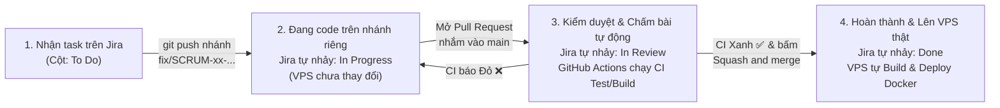

# BÁO CÁO & HƯỚNG DẪN QUY TRÌNH LÀM VIỆC NHÓM (JIRA ↔ GITHUB ↔ CI/CD VPS)

- **Dự án:** Hệ thống Quản trị Nhân sự Doanh nghiệp (`HumanResources`)
- **Jira Space:** `My Software Team` (Mã dự án: **`SCRUM`**)
- **GitHub Repository:** `QThang2006/HumanResources`
- **Môi trường Production (VPS):** Tự động triển khai bằng 100% Docker (`hr_backend`, `hr_frontend`, `hr_mysql`, `hr_n8n`)
- **Mốc hoàn thành toàn bộ 23 Task (86 SP):** **Thứ 6 tuần sau (04/12)**

---

## 1. Tổng quan hệ thống mới: 3 công cụ tự động nối liền nhau

Thay vì giao việc qua tin nhắn rời rạc và tự tay SSH lên server deploy, nhóm đã chuyển sang quy trình chuyên nghiệp chuẩn doanh nghiệp kết nối tự động **Jira ↔ GitHub ↔ VPS**:



### Nhiệm vụ của từng công cụ:
| Công cụ | Vai trò | Thành viên cần làm gì? |
|---|---|---|
| **Jira (`SCRUM`)** | Bảng giao việc, theo dõi tiến độ & lưu mô tả chi tiết từng task | Xem task của mình, đọc yêu cầu bên trong thẻ. **Không cần kéo tay cột** nếu đặt đúng mã `SCRUM-xx`! |
| **GitHub** | Lưu mã nguồn, kiểm tra lỗi tự động (CI) & duyệt Pull Request | Push code lên nhánh riêng, mở Pull Request (PR) và merge khi CI báo xanh. |
| **VPS (Web thật)** | Chạy website thực tế cho khách hàng / giảng viên demo | **Không cần đụng vào VPS.** Hệ thống tự deploy mỗi khi PR được merge vào `main`, và tự quay về bản cũ (Auto-Rollback) nếu phát sinh lỗi. |

---

## 2. Hướng dẫn sử dụng Jira cho thành viên mới (3 phút là quen)

### 2.1. Hiểu nhanh 4 khái niệm trên Jira
- **Backlog:** Kho chứa toàn bộ các đầu việc của dự án (gồm Sprint hiện tại và Sprint kế tiếp).
- **Sprint:** 1 đợt làm việc ngắn (5 ngày) giúp cả nhóm tập trung đúng mục tiêu thay vì làm tràn lan.
  - **Sprint 1 (`24/11 – 29/11`):** Đang chạy — tập trung vá lỗi bảo mật, logic cốt lõi & công cụ Demo.
  - **Sprint 2 (`30/11 – 04/12`):** Đã xếp sẵn ở Backlog — tập trung tính năng nâng cao & báo cáo.
- **Board:** Bảng làm việc hằng ngày gồm 4 cột: **`To Do`** → **`In Progress`** → **`In Review`** → **`Done`**.
- **Assignee:** Người chịu trách nhiệm chính cho thẻ việc đó (hiện bằng hình đại diện/avatar trên góc phải thẻ).

### 2.2. Mẹo xem nhanh việc của RIÊNG MÌNH trên Jira
1. Mở Jira → chọn tab **`Board`** ở thanh trên cùng.
2. Bấm **1 click vào avatar của chính bạn** (ngay cạnh ô `Search board`) → toàn bộ việc của thành viên khác sẽ tạm ẩn, chỉ hiện đúng các task của bạn!
3. Bấm mở từng thẻ `SCRUM-xx` → đọc kỹ phần **Description** (đã ghi sẵn file cần sửa, API, nghiệp vụ và tiêu chí hoàn thành).

> **Lưu ý khi làm vượt tiến độ:** Nếu bạn làm xong hết việc của mình trong **Sprint 1** sớm trước Chủ nhật, bạn hoàn toàn có thể vào tab **Backlog**, kéo 1 task tiếp theo của mình từ **`SCRUM Sprint 2`** thả lên **`SCRUM Sprint 1`** đang chạy rồi làm luôn!

---

## 3. Quy trình 5 bước làm 1 Task (Cầm tay chỉ việc)

> **Ví dụ minh họa:** Thành viên TV1 nhận task **`SCRUM-10`** (*Sửa chống brute-force đăng nhập*).

### Bước 1: Cập nhật `main` mới nhất & tạo nhánh riêng có mã `SCRUM-xx`
Trước khi bắt đầu BẤT KỲ task mới nào, luôn chạy 3 lệnh này để lấy code mới nhất của đồng đội vừa merge:
```bash
git checkout main
git pull origin main
git checkout -b fix/SCRUM-10-brute-force
```
**Quy ước đặt tên nhánh (BẮT BUỘC có mã `SCRUM-xx` viết hoa):**
- Sửa lỗi / vá bảo mật: `fix/SCRUM-xx-mo-ta-ngan` *(VD: `fix/SCRUM-13-timezone-mood`)*
- Làm tính năng mới: `feat/SCRUM-xx-mo-ta-ngan` *(VD: `feat/SCRUM-18-demo-switcher`)*

### Bước 2: Code & tự kiểm tra trên máy cá nhân
Chỉnh sửa code theo đúng mô tả trong thẻ Jira. Trước khi push, bắt buộc chạy kiểm tra biên dịch/test ở thư mục bạn vừa sửa:
- **Nếu sửa Backend:**
  ```bash
  cd backend
  npm run typecheck
  npm test
  ```
- **Nếu sửa Frontend:**
  ```bash
  cd frontend
  npm run build
  npm test
  ```

### Bước 3: Commit & Push code lên nhánh riêng
```bash
git add .
git commit -m "fix(SCRUM-10): bat trust proxy va khoa dang nhap bac thang"
git push -u origin fix/SCRUM-10-brute-force
```
- ⚡ **Tự động trên Jira:** Thẻ `SCRUM-10` tự nhảy từ **`To Do` → `In Progress`**.
- 🛡️ **Trạng thái VPS:** **Không chạy lại, không bị ảnh hưởng.** Bạn có thể push sửa nhiều lần trên nhánh riêng thoải mái.

### Bước 4: Mở Pull Request (PR) trên GitHub
1. Truy cập GitHub repo `QThang2006/HumanResources` → bấm nút màu xanh **`Compare & pull request`**.
2. Kiểm tra mũi tên gộp nhánh: **`base: main` ← `compare: fix/SCRUM-10-brute-force`**.
3. Đặt tiêu đề PR có mã Jira: `fix(SCRUM-10): Sửa chống brute-force đăng nhập`.
4. Mô tả ngắn gọn bạn đã sửa gì, test ra sao → bấm **`Create pull request`**.
5. ⚡ **2 việc tự động chạy cùng lúc:**
   - **Jira** tự kéo thẻ `SCRUM-10` từ **`In Progress` → `In Review`**.
   - **GitHub Actions CI** tự động chấm bài (~2 phút): chạy Lint, Type Check, Unit Test và Build cho cả Backend + Frontend.
     - ❌ **Nếu báo đỏ:** Nút Merge bị khóa. Bấm vào chữ `Details` để xem dòng lỗi → sửa trên máy → `git add . && git commit -m "..." && git push` lại vào đúng nhánh đó → CI sẽ tự chạy chấm lại!
     - ✅ **Nếu tất cả dấu tick đều xanh:** Đủ điều kiện gộp vào `main`!

### Bước 5: Merge vào `main` & tự động lên VPS thật
1. Kiểm tra lại tab **Files changed** trên PR xem có lỡ commit nhầm file thừa (`.env`, file rác...) không.
2. Bấm **`Squash and merge`** → bấm **`Confirm squash and merge`** → bấm **`Delete branch`** để dọn nhánh đã hoàn thành.
3. ⚡ **2 việc tự động xảy ra ngay lập tức:**
   - **Jira** tự kéo thẻ `SCRUM-10` từ **`In Review` → `Done`** ✅.
   - **GitHub Actions CD** tự build Docker image mới → đẩy sang VPS → cập nhật container → tự kiểm tra `/api/health`. Sau ~3–4 phút lên website thật bấm `F5` kiểm tra tính năng của mình chạy trực tiếp!

---

## 4. Bảng tra cứu nhanh các phản ứng tự động

| Hành động của thành viên | Cột trên Jira | GitHub Actions | Server VPS (Web thật) |
|---|---|---|---|
| Push nhánh mới có mã `SCRUM-xx` | `To Do` → **`In Progress`** | Không chạy | **Không thay đổi** |
| Push thêm commit sửa lỗi lên nhánh riêng | Giữ nguyên `In Progress` | Chạy lại CI nếu đã có PR | **Không thay đổi** |
| Mở Pull Request (PR) vào `main` | `In Progress` → **`In Review`** | **Chạy CI (Lint, Test, Build)** | **Không thay đổi** |
| Bấm **Merge PR** vào `main` | `In Review` → **`Done`** | **Chạy CI + Build Docker + Quét bảo mật + Deploy** | **Tự cập nhật web mới (~3–4 phút)** |

---

## 5. Lịch trình & Bảng phân công 23 Task (Deadline: Thứ 6 — 04/12)

Tổng khối lượng **23 task = 86 Story Points**, chia đều cho 4 thành viên (**20–23 SP/người**) qua **2 Sprint**:

- **Sprint 1 (`24/11 – 29/11` | 5 ngày):** 14 task — **42 SP** *(Hoàn thành xong trước tối Chủ nhật 29/11)*.
- **Sprint 2 (`30/11 – 03/12` | 4 ngày code):** 9 task — **44 SP** *(Chốt merge toàn bộ code trước 18h00 Thứ 5 03/12)*.
- **Ngày nghiệm thu (`Thứ 6 — 04/12`):** Không code tính năng mới — cả nhóm test toàn luồng E2E trực tiếp trên VPS thật bằng 4 tài khoản Demo và vá lỗi vặt nếu phát sinh.

### 5.1. TV1 (`QN`) — Core, Xác thực (Auth), Bảo mật, Demo UX & Dashboard — **20 SP**
| Sprint | Mã Jira | Điểm | Mô tả nhiệm vụ |
|---|---|---|---|
| **Sprint 1** | `SCRUM-18` | 3 SP | Tạo 4 nút chọn nhanh tài khoản Demo 4 Role & nút Chuyển vai 1-click trên Navbar *(ưu tiên làm đầu tiên để cả team dùng test!)* |
| **Sprint 1** | `SCRUM-10` | 5 SP | Sửa chống brute-force: bật `trust proxy`, khóa bậc thang (`IP + Device + Email`) & lưu DB |
| **Sprint 1** | `SCRUM-11` | 2 SP | Bổ sung Guard bảo vệ cho 2 API `block-ip` và `unblock-ip` *(làm ngay sau `SCRUM-10`)* |
| **Sprint 1** | `SCRUM-12` | 1 SP | Xóa bỏ `emailAliases` và email cá nhân hardcode trong `AuthService` |
| **Sprint 2** | `SCRUM-21` | 5 SP | Xây dựng tính năng Đổi mật khẩu, Quên mật khẩu, Admin đặt lại mật khẩu & My Profile |
| **Sprint 2** | `SCRUM-32` *(Subtask 1)* | 4 SP | Dashboard Tổng quan HR + Màn hình Nhật ký `AuditLog` |

### 5.2. TV2 (`LT`) — Tuyển dụng (ATS), Phỏng vấn, Offer & Nhận việc — **21 SP**
| Sprint | Mã Jira | Điểm | Mô tả nhiệm vụ |
|---|---|---|---|
| **Sprint 1** | `SCRUM-27` | 3 SP | Kích hoạt kiểm soát chỉ tiêu tuyển (`headcount`) & hạn nộp (`deadline`) tin tuyển dụng |
| **Sprint 1** | `SCRUM-26` | 3 SP | Hỗ trợ phát hành lại Offer lần 2 (`version >= 2`) khi ứng viên từ chối hoặc Offer hết hạn |
| **Sprint 1** | `SCRUM-25` | 5 SP | Bổ sung Đổi lịch / Hủy lịch phỏng vấn & kiểm tra trùng giờ người phỏng vấn |
| **Sprint 2** | `SCRUM-28` | 5 SP | Tự động gửi Email từ chối khi `REJECTED` & Trang tra cứu trạng thái hồ sơ ứng viên |
| **Sprint 2** | `SCRUM-22` | 3 SP | Nối luồng `hireCandidate`: tự gán `managerId`, `joinedDate` & khóa `MANDATORY` *(làm sau khi TV4 merge `SCRUM-15` & `SCRUM-20`)* |
| **Sprint 2** | `SCRUM-32` *(Subtask 2)* | 2 SP | Xuất báo cáo Excel/CSV (Tuyển dụng, Nhân sự, Đào tạo) |

### 5.3. TV3 (`Avatar cam`) — Onboarding 30 ngày, Mood Check-in, AI Copilot & Workspace — **22 SP**
| Sprint | Mã Jira | Điểm | Mô tả nhiệm vụ |
|---|---|---|---|
| **Sprint 1** | `SCRUM-13` | 3 SP | Chuẩn hóa múi giờ Việt Nam (`Asia/Ho_Chi_Minh`) cho Mood Check-in & Team Mood |
| **Sprint 1** | `SCRUM-14` | 3 SP | Vá lỗi quyền chéo phòng ban (`toggleTask`, `resolveBurnout`), thêm `SUPERADMIN` & khóa `seed-tasks` |
| **Sprint 1** | `SCRUM-19` | 1 SP | Bổ sung đường dẫn `/employee/workspace` trên Navbar cho HR & SuperAdmin |
| **Sprint 1** | `SCRUM-24` | 3 SP | Cho phép Nhân viên (`EMPLOYEE`) xem lịch sử điểm KPI & nhận xét đánh giá của quản lý |
| **Sprint 2** | `SCRUM-23` | 5 SP | Thống nhất 1 bộ Checklist Onboarding chuẩn & cho HR/Manager tùy biến theo phòng ban |
| **Sprint 2** | `SCRUM-29` | 5 SP | Nâng cấp AI Copilot: nhớ ngữ cảnh hội thoại đa lượt, lưu lịch sử chat & thêm `timeoutMs` |
| **Sprint 2** | `SCRUM-32` *(Subtask 3)* | 2 SP | Chuông thông báo In-App trên Navbar |

### 5.4. TV4 (`V`) — Quản lý User, Đào tạo (L&D), Kho tri thức RAG & Offboarding — **23 SP**
| Sprint | Mã Jira | Điểm | Mô tả nhiệm vụ |
|---|---|---|---|
| **Sprint 1** | `SCRUM-15` | 3 SP | Sửa lỗi `getTrainings` tự gán lại khóa học đã gỡ (`isArchived=true`) & bổ sung hạn nộp `dueAt` |
| **Sprint 1** | `SCRUM-16` | 2 SP | Chặn gán khóa học cho nhân viên đã nghỉ việc / vô hiệu hóa (`isActive = false`) *(làm sau `SCRUM-15`)* |
| **Sprint 1** | `SCRUM-17` | 5 SP | Hoàn thiện Offboarding: tự khóa tài khoản, thêm nút Hủy (`CANCELLED`) & hỗ trợ Manager/HR |
| **Sprint 2** | `SCRUM-20` | 5 SP | Đồng bộ Quản lý trực tiếp (`managerId`) & Trưởng phòng trong Quản lý User *(ưu tiên làm đầu Sprint 2)* |
| **Sprint 2** | `SCRUM-31` | 3 SP | Bổ sung Checklist xác nhận bàn giao thực tế (IT thu hồi tài sản & Tài chính chốt lương) *(làm sau `SCRUM-17`)* |
| **Sprint 2** | `SCRUM-30` | 5 SP | Xử lý PDF ảnh scan trong Kho tri thức RAG & phân quyền tài liệu theo vai trò |

---

## 6. Lưu ý phối hợp để 4 người chạy song song KHÔNG bị xung đột code

4 phân hệ gần như **độc lập 90%**, mọi người có thể làm thoải mái và vượt tiến độ không cần chờ nhau — chỉ cần chú ý **3 điểm nhỏ**:

1. **Duy nhất 1 phụ thuộc chéo giữa TV2 và TV4:**
   - TV2 để **`SCRUM-22`** (`hireCandidate`) làm sau khi TV4 merge xong **`SCRUM-15`** và **`SCRUM-20`** (trong lúc đó TV2 chạy thoải mái `SCRUM-25, 26, 27, 28`).
2. **Hai file có nhiều người cùng chỉnh:**
   - `frontend/src/components/Navbar.tsx` (TV1 làm `SCRUM-18`, TV3 làm `SCRUM-19` & Chuông `SCRUM-32`).
   - `backend/prisma/schema.prisma` (các task có thêm bảng/cột DB).
   - 👉 **Giải pháp:** Xong 1 task là **Merge vào `main` sớm trong ngày**; người làm sau trước khi mở PR luôn chạy `git pull origin main` để Git tự ghép sạch sẽ.
3. **Thứ tự nội bộ để không tự conflict file của chính mình:**
   - TV1: `SCRUM-10` → `SCRUM-11`.
   - TV4: `SCRUM-15` → `SCRUM-16`; `SCRUM-17` → `SCRUM-31`.

---

## 7. 6 Quy tắc vàng & Giải đáp nhanh lỗi hay gặp (FAQ)

### 6 Quy tắc vàng bắt buộc tuân thủ
1. **Không bao giờ code hay push thẳng vào `main`** (GitHub đã khóa nhánh `main` bằng Ruleset).
2. **Mỗi task = 1 nhánh riêng**, tên nhánh & tiêu đề PR **bắt buộc có mã `SCRUM-xx` viết hoa**.
3. **Không commit file bí mật** (`.env`, mật khẩu, API key, token) — Gitleaks trên CI sẽ chặn ngay lập tức.
4. **Chạy test/build xanh trên máy cá nhân trước khi push** để không làm đỏ CI.
5. **Merge nhỏ, merge đều mỗi ngày** — không giữ nhánh quá 2 ngày mới gộp.
6. **Chuẩn UI/UX:** Giữ thống nhất bảng màu Enterprise ATS Blue (`blue-600`, `slate-*`, card `rounded-xl`, nút/input `rounded-lg`) theo quy tắc dự án (`AGENTS.md`).

### Giải đáp nhanh (FAQ)
- **Hỏi: Tại sao mình chạy `git push origin main` bị GitHub báo lỗi từ chối?**
  - **Đáp:** Vì nhánh `main` đang được bảo vệ. Bạn phải tạo nhánh riêng (`git checkout -b fix/SCRUM-xx-...`), push nhánh đó lên rồi mở Pull Request.
- **Hỏi: Mình đã push code / mở PR rồi nhưng thẻ trên Jira không tự nhảy cột?**
  - **Đáp:** Kiểm tra lại tên nhánh hoặc tiêu đề PR có bị gõ thiếu/sai mã `SCRUM-xx` không (VD viết nhầm `scrum10` hoặc `SCRUM 10` thiếu dấu gạch ngang `-`). Sửa lại tiêu đề PR cho đúng `SCRUM-10` là Jira sẽ liên kết ngay.
- **Hỏi: Pull Request bị CI báo dấu X đỏ thì làm thế nào?**
  - **Đáp:** Bấm vào dòng bị đỏ → bấm **`Details`** để đọc log lỗi (thường là lỗi thiếu kiểu TypeScript, lỗi import, hoặc test fail). Sửa ngay trên nhánh hiện tại rồi `git commit` & `git push` lại — KHÔNG cần tạo PR mới!
- **Hỏi: Đẩy code lên nhánh riêng có làm hỏng web trên VPS không?**
  - **Đáp:** **KHÔNG.** VPS chỉ cập nhật khi PR đã xanh CI và được bấm **Merge vào `main`**.
- **Hỏi: Xong hết việc Sprint 1 sớm có được làm luôn việc Sprint 2 không?**
  - **Đáp:** **ĐƯỢC!** Kéo 1 task của mình từ `SCRUM Sprint 2` lên `SCRUM Sprint 1` trong Backlog rồi làm bình thường.
