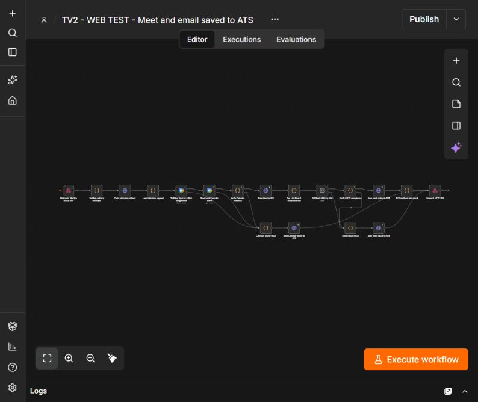
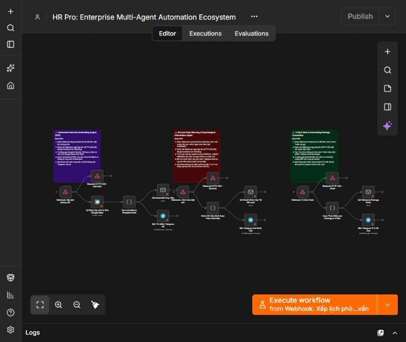
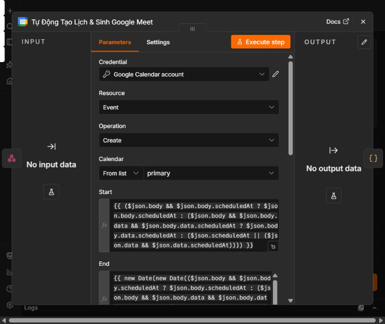
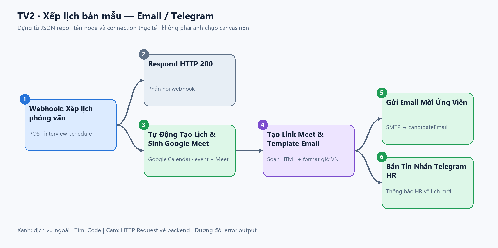
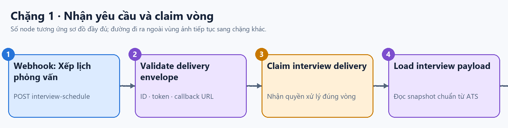
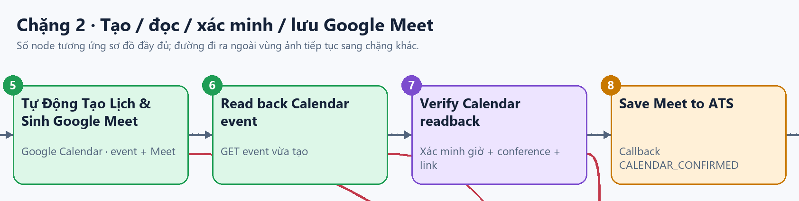
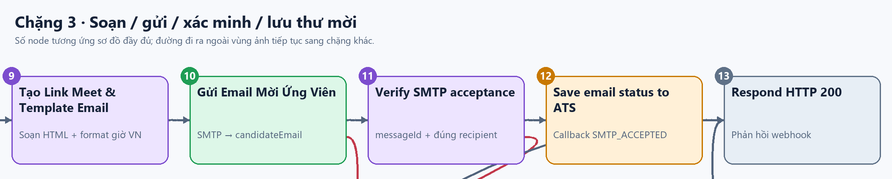
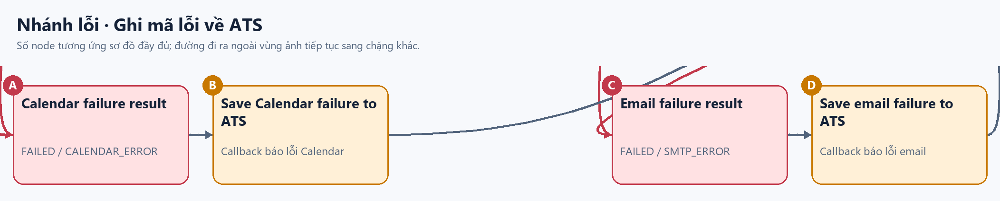
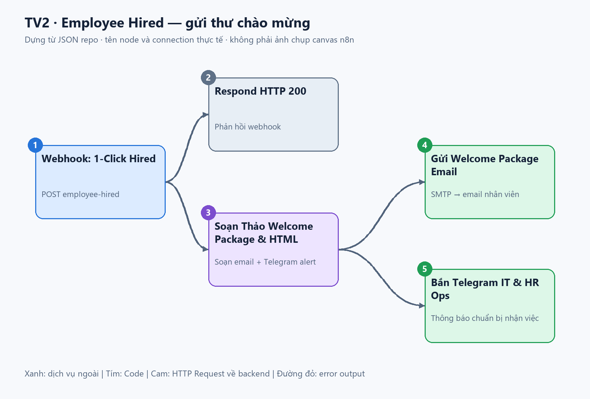

# Nhìn hình để hiểu workflow n8n của TV2

Đối chiếu code và workflow JSON ngày 09/10/2026. Hình đánh số trong tài liệu được dựng từ **tên node, vị trí và connections thực tế trong JSON**; không phải ảnh chụp phiên n8n đã đăng nhập. Số được thêm để học; Sticky Note không phải bước xử lý nên bỏ khỏi sơ đồ đánh số.

## 0. Ảnh canvas n8n thật trong phiên của bạn

Đây là workflow bạn đã đăng nhập và mở trong n8n local, tên **TV2 - WEB TEST - Meet and email saved to ATS**. Hình dưới là canvas thật; hình đánh số ở các mục sau được làm lớn hơn để đọc node dễ hơn.



Đây là canvas tổng thể **HR Pro: Enterprise Multi-Agent Automation Ecosystem**. Nhìn từ trái sang phải có ba nhánh: lịch phỏng vấn (TV2), burnout (TV3) và employee hired (TV2 bàn giao onboarding).



Trong n8n thật, node Calendar của workflow bản mẫu được cấu hình như hình dưới: Resource = Event, Operation = Create, Calendar = primary, Start lấy scheduledAt từ webhook, End cộng 45 phút, Conference Data = Google Meet.



## 1. Chức năng trên website nằm ở đâu và gọi workflow nào?

Bạn cần phân biệt **nút trên website**, **hàm backend** và **node trong n8n**.

| Bạn làm trên website | Backend chạy gì? | Bên n8n chạy gì? |
| --- | --- | --- |
| Quản lý tuyển dụng → Bảng ứng viên → chọn Job → mở hồ sơ → Xếp lịch vòng → chọn người/giờ → **Lưu lịch phỏng vấn** | POST /api/applications/:id/interview → ApplicationsService.schedule → lưu Interview/INTERVIEWING → triggerInterviewScheduled | Webhook `interview-schedule` → workflow tạo lịch/Meet/thư mời |
| Hồ sơ → **Tuyển ứng viên** → **Xác nhận tuyển** | POST /api/applications/:id/hire → hireCandidate → User + 5 task + HIRED commit → triggerEmployeeHired | Webhook `employee-hired` → Welcome Email và Telegram IT/HR |
| Chấm CV/Gợi ý câu hỏi/Tạo JD | RecruitmentAiService → GeminiService | Không đi qua workflow n8n ở code hiện tại |

**Đừng bắt đầu giải thích ở Webhook mà quên bước trước nó:** sự kiện đến từ người dùng trên website, được backend kiểm/lưu, rồi mới đẩy sang n8n.

```text
Nút website → React gọi API → NestJS kiểm/lưu MySQL
→ N8nService gửi HTTP POST → Webhook node bắt đầu workflow
```

## 2. Bản mẫu xếp lịch — dễ nhìn để hiểu tổng thể

Nguồn: [interview-schedule.json](../../workflows/interview-schedule.json).



| Số | Node — loại | Nhận gì / làm gì / đưa gì cho bước sau? |
| ---: | --- | --- |
| 1 | **Webhook: Xếp lịch phỏng vấn** — Webhook | Nhận POST `interview-schedule`, payload có tên/email ứng viên, người phỏng vấn, scheduledAt, round và ID. Đây là trigger bắt đầu. |
| 2 | **Respond HTTP 200** — Respond to Webhook | Phản hồi sớm rằng đã tiếp nhận/kích hoạt quy trình. Đứng ở nhánh riêng: nó không kiểm chứng Google hoặc SMTP. |
| 3 | **Tự Động Tạo Lịch & Sinh Google Meet** — Google Calendar | Dùng credential Google tạo Calendar event và conference Meet. Trả event, có thể có `hangoutLink`. |
| 4 | **Tạo Link Meet & Template Email** — Code | Lấy dữ liệu Webhook và event, lấy link Meet, format giờ Việt Nam, dựng `emailSubject`, `emailHtml`, `telegramAlert`. Tên có “Tạo Link” nhưng Code này chủ yếu lấy link Google đã tạo. |
| 5 | **Gửi Email Mời Ứng Viên** — Send Email | Lấy sender, candidateEmail, subject, HTML từ Code và gửi qua SMTP. |
| 6 | **Bắn Tin Nhắn Telegram HR** — Telegram | Lấy chatId và telegramAlert từ Code, gửi thông báo lịch mới đến HR. |

Bạn nói: **“Webhook nhận dữ liệu; một nhánh phản hồi ngay, nhánh còn lại tạo Calendar/Meet, soạn nội dung rồi tách ra Email và Telegram.”**

Nhánh Email và Telegram cùng xuất phát từ node Code, không phải Email xong rồi mới đi Telegram. Không vì nhìn hai nhánh mà khẳng định chúng luôn chạy đồng thời ở mọi chế độ n8n.

Giới hạn bản mẫu: fallback `https://meet.google.com/new` không chứng minh có phòng phỏng vấn riêng; HTTP200 sớm không chứng minh thư đã gửi. Vì thế repo có bản readback chặt chẽ hơn.

## 3. Bản readback — luồng lịch đầy đủ của TV2

Nguồn: [interview-schedule-readback.json](../../workflows/interview-schedule-readback.json).

Readback = đọc/xác minh kết quả thực tế rồi lưu về hồ sơ ATS. Bản này **không có Telegram**, và Respond200 đứng cuối các nhánh đã nối.

[Mở sơ đồ toàn bộ, gồm nhánh lỗi](visuals/tv2-n8n-interview-readback.png)

### Chặng 1: nhận yêu cầu → kiểm → claim → lấy dữ liệu chuẩn



**1 — Webhook: Xếp lịch phỏng vấn**

- Nằm đầu workflow, loại Webhook.
- Method POST, path `interview-schedule`; body do N8nService gửi.
- Không có request vào thì workflow này không tự chạy theo giờ.
- Nó nhận ID lịch/hồ sơ và metadata delivery; không tự tạo Interview trong MySQL.

**2 — Validate delivery envelope**

- Loại Code, kiểm interviewId, token, requestId và callbackUrl khớp API backend cấu hình.
- Ngăn xử lý yêu cầu thiếu metadata hoặc callback tới URL không đúng.
- Đầu ra giữ interviewId/delivery để node claim dùng.
- Đây là kiểm cấu trúc ở n8n; backend còn xác thực token thật ở claim/callback.

**3 — Claim interview delivery**

- Loại HTTP Request: POST `.../applications/interviews/:id/delivery/claim`.
- Header `x-interview-callback-token`, body chứa requestId.
- Nghĩa dễ hiểu: **“Execution này xin quyền xử lý đúng vòng phỏng vấn này.”**
- Claim thành công một lần, replay bị409 trước khi gọi Calendar/SMTP.
- Backend trả snapshot dữ liệu chuẩn đã lưu và eventId.
- Nếu đã claim rồi execution chết, không có nghĩa replay tự phục hồi được; recovery vẫn còn giới hạn.

**4 — Load interview payload**

- Loại Code, bóc response claim và kiểm claimed/interviewId/eventId/email/time.
- Lấy snapshot từ backend, tránh lấy contact/thời gian bị thay trong webhook payload.
- Đầu ra: tên/email ứng viên và interviewer, scheduledAt, round, sender, metadata delivery.

Bạn nói: **“Bốn node đầu bảo đảm yêu cầu đúng và execution được quyền xử lý vòng; sau đó mới gọi dịch vụ bên ngoài.”**

### Chặng 2: tạo → đọc lại → kiểm → lưu Meet về ATS



**5 — Tự Động Tạo Lịch & Sinh Google Meet**

- Loại Google Calendar, operation Create Event, calendar primary.
- Start lấy scheduledAt; end = start + **45 phút**.
- Event ID được định từ delivery metadata, tiêu đề có vòng/tên ứng viên.
- Yêu cầu conferenceSolution `hangoutsMeet` để Google sinh phòng Meet.
- Cần credential Google Calendar; Code node không thể tự sinh một URL Meet thật.
- Bản này không thêm Calendar attendees, sendUpdates=none; đừng nói tự gửi Calendar invitation cho cả hai bên.

**6 — Read back Calendar event**

- Loại Google Calendar, operation Get Event, dùng event ID vừa tạo.
- Create xong chưa coi kết quả hoàn chỉnh; đọc lại trạng thái hiện tại để xác minh.
- Đầu ra là event từ Google, gồm start/end/conference/link/status.

**7 — Verify Calendar readback**

- Loại Code; kiểm đúng eventId, event `confirmed`, đúng start/end và conference create success.
- Lấy video URL từ hangoutLink hoặc conference entryPoints; kiểm link dạng `https://meet.google.com/abc-defg-hij`.
- Hợp lệ thì tạo callback payload `CALENDAR_CONFIRMED`.
- Chưa hợp lệ đi error output, không dùng fallback link để giả định thành công.

**8 — Save Meet to ATS**

- Loại HTTP Request, POST callback về backend với token.
- Gửi requestId/applicationId, event=`CALENDAR_CONFIRMED`, eventId, meetingLink, scheduledAt.
- Backend xác thực/kiểm đúng vòng và lưu `Interview.meetingLink`, `googleCalendarEventId`, tracking status.
- Website đọc API mới thấy **Mở phòng phỏng vấn**; callback không bấm nút trực tiếp trên React.
- Callback ghi kết quả có thể retry 3 lần vì backend xử lý idempotent.

Bạn nói: **“Google tạo event/Meet; Get đọc lại; Code kiểm; HTTP Request lưu kết quả vào ATS.”**

### Chặng 3: soạn thư → gửi → kiểm SMTP → lưu trạng thái → response



**9 — Tạo Link Meet & Template Email**

- Loại Code, lấy event đã Verify và payload đã Load.
- Dùng link Meet thật đã xác minh; không tự tạo phòng mới tại node này.
- Format lịch theo `Asia/Ho_Chi_Minh`; escape tên khi đưa vào HTML.
- Đầu ra chứa fromEmail/candidateEmail, subject và HTML thư mời.

**10 — Gửi Email Mời Ứng Viên**

- Loại Send Email, cần SMTP credential.
- From lấy fromEmail, To lấy candidateEmail, Subject/HTML lấy từ Code.
- Nội dung có giờ, vòng, người phỏng vấn và link Meet.
- Recipient hiện là ứng viên; có tên/email interviewer trong nội dung không đồng nghĩa gửi mail riêng cho interviewer.

**11 — Verify SMTP acceptance**

- Loại Code, xem output node Email: phải có messageId, accepted đúng ứng viên và không có rejected.
- Thành công tạo callback `SMTP_ACCEPTED`.
- Chỉ chứng minh máy chủ chấp nhận gửi. Chưa chứng minh vào Inbox, chưa chứng minh người nhận đọc.

**12 — Save email status to ATS**

- Loại HTTP Request, callback có token về backend.
- Gửi SMTP_ACCEPTED, eventId, recipient và messageId.
- Backend lưu trạng thái để website hiện **Máy chủ email đã chấp nhận gửi**, reload vẫn đọc từ DB.

**13 — Respond HTTP 200**

- Loại Respond to Webhook, ở cuối nhánh thành công và các nhánh lưu lỗi được nối.
- Trả response JSON cho request vào webhook.
- Khác bản mẫu: không đứng nhánh phản hồi sớm.
- Nhưng N8nService hiện không await fetch, nên backend vẫn có thể đã trả trước khi node13 chạy.
- HTTP200 có thể là phản hồi của nhánh lưu lỗi; phải đọc nội dung/status tracking, không dùng code200 đơn lẻ để suy ra cả chuỗi thành công.

### Nhánh lỗi A–D



| Nhánh | Trigger từ đâu? | Làm gì? |
| --- | --- | --- |
| A → B | Error output của node5, node6 hoặc node7 | Calendar failure result dựng FAILED/stage CALENDAR/code CALENDAR_ERROR; Save Calendar failure to ATS callback lỗi; sau đó nối node13 |
| C → D | Error output của node10 hoặc node11 | Email failure result dựng FAILED/stage EMAIL/code SMTP_ERROR; Save email failure to ATS callback lỗi; sau đó nối node13 |

Không phải mọi lỗi đều được hai nhánh này bắt: lỗi validate/claim/load hoặc callback HTTP có thể dừng execution ở node đó. Callback đã retry hết hoặc mất kết quả cần kiểm execution/đối soát. Meet đã confirmed được giữ khi email lỗi; email outcome có thể UNKNOWN.

### Cuối cùng website cập nhật như thế nào?

```text
n8n HTTP Request callback → NestJS kiểm token/dữ liệu → MySQL cập nhật
→ hộp chi tiết hồ sơ polling khoảng 3 giây khi đang chờ → đọc API → hiện link/status
```

Sau 10 phút chưa có đủ callback, read model có thể trả UNKNOWN. UNKNOWN nghĩa là chưa biết chắc; không có nghĩa chắc chắn provider chưa làm. Không gửi lại mù quáng vì có thể trùng thư/event.

## 4. Employee Hired — sau khi bạn bấm xác nhận tuyển

Nguồn: [employee-hired.json](../../workflows/employee-hired.json).



**Trước node1**, backend đã kiểm HR/Admin + Application INTERVIEWING/OFFERED + latest PASSED, tạo User EMPLOYEE/mật khẩu hash, năm task và HIRED/hiredUserId trong một transaction. Sau commit mới dispatch.

| Số | Node | Giải thích để nói khi thi |
| ---: | --- | --- |
| 1 | Webhook: 1-Click Hired | Nhận POST employee-hired: userId, fullName, email, jobTitle, departmentName, tempPassword và sender nếu có. |
| 2 | Respond HTTP 200 | Nhánh phản hồi sớm “đã kích hoạt”. Không phải xác nhận gửi thư xong. |
| 3 | Soạn Thảo Welcome Package & HTML | Code bóc body/data, chuẩn hóa thông tin, tạo emailSubject/emailHtml và telegramAlert. |
| 4 | Gửi Welcome Package Email | SMTP To=email nhân viên, subject/html từ node3; gửi thông tin chào mừng/portal/tài khoản theo template. |
| 5 | Bắn Telegram IT & HR Ops | Bot gửi telegramAlert tới chatId; nhắc chuẩn bị laptop/Welcome Kit và hỗ trợ nhân viên mới. |

Luồng đúng: **1 tách 2 và 3; 3 tách 4 và 5.** Node2 không nối tuần tự sang node3. Email và Telegram cùng lấy output Code.

**Không có node tạo User/Task ở workflow này.** Mật khẩu tạm do backend sinh; workflow hiện dùng payload để gửi. Các giá trị mặc định trong template là mẫu, không chứng minh đã provision hoặc đã cấu hình SMTP/Telegram thật.

Nếu SMTP lỗi sau Hire: tài khoản/task/HIRED đã commit vẫn giữ. welcomeEmailStatus có thể DISPATCHED_UNVERIFIED/FAILED/NOT_RETRIED; phần Welcome LIVE/recovery còn chưa đóng trong hồ sơ nghiệm thu.

## 5. “Cái này ở mô trong n8n?” — cách nhìn node và tham số

Tên node là nhãn người làm đặt; **loại node** mới cho biết nó làm gì. Code node có thể đặt tên “Tạo Link Meet”, nhưng phải đọc jsCode mới biết nó đang lấy link hay thực sự gọi provider.

| Thấy trong canvas | Mở node để đọc các trường | Điều bạn cần giải thích |
| --- | --- | --- |
| Webhook | HTTP Method, Path, Test URL/Production URL, Response mode | Sự kiện đi vào URL nào, ai gọi và response được trả bởi node nào |
| Code | JavaScript/jsCode | Kiểm dữ liệu hay biến đổi payload? Return gì cho node sau? |
| Google Calendar | Operation, Calendar, Start, End, Additional Fields/conference, Credential | Create hay Get, event của tài khoản nào, thời gian/link sinh thế nào |
| HTTP Request | Method, URL, Headers, JSON Body, Retry | Đây là claim hay callback; endpoint nào, token đặt ở header nào |
| Send Email | SMTP credential, From, To, Subject, HTML | Ai gửi cho ai, nội dung lấy từ output node nào |
| Telegram | Credential, Chat ID, Text, Parse mode | Bot nào, gửi vào chat nào, message lấy từ đâu |
| Respond to Webhook | Response body, Response Code | Phản hồi sớm hay cuối workflow? Response có nói thành công hay lỗi? |

Trong execution, quan sát **Input** và **Output** để kể đường đi của dữ liệu. Output thành công của một node không chứng minh tất cả node sau thành công. Đừng mở/đưa token hoặc mật khẩu trong output vào bài trình chiếu.

### Những expression cần biết

```javascript
$input.first().json                       // Item đầu vào của Code hiện tại
$json                                    // JSON item hiện tại
$('Load interview payload').first().json  // Output của node có tên này
body.data || body                        // Payload nằm trong data hoặc trực tiếp ở body
```

Trong trường To của Send Email có thể là `={{ $json.candidateEmail }}`. Đây là lấy email từ output trước, không phải chuỗi text cố định.

Sau Calendar, `$json` là event, vì vậy Code phải lấy payload từ node Webhook/Load có tên để không mất contact/time ban đầu.

## 6. Câu nói để chỉ đúng hình khi thầy hỏi

**“Webhook để làm gì?”**

> Đây là cửa nhận sự kiện từ NestJS. Người dùng bấm Lưu lịch trên website, backend lưu Interview rồi POST JSON vào đây để n8n bắt đầu workflow.

**“Node Code này để làm gì?”**

> Em xem tên và jsCode: node Validate kiểm metadata; Load lấy snapshot; Verify kiểm provider result; Template tạo subject/HTML. Code không thay thế node Google để tự tạo Meet thật.

**“HTTP Request này gọi về đâu?”**

> Claim gọi backend để nhận quyền xử lý đúng vòng; Save Meet/Save Email là callback báo kết quả vào ATS bằng token riêng vòng. Chúng không gửi email.

**“Sao Create xong còn Get/Verify?”**

> Để đọc lại event và xác minh conference/link/giờ đúng. Chỉ khi đã xác minh mới callback lưu Meet và soạn thư với link đó.

**“Đường đỏ chạy khi nào?”**

> Error output của Calendar/Create/Get/Verify hoặc SMTP/Verify đi vào node dựng mã lỗi rồi callback. Không phải luồng thành công chạy cả hai nhánh; lỗi ở node không có nhánh bắt riêng có thể dừng execution.

**“Email xong là ứng viên nhận chưa?”**

> SMTP_ACCEPTED là máy chủ chấp nhận. Inbox/Spam/bounce/đọc thư là mức khác. Backend dispatch true còn chưa xác nhận SMTP.

**“n8n tạo nhân viên chỗ nào?”**

> Theo code hiện tại User + 5 task + HIRED được tạo trong backend transaction trước khi gọi employee-hired. Workflow này chỉ soạn/gửi Welcome và Telegram.

**“AI chấm CV nằm node nào?”**

> Ở luồng hiện tại không có node n8n chấm CV. Backend gọi GeminiService qua RecruitmentAiService. n8n dùng cho lịch/Meet/thông báo.

## 7. Các file gốc để thầy hỏi code thì mở đúng chỗ

- [N8nService — ba trigger và fetch trả sớm](../../backend/src/modules/core/automation/n8n.service.ts)
- [ApplicationsService — schedule và hireCandidate](../../backend/src/modules/applications/applications.service.ts)
- [CandidateDetail — nút Lưu lịch / Tuyển / polling](../../frontend/src/features/recruitment/CandidateDetail.tsx)
- [InterviewDeliveryService — prepare/claim/callback](../../backend/src/modules/applications/interview-delivery.service.ts)
- [Readback contract, cấu hình và giới hạn](INTERVIEW-READBACK.md)
- [Hire integration, transaction và task](HIRE-INTEGRATION.md)

Hai API máy với máy của readback dùng token. Repo còn endpoint meeting-link cũ không có cùng guard/token; đừng tuyên bố mọi callback đều đã bảo vệ giống nhau. Khi triển khai thật cần review endpoint cũ/recovery/outbox và nghiệm thu các credentials/provider.

## 8. Bộ câu hỏi mô phỏng đúng kiểu thầy chỉ vào hình

Ảnh bạn gửi cho thấy thầy có thể hỏi rất ngắn, ví dụ “khi chuyển tiền”, “chuyển dữ liệu nào cho FE”, “hàm nào phát âm thanh”. Với dự án TV2, hãy đổi sang các câu tương đương sau:

### “Khi HR bấm lưu lịch phỏng vấn thì chuyện gì xảy ra?”

Trả lời theo đúng thứ tự:

> Frontend gọi `POST /applications/:id/interview`. `ApplicationsService.schedule()` kiểm quyền HR/SuperAdmin, kiểm thời gian tương lai có timezone, interviewer đúng phòng ban và round nối tiếp. Backend lưu Interview `PENDING`, đổi Application sang `INTERVIEWING`, tạo delivery metadata trong transaction. Sau commit, hàm `n8n.triggerInterviewScheduled(result.payload)` gọi Webhook `interview-schedule`. n8n claim vòng, tạo Calendar/Meet, đọc lại và verify, callback `CALENDAR_CONFIRMED`, gửi SMTP rồi callback `SMTP_ACCEPTED`. Frontend polling chi tiết hồ sơ và thấy link/trạng thái từ database.

### “Chuyển dữ liệu như thế nào để FE thay đổi giao diện?”

Đây là câu rất giống câu trong ảnh. Trả lời:

> n8n không truyền dữ liệu trực tiếp vào React. n8n callback HTTP về NestJS. Backend kiểm token và payload, lưu `Interview.meetingLink`, `googleCalendarEventId`, `calendarStatus`, `emailStatus`, `smtpMessageId` vào MySQL. Frontend gọi `GET /applications/:id` để đọc các trường này. Trong `CandidateDetail.tsx`, khi delivery còn chờ, hàm `refresh()` được gọi lại sau khoảng 3 giây; khi response có link/status mới thì React state render lại nút “Mở phòng phỏng vấn” và trạng thái email.

Chuỗi ngắn để nhớ:

```text
n8n callback → API backend → MySQL → GET detail → React state → giao diện đổi
```

### “Dữ liệu nào được truyền qua n8n?”

Với lịch phỏng vấn:

```text
interviewId
applicationId
candidateName
candidateEmail
interviewerName
interviewerEmail
scheduledAt
round
fromEmail
delivery.requestId / eventId / callbackUrl / token
```

Với Hire:

```text
userId
fullName
email
jobTitle
departmentName
tempPassword
fromEmail
telegramChatId
```

Không gửi password hoặc hash về response ATS/FE. Password tạm chỉ đi trong payload dispatcher employee-hired để tạo thư chào mừng; phần này cần bảo vệ log/execution.

### “Hàm nào phát ra Webhook?”

Ba hàm trong `N8nService`:

```ts
triggerInterviewScheduled(payload) // lịch phỏng vấn
triggerEmployeeHired(payload)      // tuyển thành nhân viên
triggerBurnoutAlert(payload)       // cảnh báo burnout của TV3
```

Ba hàm đều đi qua:

```ts
private postWebhook(url, data, actionName)
```

Hàm này tạo HTTP POST tới:

```text
N8N_WEBHOOK_URL + '/interview-schedule'
N8N_WEBHOOK_URL + '/employee-hired'
N8N_WEBHOOK_URL + '/burnout-alert'
```

### “Hàm nào làm Calendar tạo Meet?”

Không phải một hàm frontend. Trong backend, `triggerInterviewScheduled()` phát webhook. Trong n8n, node **Tự Động Tạo Lịch & Sinh Google Meet** là Google Calendar node với `Operation = Create`; nó dùng `scheduledAt` làm Start, cộng 45 phút làm End và bật Conference Data Google Meet.

### “Hàm nào gửi email?”

Ở backend, `postWebhook()` chỉ phát sự kiện; nó không tự gửi SMTP. Trong n8n:

- **Gửi Email Mời Ứng Viên** gửi email lịch phỏng vấn.
- **Gửi Welcome Package Email** gửi email nhân viên mới.

Email lấy địa chỉ/subject/HTML bằng expression từ output Code node phía trước.

### “Hàm nào phát âm thanh?”

> Dự án TV2 không có chức năng âm thanh và không có node Audio/Sound. Nếu thầy hỏi tương tự, không được bịa hàm. Phần gần nhất là Telegram/Email notification; đó là thông báo chữ, không phải phát âm thanh.

### “Node Code có tác dụng gì?”

Không trả lời chung chung là “xử lý dữ liệu”. Hãy gọi đúng node:

| Node Code | Chức năng |
| --- | --- |
| Validate delivery envelope | Kiểm metadata đầu vào |
| Load interview payload | Lấy snapshot chuẩn từ backend |
| Verify Calendar readback | Kiểm event/link/giờ Meet |
| Tạo Link Meet & Template Email | Tạo subject và HTML email |
| Verify SMTP acceptance | Kiểm accepted/messageId/rejected |
| Calendar/Email failure result | Tạo payload lỗi để callback |
| Soạn Thảo Welcome Package & HTML | Tạo email và Telegram alert Hire |

### “Node nào thay đổi dữ liệu database?”

Trong workflow readback, các node **Save Meet to ATS**, **Save email status to ATS**, **Save Calendar failure to ATS**, **Save email failure to ATS** gọi HTTP API backend. Chính NestJS `InterviewDeliveryService.callback()` mới kiểm token và ghi MySQL; n8n không kết nối TypeORM trực tiếp.

### “Nếu node Email lỗi thì flow có dừng không?”

> Node Email có error output nối sang `Email failure result`, sau đó `Save email failure to ATS`. Backend ghi lỗi email. Nếu Calendar đã confirmed thì link Meet vẫn giữ; không rollback được tác vụ Google chỉ vì SMTP lỗi.

### “Nếu bấm lại nút Lưu lịch thì có tạo hai lịch không?”

> Backend tìm Interview cùng application/round. Nếu interviewer và thời gian giống nhau thì trả lịch cũ, `NOT_RETRIED`, không gọi webhook lần hai. Nếu cùng round nhưng dữ liệu khác thì trả 409.

### “Nếu n8n trả HTTP 200 thì đã thành công chưa?”

> Chưa chắc. Phải xem Respond node nằm ở đâu và trạng thái readback. `UNVERIFIED` chỉ là helper đã khởi chạy; `CALENDAR_CONFIRMED` mới là Calendar/Meet đã verify; `SMTP_ACCEPTED` mới là SMTP nhận thư; Inbox còn phải kiểm riêng.

### “Nếu thầy chỉ vào một node, em trình bày theo công thức nào?”

```text
Node này thuộc loại gì?
Input lấy từ node/hàm nào?
Nó kiểm tra hoặc gọi dịch vụ nào?
Output có những field nào?
Node tiếp theo dùng output đó làm gì?
Nếu lỗi thì đi nhánh nào và backend lưu gì?
```

## 9. Luồng 2 có source map: 1-Click Hire → employee-hired

Phần này dùng để mở code khi thầy chỉ vào một nút và hỏi “hàm nằm ở đâu?”.

### 9.1. Từ nút trên frontend đến controller

**File:** `frontend/src/features/recruitment/CandidateDetail.tsx`, khoảng dòng **566–622**.

- Dòng khoảng 566 render nút `Tuyển ứng viên`.
- Dòng khoảng 582 render hộp xác nhận `Xác nhận tuyển`.
- Dòng khoảng 600 gọi `const result = await api.hire(id)`.
- Dòng khoảng 603–610 đọc `welcomeEmailStatus` để tạo thông báo cho HR.
- Dòng khoảng 613–615 đọc `hiredUserId` và `onboardingTasksCount` để hiện mã nhân viên/số nhiệm vụ.
- Dòng khoảng 660–662 render mã User khi Application đã HIRED.

**File:** `frontend/src/features/recruitment/api.ts`, dòng **114**:

```ts
hire: (id: number) => post<HireReceipt>('/applications/' + id + '/hire')
```

Đây là hàm frontend không tạo User, không gọi n8n; nó chỉ gọi API backend.

### 9.2. Controller nhận request

**File:** `backend/src/modules/applications/applications.controller.ts`, dòng **172–176**:

```ts
@Post(':id/hire')
@UseGuards(JwtAuthGuard, RolesGuard)
@Roles(UserRole.HR, UserRole.SUPERADMIN)
hire(@Param('id', ParseIntPipe) id: number, @CurrentUser() actor: Actor) {
  return this.service.hire(id, actor);
}
```

Ý nghĩa từng dòng:

| Dòng | Chức năng |
| ---: | --- |
| 172 | Tạo route `POST /applications/:id/hire` |
| 173 | Bắt buộc có JWT và qua RolesGuard |
| 174 | Chỉ HR/SUPERADMIN được gọi |
| 175–176 | Lấy application ID và chuyển cho service |

Controller chỉ là cửa API. Logic nghiệp vụ nằm ở ApplicationsService.

### 9.3. Service điều phối Hire

**File:** `backend/src/modules/applications/applications.service.ts`.

| Dòng | Hàm/đoạn | Vai trò |
| ---: | --- | --- |
| 515–517 | `hire()` | Hàm public của ApplicationsService, chuyển tiếp sang `hireCandidate()` |
| 521 | `hireCandidate(applicationId, actor)` | Hàm chính của luồng Hire |
| 523 | `assertOperator(actor)` | Chặn người không phải HR/SUPERADMIN |
| 542 | `this.db.transaction(...)` | Bao User + Task + HIRED vào một transaction |
| 544–559 | Nhánh đã HIRED | Đếm task cũ, trả receipt, không tạo trùng |
| 562–570 | Kiểm trạng thái/latest interview | Chỉ cho INTERVIEWING/OFFERED và vòng mới nhất PASSED |
| 573–577 | Kiểm email User | Email đã tồn tại thì trả Conflict 409 |
| 579–580 | Sinh mật khẩu/hash | `randomBytes(24)` tạo password tạm; bcrypt lưu hash |
| 581–591 | Tạo User | Tạo role EMPLOYEE, phòng ban, chức danh |
| 593–637 | `defaultOnboardingTasks` | Khai báo 5 task onboarding |
| 638–640 | Save task | Ghi 5 task gắn `userId` |
| 642–644 | Ghi Application | `status = HIRED`, `hiredUserId = user.id` |
| 646–667 | Receipt/notification | Receipt cho FE và payload riêng cho dispatcher |
| 672 | `welcomeEmailStatus` | Mặc định `NOT_RETRIED` |
| 675 | `triggerEmployeeHired()` | Sau commit mới gọi n8n |
| 677–680 | Xử lý dispatcher lỗi | Gán `FAILED`, không rollback User/task |
| 685 | Return FE | Trả receipt, không trả password/hash |

### 9.4. Hai object khác nhau trong service

Đoạn code có hai object cần phân biệt:

```ts
receipt
```

Gửi về frontend:

```text
success
alreadyHired
hiredUserId
email
fullName
onboardingTasksCount
welcomeEmailStatus
```

```ts
notification
```

Chỉ dùng sau commit để gọi n8n, có thêm:

```text
userId
jobTitle
departmentName
tempPassword
```

**Lý do tách hai object:** password tạm cần đi tới dispatcher để tạo email, nhưng không được trả về browser/ATS response.

### 9.5. N8nService phát event

**File:** `backend/src/modules/core/automation/n8n.service.ts`.

| Dòng | Đoạn | Chức năng |
| ---: | --- | --- |
| 54 | `triggerEmployeeHired(payload)` | Hàm được ApplicationsService gọi |
| 64 | Tạo URL `/employee-hired` | Chọn webhook Hire |
| 65–68 | Thêm `fromEmail` và spread payload | Đóng gói dữ liệu gửi n8n |
| 69 | Gọi `postWebhook(...)` | Chuyển sang dispatcher chung |
| 94 | `postWebhook(url, data, actionName)` | Hàm dùng chung để POST Webhook |
| 98–108 | `fetch()` | POST JSON, timeout 10 giây, log lỗi kết nối |

Payload thực tế được bọc thêm:

```json
{
  "event": "Tuyển dụng nhân sự mới",
  "timestamp": "...",
  "userId": 7,
  "fullName": "Nguyễn Ngọc Mai",
  "email": "mai@example.com",
  "data": {
    "userId": 7,
    "fullName": "Nguyễn Ngọc Mai"
  }
}
```

Vì vậy Code node n8n hỗ trợ cả `raw.body`, `raw.body.data` và payload root.

### 9.6. Workflow JSON chứa các node nào?

**File:** `workflows/employee-hired.json`.

| Dòng | Node | Chức năng |
| ---: | --- | --- |
| 23 | `path: employee-hired` | URL path của Webhook |
| 28 | `Webhook: 1-Click Hired` | Trigger nhận POST |
| 46 | `Respond HTTP 200` | Trả phản hồi tiếp nhận |
| 59 | `Soạn Thảo Welcome Package & HTML` | Code tạo email/Telegram payload |
| 75 | `Gửi Welcome Package Email` | Cấu hình From/To/Subject/HTML |
| 92 | `Bắn Telegram IT & HR Ops` | Cấu hình chatId/text/HTML parse mode |
| 102–115 | connections từ Webhook | Webhook tách nhánh Respond và Code |
| 118–127 | connections từ Code | Code tách nhánh Email và Telegram |

Workflow không có node `MySQL`, `Create User` hoặc `Create Task`. Các thao tác đó đã nằm ở `hireCandidate()` backend.

### 9.7. Frontend thay đổi giao diện ở đâu?

**File:** `frontend/src/features/recruitment/CandidateDetail.tsx`, dòng khoảng **600–621**.

Sau khi `api.hire(id)` trả response:

1. `setConfirmHire(false)` đóng hộp xác nhận.
2. Đọc `welcomeEmailStatus` để chọn cảnh báo.
3. Đọc `hiredUserId` để hiện mã nhân viên.
4. Đọc `onboardingTasksCount` để hiện số task.
5. Hook/action của component refetch candidate detail, nên Application HIRED đọc lại từ server khi mở lại.

Chuỗi thay đổi giao diện của luồng Hire là:

```text
FE click
→ API hire trả receipt
→ CandidateDetail cập nhật thông báo
→ refetch candidate
→ candidate.status = HIRED
→ hiện mã User và 5 task
```

Khác luồng lịch phỏng vấn: employee-hired hiện **chưa có callback delivery bền về ATS** cho Email/Telegram; `welcomeEmailStatus` chỉ phản ánh dispatcher đã khởi chạy, thất bại hoặc không retry.
