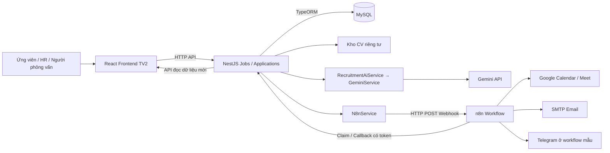
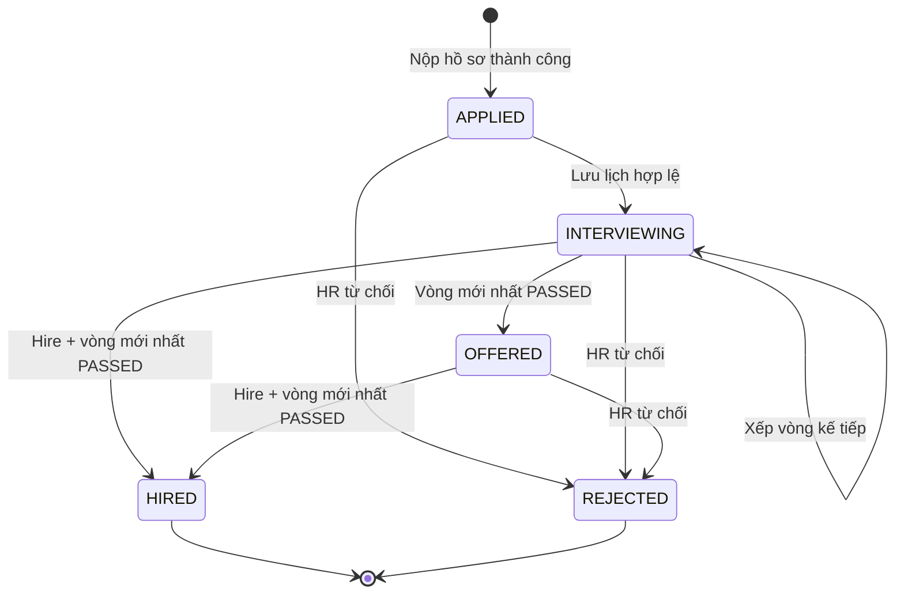

# Ôn giữa kỳ: TV2 làm gì và kết nối n8n như thế nào?

Biên soạn ngày **09/10/2026**, để ôn cho ngày **10/10/2026**. TV2 ở đây là **Thành viên 2 — phân hệ tuyển dụng ATS**, tức phần bạn phụ trách theo phân công dự án.

Tài liệu được đối chiếu với mã nguồn hiện tại trong `HumanResources`, các workflow JSON, PROGRESS, INTERVIEW-READBACK và HIRE-INTEGRATION. Một số đoạn RUNBOOK/CONTRACTS cũ vẫn ghi “Hire chưa mở”, “chỉ PDF” hoặc “Manager tạo câu hỏi”; phần dưới ưu tiên hành vi code hiện tại và tài liệu tích hợp mới. Đây là tài liệu giải thích để học, không phải một lượt nghiệm thu mới; các kết quả LIVE/test được dẫn lại từ hồ sơ dự án.

**Nếu chỉ có 30 phút:** đọc mục 1, 3, 5, 7, 8 và 12. **Nếu có 2 giờ:** đọc toàn bộ, rồi tự trả lời mục 11 mà không nhìn đáp án. **Nếu thầy hỏi luồng n8n:** tập trung mục 6–8.

## 1. Câu trả lời cần nắm trước tiên

### TV2 là gì?

TV2 phụ trách **quy trình tuyển dụng từ khi công ty đăng tin đến khi ứng viên trở thành nhân viên**. Phần này gồm giao diện React, API NestJS, lưu dữ liệu MySQL và tích hợp các dịch vụ AI/n8n do trưởng nhóm xây dựng.

Luồng nghiệp vụ tổng quát:

```text
HR tạo tin tuyển dụng
    ↓
Ứng viên xem tin và nộp CV
    ↓
Hồ sơ được lưu, xuất hiện trên bảng ATS
    ↓
HR dùng AI hỗ trợ đánh giá độ phù hợp CV với JD
    ↓
HR xếp lịch phỏng vấn → n8n tạo Calendar/Meet và gửi thư mời
    ↓
Người được phân công phỏng vấn đánh giá, ghi điểm và Đạt/Chưa đạt
    ↓
HR quyết định tuyển nếu vòng mới nhất đạt
    ↓
Backend tạo tài khoản nhân viên + 5 nhiệm vụ onboarding + trạng thái HIRED
    ↓
n8n gửi thư chào mừng và thông báo IT/HR
    ↓
TV3 tiếp nhận nhân viên mới trong Workspace/onboarding
```

**Câu nhớ:** “TV2 quản lý tuyển dụng; Gemini hỗ trợ nội dung và đánh giá; n8n tự động hóa tích hợp; HR và người phỏng vấn đưa ra quyết định.”

### Đoạn trả lời khoảng 60–90 giây

> Em phụ trách phân hệ tuyển dụng ATS, từ quản lý tin tuyển dụng, cổng ứng tuyển và tiếp nhận CV đến theo dõi hồ sơ trên Kanban, xếp lịch, ghi kết quả phỏng vấn và tuyển ứng viên thành nhân viên. Frontend dùng React, backend dùng NestJS, dữ liệu lưu MySQL. Em tích hợp GeminiService để tạo mô tả công việc, so khớp CV với yêu cầu và gợi ý câu hỏi phỏng vấn. Khi HR xếp lịch, backend lưu Interview và gửi webhook sang n8n. n8n tạo Google Calendar và Google Meet, gửi thư mời, rồi ở workflow readback gửi kết quả về backend để website hiện link và trạng thái thư. Khi HR tuyển một ứng viên có vòng mới nhất đạt, backend tạo User và 5 nhiệm vụ onboarding cùng với trạng thái HIRED trong một transaction, sau đó gọi n8n gửi thông báo chào mừng. AI chỉ hỗ trợ, quyền và điều kiện chuyển trạng thái vẫn được backend kiểm tra.

Không cần thuộc từng chữ. Cần hiểu **ai thao tác → dữ liệu vào đâu → xử lý gì → kết quả gì**.

## 2. Từ vựng để hiểu dự án

| Thuật ngữ | Nghĩa dễ hiểu | Ví dụ trong phần TV2 |
| --- | --- | --- |
| ATS — Applicant Tracking System | Hệ thống theo dõi hồ sơ ứng viên qua các bước tuyển dụng | Bảng Mới nộp / Phỏng vấn / Đã nhận việc |
| Job | Tin tuyển dụng cho một vị trí | Backend Developer thuộc phòng Engineering |
| JD — Job Description | Mô tả công việc và yêu cầu tuyển dụng | Cần NestJS, MySQL, kinh nghiệm REST API |
| Application | Một hồ sơ ứng tuyển vào một Job | Mai nộp CV vào Job số 1 |
| Interview | Một vòng phỏng vấn của một Application | Vòng 1, người phỏng vấn, ngày giờ, kết quả |
| Kanban | Bảng dùng các cột để biểu diễn tiến trình | Hồ sơ chuyển từ Mới nộp sang Phỏng vấn |
| CRUD | Tạo, đọc, sửa, xóa dữ liệu | TV2 chủ yếu tạo/đọc/sửa và đóng/mở Job; không có nghĩa luôn xóa cứng |
| API | Điểm giao tiếp để một phần mềm yêu cầu phần khác xử lý | React gọi POST /applications/:id/interview |
| HTTP POST | Gửi dữ liệu để thực hiện thao tác | Backend gửi JSON sang webhook n8n |
| JSON | Cấu trúc dữ liệu gồm các trường và giá trị | candidateName, candidateEmail, round |
| Webhook | Một URL nhận sự kiện từ hệ thống khác | /webhook/interview-schedule |
| Workflow | Chuỗi bước xử lý tự động nối với nhau | Webhook → Calendar → Email |
| Node | Một bước trong workflow n8n | Webhook, Code, HTTP Request, Send Email |
| Trigger | Điểm bắt đầu thực thi workflow | Có HTTP request gửi vào Webhook |
| Credential | Thông tin xác thực với dịch vụ bên ngoài | OAuth Google Calendar, SMTP, Telegram Bot token |
| Callback | Hệ thống xử lý xong gọi về hệ thống ban đầu | n8n POST link Meet về API TV2 |
| Readback | Đọc/xác minh lại kết quả đã tạo | Google Calendar GET để kiểm event/Meet thật |
| Polling | Gọi API lặp theo khoảng thời gian để đọc kết quả mới | Hồ sơ đợi callback và tải lại mỗi 3 giây |
| JWT | Token dùng xác thực người gọi API | HR đăng nhập rồi gọi API nội bộ |
| RBAC | Cấp quyền theo vai trò | HR tuyển người, Employee không được tuyển |
| Scope | Phạm vi dữ liệu được nhìn thấy | Manager xem hồ sơ thuộc phòng mình |
| Transaction | Nhóm thao tác DB thành một đơn vị cùng thành công/cùng thất bại | User + 5 task + HIRED |
| Commit / Rollback | Xác nhận dữ liệu / hoàn tác các ghi trong transaction | Lỗi tạo task thì không để User tạo dở |
| Idempotency | Gửi lại cùng thao tác không tạo thêm kết quả nghiệp vụ | Bấm Hire hai lần vẫn một tài khoản |
| Concurrency | Nhiều thao tác xảy ra đồng thời | Hai HR cùng tuyển một hồ sơ |
| LIVE / MOCK | Kết quả provider thật / kết quả mô phỏng | Điểm MOCK chỉ xem trước |
| SMTP_ACCEPTED | Máy chủ gửi thư chấp nhận thư | Chưa chứng minh thư nằm trong Inbox |
| Outbox | Bản ghi công việc cần gửi đi được lưu bền cùng dữ liệu nghiệp vụ | Hướng cải thiện khi process chết sau commit; chưa có luồng recovery đầy đủ |
| Onboarding | Quá trình nhân viên mới hòa nhập công ty | Nhận máy, ký hợp đồng, học nội quy |

## 3. Bạn phụ trách gì, các thành viên khác phụ trách gì?

### 3.1. Phạm vi TV2

TV2 là một **lát cắt fullstack**: bạn có cả màn hình và logic server của nghiệp vụ tuyển dụng.

| Phần | TV2 thực hiện/tích hợp |
| --- | --- |
| Tin tuyển dụng | Danh sách, chi tiết, tìm kiếm/lọc/phân trang, tạo/sửa, đóng/mở |
| Cổng ứng tuyển | CareersPage, JobDetailPage, form thông tin và upload CV |
| Hồ sơ | Lưu Application, chống nộp trùng, lưu CV riêng tư, đọc nội dung |
| AI tuyển dụng | Gọi SDK, chuẩn hóa/kiểm tra đầu ra, phân biệt LIVE/MOCK, lưu kết quả hợp lệ |
| Bàn ATS | RecruitmentAdminPage, ba cột Kanban, chi tiết hồ sơ, bộ lọc và thao tác |
| Phỏng vấn | Xếp lịch, các vòng, người được giao, gợi ý câu hỏi, điểm/feedback/result |
| Lịch phỏng vấn | Xem tuần/tháng, lịch/danh sách, tìm kiếm/lọc, mở link Meet đã lưu |
| n8n | Chuẩn bị payload, gọi N8nService, workflow readback, claim/callback và trạng thái giao thư |
| Hire | Nối luồng provisioning của lead với endpoint/UI ATS; quyền, điều kiện, transaction và chống trùng |
| Bàn giao | hiredUserId và OnboardingTask để Workspace của TV3 sử dụng |

Các file chính:

- Frontend: `CareersPage.tsx`, `JobDetailPage.tsx`, `RecruitmentAdminPage.tsx`, `features/recruitment/`.
- Backend: `modules/jobs/`, `modules/applications/`.
- Tích hợp AI phía TV2: `RecruitmentAiService` gọi `GeminiService`.
- Tích hợp n8n: `ApplicationsService` gọi `N8nService`, `InterviewDeliveryService` theo dõi callback.

### 3.2. Ranh giới đóng góp

| Thành viên | Vai trò liên quan |
| --- | --- |
| Trưởng nhóm | Core platform, Auth/JWT, schema nền, GeminiService, N8nService, mẫu provisioning Hire và 5 task |
| TV2 — bạn | Fullstack tuyển dụng; tích hợp dịch vụ core vào nghiệp vụ, kiểm quyền/trạng thái, UI/API/CV/readback và kiểm thử |
| TV3 | Workspace, checklist onboarding, tâm trạng nhân viên, cảnh báo burnout và Copilot |
| TV4 | Quản trị quyền/cấu hình, kho tri thức và đào tạo |

**Cách nói đúng về đóng góp:** “Em xây dựng và tích hợp phân hệ tuyển dụng; em sử dụng SDK AI/n8n của trưởng nhóm. Với Hire, em tích hợp mẫu provisioning của lead vào luồng ATS và bổ sung điều kiện, transaction, dedupe và UI.”

## 4. Kiến trúc: một thao tác đi qua những đâu?



### Ai giữ dữ liệu chuẩn?

MySQL/backend giữ trạng thái nghiệp vụ chuẩn: Job, Application, Interview, User và Task. Website hiển thị dữ liệu từ API. n8n xử lý các tác vụ tích hợp; bản readback báo kết quả về backend để website đọc.

**Ví dụ:** bạn đóng tab web sau khi xếp lịch. Nếu backend đã lưu lịch và callback cũng đã lưu kết quả thì mở lại vẫn thấy Interview/link Meet. Thông báo tạm trên màn hình không đủ thay thế dữ liệu DB.

### Vì sao frontend không gọi Google/Gemini trực tiếp?

Để backend kiểm quyền, kiểm dữ liệu và tập trung khóa tích hợp ở server. Frontend không nên tự quyết định điểm AI, trạng thái HIRED hoặc người nhận thư. Backend lấy CV/JD/contact đã lưu, rồi mới gọi dịch vụ.

### Low-code/no-code nằm ở đâu?

n8n biểu diễn tự động hóa bằng các node và connection, có thể cấu hình qua giao diện. Code node vẫn có JavaScript để biến đổi/xác minh dữ liệu. React/NestJS là phần viết code. Toàn bộ dự án **kết hợp code với low-code**, không phải một hệ thống hoàn toàn không cần code.

## 5. Toàn bộ luồng nghiệp vụ TV2

### 5.1. Luồng tạo và công bố Job

**Người thao tác:** HR hoặc SUPERADMIN.

1. HR nhập chức danh, phòng ban, mô tả, yêu cầu và thông tin như địa điểm/lương.
2. Có thể bấm tạo JD bằng AI: backend gọi `generateJobDescription(title, departmentName, level)`.
3. Kết quả đưa vào bản nháp; HR đọc, sửa, quyết định lưu. Tạo JD không tự tạo Job.
4. API validate và lưu Job vào MySQL.
5. Job OPEN xuất hiện ở Careers; Job CLOSED không hiện ở public.
6. Khi sửa/đóng/mở, gửi `expectedUpdatedAt` để tránh ghi đè bản đã bị người khác thay đổi.

**Đầu ra:** một tin tuyển dụng có ID và trạng thái. **Giá trị:** HR quản lý tin thật, ứng viên chỉ thấy tin đang mở.

Code hiện còn có quản lý phòng ban và gán người quản lý phòng ban. Người được chỉ định này được dùng để chọn người phỏng vấn ở các bước sau.

### 5.2. Luồng ứng viên nộp CV

**Người thao tác:** ứng viên public, không cần tài khoản nội bộ để nộp.

1. Ứng viên vào Careers, tìm/lọc Job.
2. Mở JobDetailPage theo ID.
3. Nhập tên, email, số điện thoại tùy chọn và chọn CV.
4. Frontend gửi `multipart/form-data` vào `POST /api/applications/apply`, field file tên `cv`.
5. Backend kiểm Job đang OPEN, kiểm loại/dung lượng CV và đọc nội dung nếu có lớp text.
6. CV được lưu vào kho riêng bằng tên UUID; MySQL lưu khóa file cùng thông tin Application.
7. Trong transaction, backend kiểm lại Job còn OPEN; điều này xử lý tình huống HR vừa đóng tin trong lúc PDF đang được đọc.
8. Application mới có trạng thái APPLIED. API trả `applicationId` và thông báo đã lưu.
9. Nếu DB ghi lỗi sau khi lưu file, backend dọn file vừa tạo.

**Chống trùng:** email được trim/lowercase, unique theo `jobId + candidateEmail`. Cùng email không được nộp hai hồ sơ cho cùng Job. Nộp Job khác vẫn là một Application khác, nhưng khi Hire phải xử lý ràng buộc email User.

**Quan trọng:** nộp CV không tự chấm AI. Hồ sơ vẫn được tiếp nhận nếu chưa chấm.

#### CV hiện hỗ trợ gì?

- PDF, PNG, JPG/JPEG, WEBP hợp lệ; tối đa **5 MiB** mỗi file.
- Kiểm phần mở rộng, MIME và chữ ký đầu file; đổi tên một file bất kỳ thành `.pdf` không đủ để được chấp nhận.
- PDF được parse trong worker giới hạn thời gian **10 giây**, bộ nhớ worker **128 MiB**, tối đa **40 trang / 60.000 ký tự** text.
- CV ảnh hoặc PDF scan không có text: `rawCvText = null`, giữ file và cảnh báo để dùng AI Vision khi HR chấm.
- Backend hiện không nhận link CV/rawCvText từ client ở luồng nộp hồ sơ này, dù phân công ban đầu có nhắc dán link.
- CV không nằm trong `frontend/public`; đọc file phải qua API có quyền và phạm vi.

### 5.3. Luồng chấm CV bằng AI

**Người thao tác:** HR/SUPERADMIN bấm chấm hồ sơ.

```text
POST /applications/:id/score
    ↓
Backend lấy CV và JD của Job từ dữ liệu server
    ↓
Có rawCvText? ── Có → scoreResume(text, JD)
    │
    Không → đọc file gốc → scoreResumeFile(file, MIME, JD)
    ↓
RecruitmentAiService kiểm đầu ra/mode
    ↓
Kết quả LIVE hợp lệ và dữ liệu vẫn còn mới → lưu vào Application
```

Đầu ra lưu gồm `matchScore`, `aiSummary`, `skillsDetected`, `aiRecommendation`; Vision LIVE còn có `extractedText` để lưu thành `rawCvText`.

**Ngưỡng khuyến nghị trong backend:**

| Điểm AI | Nhãn |
| --- | --- |
| 85–100 | STRONG_HIRE |
| Từ 70 đến dưới 85 | HIRE |
| Từ 50 đến dưới 70 | CONSIDER |
| Dưới 50 | REJECT |

Đây là **nhãn gợi ý từ điểm**, không tự đổi trạng thái Application sang HIRED hoặc REJECTED. Điểm chưa chấm là `null`, khác điểm `0`.

**LIVE/MOCK:**

- Với CV text: kết quả MOCK được trả cho xem trước, `saved=false`, không lưu điểm giả vào hồ sơ.
- Với CV ảnh/scan: nếu SDK không trả `aiGenerated=true`, adapter báo **503**; không lấy text OCR mô phỏng để trình bày như đã đọc CV thật.
- Kết quả LIVE cũng cần đúng schema: điểm số hợp lệ 0–100, kỹ năng/summary/text đúng giới hạn.
- Nếu CV/Application/JD đổi trong lúc AI chạy, backend từ chối lưu kết quả cũ bằng 409.
- Cùng hồ sơ đang chấm thì request trùng bị chặn; khóa được giải phóng khi xong/lỗi. Khóa hiện nằm trong process, chưa là queue dùng chung cho nhiều server.

**Hai loại điểm khác nhau:** `Application.matchScore` là độ phù hợp CV do AI hỗ trợ; `Interview.score` là điểm do người phỏng vấn nhập. Điểm AI cao không thay thế kết quả phỏng vấn.

### 5.4. Luồng bảng ATS/Kanban

HR chọn một Job ở bên trái, backend tải Application của Job đó. Có tìm theo tên/email, lọc trạng thái/điểm và phân trang.

| Cột giao diện | Trạng thái dữ liệu |
| --- | --- |
| Mới nộp | APPLIED |
| Phỏng vấn | INTERVIEWING và OFFERED |
| Đã nhận việc | HIRED |
| Bộ lọc Đã từ chối riêng | REJECTED |

**Kéo thả không có nghĩa đổi trạng thái tùy ý.** Kéo APPLIED sang Phỏng vấn mở form xếp lịch; chỉ lưu thành công mới chuyển INTERVIEWING. Kéo INTERVIEWING/OFFERED sang Đã nhận việc mở chi tiết/xác nhận tuyển; backend vẫn kiểm điều kiện. Hủy thì không thay dữ liệu.

### 5.5. Luồng xếp lịch phỏng vấn

**Người thao tác:** HR/SUPERADMIN.

1. Chọn ứng viên APPLIED hoặc INTERVIEWING.
2. Chọn người phỏng vấn, thời gian tương lai có múi giờ, số vòng.
3. Backend kiểm Application, trạng thái, người phỏng vấn đang active và điều kiện phòng ban.
4. Nếu phòng ban đã gán quản lý: chọn người được gán. Nếu chưa gán: có thể chọn Manager cùng phòng hoặc HR/SUPERADMIN làm người phỏng vấn dự phòng theo code hiện tại.
5. Vòng mới phải nối tiếp: chưa có vòng thì vòng 1; có vòng 1 thì vòng 2.
6. Trong transaction, tạo Interview `PENDING`, chuyển Application sang INTERVIEWING; nếu bật readback thì tạo thêm tracking delivery.
7. Sau commit, gọi `triggerInterviewScheduled(payload)` gửi webhook cho n8n.
8. n8n xử lý Calendar/Meet/Email, bản readback lưu kết quả về ATS.
9. Website đọc API để hiện trạng thái/link.

**Bấm lặp:** cùng hồ sơ/vòng/người/thời gian trả lịch đã lưu và không dispatch lần hai. Cùng vòng nhưng nội dung khác trả 409. Cơ chế này hạn chế tạo lịch và thư trùng, nhưng chưa thay thế recovery khi lỗi mạng/process crash.

### 5.6. Luồng câu hỏi và chấm phỏng vấn

**Người thao tác:** người có `interviewerId` trùng tài khoản đang đăng nhập — có thể là Manager được giao, hoặc HR/SUPERADMIN được chọn làm người phỏng vấn dự phòng.

1. Người được giao mở hồ sơ/vòng của mình.
2. Có thể yêu cầu gợi ý 3–5 câu hỏi: `generateInterviewQuestions(rawCvText, job.requirements)`.
3. Chỉ gợi ý khi Application đang INTERVIEWING và vòng còn PENDING. Cần có `rawCvText`; với ảnh/scan phải có text được Vision LIVE đọc/lưu trước.
4. Câu hỏi LIVE hợp lệ được lưu snapshot trên Interview. MOCK chỉ xem trước.
5. Người phỏng vấn nhập điểm **số nguyên 0–100**, nhận xét **1–5.000 ký tự**, và chọn PASSED hoặc FAILED.
6. Backend kiểm đúng người được giao và Application còn INTERVIEWING; `expectedResult`/`expectedUpdatedAt` chống ghi đè dữ liệu đã đổi.
7. HR đọc kết quả mới để quyết định đề xuất nhận việc/tuyển/từ chối.

**PASSED không tự Hire.** Khi quyết định nhận việc, xét **vòng có số round cao nhất**, không chọn vòng có điểm tốt nhất trong lịch sử.

Ví dụ: vòng 1 PASSED, vòng 2 FAILED → không đủ điều kiện Hire, dù CV 95 điểm.

### 5.7. Luồng xem lịch phỏng vấn

TV2 còn có tab Lịch phỏng vấn trong trang tuyển dụng:

- Xem tuần/tháng, dạng lịch hoặc danh sách; tìm ứng viên/Job, lọc người phỏng vấn và kết quả.
- Ngày giờ hiển thị theo Việt Nam **UTC+7**, tuần bắt đầu thứ Hai.
- Có vòng cũ và lịch của Job đã đóng để xem lịch sử.
- Link đến từ `Interview.meetingLink` đã lưu; mở tab lịch không tự tạo Meet.
- Lịch tự refresh khoảng 30 giây, chi tiết khoảng 15 giây khi tab hiển thị. Đây khác polling 3 giây của hộp chi tiết hồ sơ đang chờ callback.
- Manager xem lịch trong phạm vi phòng mình; HR/SUPERADMIN xem toàn bộ.
- API lấy khoảng `[from, to)`, nghĩa là gồm thời điểm bắt đầu, không gồm thời điểm kết thúc, tối đa 62 ngày.

### 5.8. Luồng Hire và bàn giao TV3

Luồng quan trọng này được giải thích riêng ở mục 8. Cần nhớ: **tạo User/Task trong backend trước; thông báo qua n8n sau commit; TV3 dùng userId để đọc Task**.

## 6. n8n trong dự án: hiểu nền tảng trước khi nhìn từng node

### 6.1. n8n giải quyết việc gì?

n8n nối hệ thống tuyển dụng với Google Calendar/Meet, SMTP Email và Telegram bằng workflow trực quan. Thay vì đưa mọi lời gọi bên thứ ba vào controller tuyển dụng, backend phát sự kiện có dữ liệu, n8n thực hiện các bước tích hợp theo cấu hình.

Ba sự kiện chính của SDK:

| Hàm backend | Webhook path | Ý nghĩa |
| --- | --- | --- |
| triggerInterviewScheduled | interview-schedule | Có lịch phỏng vấn mới |
| triggerEmployeeHired | employee-hired | Có nhân viên mới được tuyển |
| triggerBurnoutAlert | burnout-alert | Có cảnh báo căng thẳng/kiệt sức, thuộc nghiệp vụ TV3 |

`master-hr-ecosystem.json` gộp ba nhánh mẫu. Các workflow riêng giúp học/test từng nhánh. `interview-schedule-readback.json` là bản lịch có claim/callback và xác minh kết quả tốt hơn. Không chạy đồng thời nhiều workflow dùng cùng webhook path trong một môi trường.

### 6.2. Phân biệt node hay gặp

| Node | Nhận gì? | Làm gì? | Trả gì? |
| --- | --- | --- | --- |
| Webhook | HTTP POST từ backend | Bắt đầu workflow | body và thông tin request |
| Code | Item JSON của các bước trước | Chuẩn hóa, kiểm dữ liệu, tạo HTML/nội dung | Item JSON mới |
| Google Calendar Create | Thời gian/tên/event ID | Tạo event và yêu cầu conference Meet | Thông tin event |
| Google Calendar Get | Event ID | Đọc lại event để xác minh | Event hiện tại |
| HTTP Request | URL/header/body | Claim hoặc callback về API | Response backend |
| Send Email | Người gửi/người nhận/subject/html | Gửi qua SMTP | Thông tin message/accepted/rejected nếu node trả |
| Telegram | Chat ID và nội dung | Gửi thông báo vào kênh/chat | Kết quả Telegram |
| Respond to Webhook | Kết quả workflow | Trả HTTP response cho request vào | JSON/status code |
| Sticky Note | Ghi chú của người thiết kế | Giải thích workflow | Không là bước xử lý nghiệp vụ |

Connection biểu thị bước tiếp theo. Các nhánh cùng xuất phát từ một node là các nhánh xử lý; không cần khẳng định chúng luôn chạy đồng thời ở mức runtime.

### 6.3. Item, expression và bóc payload

n8n chuyển dữ liệu giữa node theo các item, dữ liệu thường nằm trong `item.json`.

```javascript
const raw = $input.first().json;
const body = raw.body || raw;
const payload = body.data || body;
```

Giải thích:

- `$input.first().json`: JSON của item đầu vào đầu tiên ở node hiện tại.
- `raw.body`: Webhook node thường đặt nội dung HTTP request trong `body`.
- `body.data`: SDK nhóm gửi payload cả ở root và trong trường `data`, nên code hỗ trợ lớp bọc này.
- `$('Tên node').first().json`: đọc dữ liệu của node được chỉ định đã chạy.
- `={{ $json.candidateEmail }}`: expression để lấy email từ item hiện tại vào trường cấu hình node.
- `return [{ json: {...} }]`: cách Code node chuyển item đã xử lý sang node sau.

**Không đọc `$json.candidateEmail` ở mọi node một cách máy móc.** Sau Calendar node, `$json` có thể là event Google; vì thế workflow đọc lại payload từ node trước có tên để lấy thông tin ứng viên.

### 6.4. Credentials và cấu hình

- Google Calendar cần OAuth có quyền phù hợp; node Create/Get cần được gắn credential.
- Send Email cần SMTP credential phù hợp với địa chỉ người gửi.
- Telegram cần Bot token và chat/channel nhận được bot message.
- Backend dùng `N8N_WEBHOOK_URL`, mặc định SDK là `http://localhost:5678/webhook`.
- Readback cần `RECRUITMENT_CALLBACK_BASE_URL`: URL API backend mà n8n truy cập được, ví dụ `http://localhost:3001/api`.
- `MAIL_FROM` hoặc `GMAIL_USER` dùng xác định địa chỉ gửi ở luồng readback.
- Địa chỉ mặc định trong template là dữ liệu mẫu của dự án, không phải bằng chứng đã cấu hình đúng người gửi/người nhận.

**`localhost` là máy/container hiện đang chạy tiến trình gọi.** Khi n8n chạy trong container/server khác, callback về `localhost:3001` có thể không trỏ tới backend trên máy bạn. Phải cấu hình URL reachable và đúng base của node guard.

### 6.5. Test URL và Production URL

- Test webhook: mở workflow và bật chế độ nghe/Execute workflow trước; URL thường là `/webhook-test/<path>`.
- Production webhook: URL `/webhook/<path>`, workflow phải được publish/active theo phiên bản n8n.
- File JSON có trường `active` chỉ mô tả bản export; không chứng minh runtime hiện tại đã publish và có credentials.
- Đổi `N8N_WEBHOOK_URL` phải dùng đúng base URL dành cho workflow đang test/chạy.

### 6.6. Bất đồng bộ và `true` có ý nghĩa gì?

`N8nService.postWebhook()` hiện gọi `fetch()` với timeout 10 giây nhưng **không await kết quả HTTP**; gắn `.catch()` để ghi nhận lỗi rồi trả `true` ngay khi khởi chạy được.

```text
Gọi triggerInterviewScheduled()
    ↓
Khởi chạy fetch gửi webhook
    ↓
Helper trả true trước khi biết n8n/provider đã hoàn tất
```

Vì vậy dù caller viết `await triggerInterviewScheduled(...)`, nó chỉ chờ Promise của helper trả boolean, không chờ Google/SMTP thực hiện xong. Không thể dùng boolean này để kết luận webhook HTTP thành công, Meet đã tạo hoặc email đã gửi.

**Ba mức cần phân biệt:**

1. Backend đã lưu nghiệp vụ: có Interview/User/Task trong DB.
2. Đã khởi chạy gửi yêu cầu: UNVERIFIED / DISPATCHED_UNVERIFIED.
3. Đã có bằng chứng từ provider/callback: Calendar confirmed, SMTP accepted; Inbox còn cần kiểm riêng.

Không nên thuộc con số “<5ms” từ tài liệu giới thiệu như một cam kết hiệu năng thực tế; đó không phải số đo bảo đảm cho mọi môi trường.

## 7. Hai luồng n8n xếp lịch cần hiểu

### 7.1. Bản mẫu `interview-schedule.json`

```text
Webhook: Xếp lịch phỏng vấn
    ├─ Respond HTTP 200
    └─ Tạo Google Calendar + Meet
           ↓
       Tạo template email và nội dung Telegram
           ├─ Gửi Email mời ứng viên
           └─ Gửi Telegram cho HR
```

- Webhook nhận POST tại `interview-schedule`.
- Nhánh Respond trả phản hồi sớm; **HTTP 200 ở đây chỉ là phản hồi tiếp nhận**, các bước khác có thể lỗi về sau.
- Calendar tạo sự kiện và conference Meet.
- Code lấy `hangoutLink`, format thời gian theo Việt Nam và soạn HTML.
- Email mẫu gửi cho **ứng viên**; người phỏng vấn có tên/email trong nội dung, không vì vậy mà tự nhận một email riêng.
- Telegram báo HR lịch mới ở nhánh template.
- Template cũ có fallback `https://meet.google.com/new`; đây là trang tạo cuộc họp mới, không phải link phòng phỏng vấn đã được xác minh.

Master có thêm node cập nhật Meet về backend qua endpoint cũ. Bản readback dưới đây dùng endpoint có token và kiểm đúng vòng; khi thuyết trình cần nêu đang nói về phiên bản nào.

### 7.2. Bản `interview-schedule-readback.json` hiện có

```text
Webhook
  ↓
Validate delivery envelope
  ↓
Claim interview delivery → Load interview payload
  ↓
Create Calendar/Meet → GET event → Verify Calendar readback
  ↓
Save Meet to ATS
  ↓
Soạn HTML thư mời → Send Email → Verify SMTP acceptance
  ↓
Save email status to ATS
  ↓
Respond HTTP 200
```

**Bản này không có nhánh Telegram.** Respond HTTP 200 nằm cuối nhánh thành công và các nhánh lưu lỗi đã nối; nó không nằm ở nhánh phản hồi sớm như template cũ. Backend vẫn không chờ hoàn tất vì dispatcher của nhóm trả sớm.

### 7.3. Từng node làm gì?

| Thứ tự | Node | Điều cần giải thích khi thầy hỏi |
| ---: | --- | --- |
| 1 | Webhook: Xếp lịch phỏng vấn | Nhận POST từ N8nService |
| 2 | Validate delivery envelope | Kiểm interviewId, requestId, token và callback URL đúng API đã cấu hình |
| 3 | Claim interview delivery | POST claim có token; giành quyền xử lý vòng này một lần trước provider |
| 4 | Load interview payload | Lấy snapshot backend đã lưu, kiểm claimed/event ID/contact/thời gian |
| 5 | Tự Động Tạo Lịch & Sinh Google Meet | Tạo Calendar event với event ID đã định, thời gian kết thúc = bắt đầu + 45 phút |
| 6 | Read back Calendar event | GET event vừa tạo để đọc lại kết quả thực tế |
| 7 | Verify Calendar readback | Kiểm ID, status confirmed, giờ bắt đầu/kết thúc, conference success và Meet URL hợp lệ |
| 8 | Save Meet to ATS | Callback CALENDAR_CONFIRMED; lưu link Meet/eventId trong DB |
| 9 | Tạo Link Meet & Template Email | Lấy link đã xác minh; soạn thư với giờ Việt Nam, escape tên để đưa vào HTML |
| 10 | Gửi Email Mời Ứng Viên | Gửi HTML qua SMTP cho candidateEmail |
| 11 | Verify SMTP acceptance | Kiểm messageId, accepted đúng ứng viên và không có recipient rejected |
| 12 | Save email status to ATS | Callback SMTP_ACCEPTED; lưu trạng thái/messageId |
| 13 | Respond HTTP 200 | Trả kết quả cho webhook request |

Các node lỗi bổ sung: `Calendar failure result`, `Email failure result`, `Save Calendar failure to ATS`, `Save email failure to ATS`. Chúng báo stage/code lỗi về backend; kết quả Meet đã confirmed không bị xóa chỉ vì Email lỗi.

**Workflow hiện tại tạo Calendar primary, không thêm Calendar attendees, gửi thư ứng viên qua SMTP.** Không khẳng định cả ứng viên và người phỏng vấn đều nhận Calendar invitation hoặc email riêng nếu cấu hình/code chưa làm điều đó.

### 7.4. Payload minh họa

Dữ liệu dưới đây là ví dụ học, không phải một lịch đã được gửi:

```json
{
  "interviewId": 21,
  "applicationId": 10,
  "candidateName": "Nguyễn Ngọc Mai",
  "candidateEmail": "mai@example.test",
  "interviewerName": "Trần Minh An",
  "interviewerEmail": "an@example.test",
  "scheduledAt": "2026-10-10T07:00:00.000Z",
  "round": 1,
  "fromEmail": "hr@example.test"
}
```

`07:00Z` = **14:00 giờ Việt Nam** cùng ngày. Trường `Z` biểu thị UTC; nếu dùng giờ Việt Nam trực tiếp có thể truyền `2026-10-10T14:00:00+07:00`. Backend chuẩn hóa ISO UTC trong payload.

Khi bật readback có thêm metadata `delivery`, gồm requestId, eventId, callbackUrl và token riêng từng vòng. Token thực tế không được đưa lên UI hoặc tài liệu demo.

### 7.5. Webhook và callback khác nhau ra sao?

```text
Backend → n8n: “Có lịch mới, hãy tạo Meet và gửi thư.”       [webhook]
n8n → Backend: “Tôi đã xác minh event/Meet và đây là link.” [callback]
Browser → Backend: “Có kết quả mới chưa?”                  [polling]
```

Ba chiều khác nhau. Callback không cập nhật trực tiếp biến trong React; nó ghi DB, rồi React đọc API.

### 7.6. Claim/token chống giả và chống trùng

- Token ngẫu nhiên **256 bit**, riêng từng vòng, hiệu lực **48 giờ**; DB giữ SHA-256 hash.
- n8n gửi header `x-interview-callback-token`; không dùng JWT HR cho callback máy với máy này.
- Claim trả snapshot người nhận/thời gian chuẩn từ backend, tránh dùng contact bị sửa trên payload bên ngoài.
- Claim lại đã xử lý trả 409 trước khi gọi Calendar/SMTP.
- Callback cùng nội dung được xử lý idempotent; nội dung mâu thuẫn trả 409.
- Token/requestId sai hoặc hết hạn trả 401; dữ liệu callback sai trả 400.
- Callback Calendar kiểm eventId, thời gian và định dạng link Meet; SMTP callback kiểm recipient khớp snapshot và Calendar đã confirmed.

**Lưu ý hiện trạng:** code còn endpoint cũ `POST /applications/interviews/:id/meeting-link` không dùng guard/token như đường delivery mới. Vì vậy chỉ nói cơ chế có xác thực của **readback mới**; không nói toàn bộ endpoint callback trong dự án đều đã được bảo vệ giống nhau. Endpoint cũ cần được review/loại bỏ hoặc bảo vệ khi triển khai thật.

### 7.7. Trạng thái và lỗi

| Tình huống | Điều được biết | Cách hiểu |
| --- | --- | --- |
| Interview đã lưu, helper true | Dispatch UNVERIFIED | Đang chờ bằng chứng provider |
| Helper false/throw | Dispatch FAILED | Lịch trong DB vẫn giữ |
| Gửi lại đúng lịch đã tồn tại | NOT_RETRIED | Không phát webhook lần hai |
| Calendar callback hợp lệ | Meet/event được confirmed và lưu | Có thể hiển thị link đã xác minh |
| SMTP callback hợp lệ | Email SMTP_ACCEPTED | Máy chủ chấp nhận; chưa chứng minh Inbox |
| Calendar thành công, Email lỗi | Giữ Meet, email outcome có thể UNKNOWN | Không xóa lịch/link đã tạo |
| Sau 10 phút chưa đủ callback | Read model trả UNKNOWN | Cần đối soát, không kết luận chắc thất bại |

Callback ghi kết quả có thể retry tối đa **3 lần** nhờ idempotency. Calendar/SMTP và claim không tự retry khi kết quả mơ hồ, để hạn chế tạo/gửi lặp.

**Chưa có recovery/outbox/queue/đối soát tự động đầy đủ** sau crash hoặc mất callback. Nếu workflow chết sau claim, replay không được coi là cách khôi phục hoàn chỉnh. Nếu provider đã gửi thư nhưng callback thất lạc, bấm gửi lại có thể gây thư trùng.

## 8. Luồng Hire: phần rất dễ nói nhầm

### 8.1. Điều kiện tuyển

1. Người gọi là HR hoặc SUPERADMIN.
2. Application đang INTERVIEWING hoặc OFFERED.
3. **Vòng phỏng vấn mới nhất PASSED**.
4. Email chưa có User khác; nếu đã có tài khoản thì trả 409 để HR đối soát.

API: `POST /api/applications/:id/hire`. Không dùng PATCH status chung để gán HIRED trực tiếp.

### 8.2. Backend tạo gì?

```text
Bắt đầu transaction MySQL
    ↓
Khóa Application và kiểm lại quyền/điều kiện
    ↓
Sinh mật khẩu ngẫu nhiên → bcrypt hash
    ↓
Tạo User role EMPLOYEE
    ↓
Tạo 5 OnboardingTask gắn userId
    ↓
Application.status = HIRED
Application.hiredUserId = User.id
    ↓
COMMIT
    ↓
Gọi n8n triggerEmployeeHired() để gửi thông báo
```

User nhận tên/email/phone từ Application, phòng ban/chức danh từ Job. DB lưu **passwordHash**, không lưu mật khẩu thô trong trường password. Receipt/API ATS không trả mật khẩu/hash.

**Atomic:** User + 5 task + HIRED/hiredUserId cùng thành công hoặc rollback nếu ghi DB lỗi. Không để “đã tuyển” mà thiếu một phần do lỗi transaction.

**Idempotent:** bấm lại cùng Application đã HIRED trả receipt đã có, không tạo User/task mới và không dispatch mail lần nữa. Các request đồng thời được kiểm qua transaction/khóa/ràng buộc DB. Hai hồ sơ khác nhau cùng email cũng không được tạo hai User.

### 8.3. Năm nhiệm vụ là gì?

| dueDay | Task |
| ---: | --- |
| 1 | Nộp hồ sơ nhân sự và ký hợp đồng lao động |
| 2 | Nhận máy tính và cài đặt môi trường dự án |
| 3 | Gặp quản lý trực tiếp và phân công Buddy |
| 7 | Học hội nhập văn hóa và an toàn thông tin |
| 30 | Đánh giá tổng kết thử việc cùng Manager |

`dueDay` là mốc ngày theo schema, **chưa phải ngày lịch tuyệt đối**. Có task “phân công Buddy/Manager” không có nghĩa tài khoản đã được tự động gán đầy đủ quan hệ quản lý; bàn giao này còn cần nghiệm thu.

### 8.4. n8n employee-hired làm gì?

```text
Webhook: 1-Click Hired
    ├─ Respond HTTP 200 sớm
    └─ Soạn Welcome Package / HTML
           ├─ Gửi Email chào mừng cho nhân viên
           └─ Gửi Telegram IT & HR Ops
```

Payload gồm `userId`, `fullName`, `email`, `jobTitle`, `departmentName`, mật khẩu tạm trong dữ liệu server gửi cho dispatcher và thông tin người gửi nếu có.

Code node chuẩn hóa tên/email/chức danh, dựng email HTML với thông tin nhận việc và portal; Telegram nhắc IT/HR chuẩn bị Welcome Kit. **Workflow hiện không tạo User và không tạo thêm 5 task trong MySQL.** Những việc đó đã thực hiện ở backend để giữ transaction nhất quán.

Phân công ban đầu mô tả n8n sinh password/task; implementation hiện đã đặt provisioning ở backend. Khi bảo vệ hãy nói theo code hiện tại, đồng thời giải thích đó là cách giữ các ghi DB atomic.

### 8.5. Nếu thư chào mừng thất bại?

User/task/HIRED đã commit **vẫn giữ**. Email là tác vụ bên ngoài sau transaction, không có rollback MySQL xuyên qua SMTP.

| welcomeEmailStatus | Nghĩa |
| --- | --- |
| DISPATCHED_UNVERIFIED | Helper khởi chạy; chưa xác nhận provider hoặc Inbox |
| FAILED | Helper false/throw; nghiệp vụ DB vẫn giữ |
| NOT_RETRIED | Hồ sơ đã tuyển; không gửi lại |

Trạng thái này trong receipt chưa là readback gửi thư bền sau reload. Chưa nghiệm thu welcome-mail LIVE/recovery/cấp lại truy cập. Không dùng bấm Hire lặp để gửi mật khẩu lại. Hướng cải thiện là outbox, callback/tracking và cơ chế activation/reset phù hợp.

### 8.6. Bàn giao cho TV3

- `Application.hiredUserId` nối hồ sơ tuyển dụng với User mới.
- Các OnboardingTask có `userId` của nhân viên đó.
- TV3 đọc task theo người đăng nhập trong Workspace để hiển thị checklist/tiến độ.
- TV2 đã kiểm phần dữ liệu bàn giao trong DB theo báo cáo; **Workspace TV3 và luồng thư/cấp truy cập hoàn chỉnh còn REVIEW**.

## 9. Trạng thái, dữ liệu và phân quyền

### 9.1. State machine Application



OFFERED là **đề xuất nhận việc**, HIRED là **đã tuyển thành công theo nghiệp vụ**. PASSED/FAILED thuộc **Interview**, không phải các trạng thái Application. `aiRecommendation=HIRE` cũng không phải `Application.status=HIRED`.

HIRED/REJECTED là trạng thái kết thúc của luồng hiện tại, không có thao tác chung để kéo ngược tùy ý.

### 9.2. Những bảng cần biết

```text
Department 1 ── n Job 1 ── n Application 1 ── n Interview
                                │                  │
                     hiredUserId│                  │interviewerId
                                ↓                  ↓
                               User               User
                                │
                                └─ 1 ── n OnboardingTask

Interview 1 ── 0..1 InterviewDelivery (khi bật tracking readback)
```

| Bảng/entity | Trường bạn nên nhớ |
| --- | --- |
| Job | id, departmentId, title, description, requirements, status, updatedAt |
| Application | id, jobId, candidateName/email/phone, cvFileUrl, rawCvText, matchScore, skillsDetected, aiSummary, aiRecommendation, status, hiredUserId |
| Interview | id, applicationId, interviewerId, round, scheduledAt, meetingLink, googleCalendarEventId, aiSuggestedQuestions, score, interviewerFeedback, result |
| InterviewDelivery | interviewId, requestId, tokenHash, snapshot, expectedEventId, status/calendarStatus/emailStatus, messageId, claim/expiry |
| User | id, email, passwordHash, role, departmentId, jobTitle |
| OnboardingTask | userId, title, category, dueDay và trạng thái theo schema onboarding |

**CV nằm ở filesystem riêng**, Application lưu khóa tham chiếu; không phải toàn bộ file PDF nằm trong cột text MySQL. `rawCvText` là văn bản trích xuất để dùng AI, khác file gốc.

### 9.3. Quyền hiện tại

| Tác nhân | Được làm gì? |
| --- | --- |
| Public/Ứng viên | Xem Job OPEN, nộp CV; không được đọc bảng ứng viên/CV người khác |
| HR/SUPERADMIN | Quản lý Job, xem/chấm hồ sơ, xếp lịch, đề xuất/từ chối/Hire |
| Manager | Xem dữ liệu tuyển dụng/lịch trong phạm vi phòng; không có quyền Hire chỉ nhờ role Manager |
| Người được giao một vòng | Gợi ý câu hỏi và ghi kết quả vòng đó khi đúng điều kiện; không chấm vòng giao cho người khác |
| Employee | Không dùng API tuyển dụng nội bộ; dùng Workspace theo quyền |
| Workflow readback | Claim/callback bằng token riêng vòng, không bằng quyền giao diện |

Một HR có quyền quản lý tuyển dụng **không tự được chấm mọi vòng**. Muốn gợi ý câu hỏi/ghi result phải là người có ID được giao vòng đó. Chặn nút ở frontend chỉ giúp UX; backend mới là nơi bắt buộc kiểm quyền.

### 9.4. API cốt lõi để nhận diện

Không cần học thuộc mọi URL nếu thầy không yêu cầu; nên biết action vào module nào.

| API dưới `/api` | Mục đích |
| --- | --- |
| GET /jobs, GET /jobs/:id | Public đọc tin OPEN |
| GET /jobs/admin | Nội bộ đọc Job theo quyền |
| POST /jobs; PATCH /jobs/:id; PATCH /jobs/:id/status | Tạo, sửa, đóng/mở Job |
| POST /jobs/ai-generate | Tạo bản nháp JD bằng AI |
| POST /applications/apply | Nộp contact + file CV |
| GET /applications?jobId=... | Danh sách hồ sơ của Job |
| GET /applications/:id; GET /applications/:id/cv | Chi tiết và CV có kiểm quyền |
| POST /applications/:id/score | Chấm CV, dùng dữ liệu server |
| POST /applications/:id/interview | Xếp vòng phỏng vấn |
| POST /applications/interviews/:id/questions | Gợi ý câu hỏi cho người được giao |
| PATCH /applications/interviews/:id/result | Lưu điểm/feedback/PASSED hoặc FAILED |
| PATCH /applications/:id/status | Đề xuất nhận việc/từ chối theo state machine |
| POST /applications/:id/hire | Provisioning User/Task/HIRED |
| GET /applications/interviews/schedule | Danh sách lịch theo khoảng thời gian |
| POST /applications/interviews/:id/delivery/claim | Workflow nhận quyền xử lý vòng |
| POST /applications/interviews/:id/delivery | Callback ghi kết quả readback |

### 9.5. Mã lỗi thường được hỏi

| HTTP | Ví dụ |
| --- | --- |
| 400 | Sai dữ liệu, thời gian không có múi giờ, số vòng không hợp lệ theo input |
| 401 | Thiếu/sai JWT, token callback sai/hết hạn |
| 403 | Đã đăng nhập nhưng không đủ quyền; không được giao vòng |
| 404 | Job không tồn tại/đã đóng ở public; dữ liệu ngoài phạm vi đọc |
| 409 | Nộp trùng, dữ liệu vừa đổi, vòng đã có lịch khác, Hire chưa đủ điều kiện, email User trùng |
| 415 | File không thuộc định dạng hợp lệ |
| 422 | PDF hỏng/có mật khẩu/quá giới hạn xử lý |
| 429 | Rate limit nộp hồ sơ; provider AI cũng có thể rate-limit |
| 502 | SDK AI lỗi/đầu ra sai hợp đồng |
| 503 | Chưa có method, AI quá thời gian, Vision không có kết quả thật hoặc thiếu cấu hình cần thiết |

Giới hạn nộp hiện là **10 request/phút/IP trong bộ nhớ process**. Đây không phải một bộ chống spam phân tán hoàn chỉnh.

## 10. Những tình huống thầy có thể đổi để kiểm tra bạn hiểu luồng

| Tình huống | Bạn giải thích thế nào? |
| --- | --- |
| Ứng viên nộp khi tin vừa đóng | Backend kiểm lại Job trong transaction; từ chối, không lưu Application sai và dọn file vừa tạo nếu cần |
| Ứng viên bấm nộp hai lần | Unique jobId/email chặn hồ sơ trùng |
| CV là ảnh hoặc PDF scan | Lưu file, text null; khi HR chấm dùng Vision, chỉ lưu kết quả thật hợp lệ |
| CV đạt 95 điểm nhưng phỏng vấn FAILED | Điểm AI không quyết định tuyển; latest PASSED là điều kiện Hire |
| Vòng 1 Đạt, vòng 2 Chưa đạt | Xét vòng mới nhất; chưa được Hire |
| HR kéo APPLIED sang HIRED | Không bypass; cần xếp lịch/kết quả/hire hợp lệ |
| Manager phòng khác mở CV | Backend kiểm scope, không được truy cập theo quyền Manager |
| Manager cùng phòng chấm vòng giao cho người khác | Không được; phải khớp interviewerId |
| HR bấm tạo câu hỏi của vòng không giao mình | Không được; operator không thay thế điều kiện assignment |
| JD đổi lúc AI đang chấm | Kiểm lại JD/revision trước khi lưu; kết quả cũ bị 409 |
| n8n chưa chạy | Lịch DB có thể đã lưu; helper true không chứng minh kết nối, tracking có thể chờ rồi UNKNOWN |
| Google Meet được tạo nhưng SMTP lỗi | Giữ event/link đã confirmed; báo trạng thái thư riêng |
| SMTP accepted nhưng ứng viên chưa thấy mail | Kiểm Inbox/Spam/provider; chưa được coi là ứng viên đã nhận/đọc |
| Calendar thành công nhưng callback mất | UI có thể UNKNOWN dù provider đã làm; cần đối soát, không gửi/tạo lại mù quáng |
| Hai HR cùng bấm Hire | Khóa/transaction/dedupe giữ một kết quả, một User và một bộ task |
| Email đã là User công ty | 409 để đối soát; không tự đổi role/password của tài khoản cũ |
| Ghi task thứ 3 bị lỗi | Rollback transaction; không để User/HIRED tạo dở |
| Hire commit nhưng email lỗi | Giữ User/task/HIRED; xử lý cấp truy cập/notification riêng |
| Mở lại website sau khi Hire | Đọc HIRED/hiredUserId từ DB; không dựa vào thông báo tạm |
| Thay giờ Việt Nam thành UTC | Chuẩn hóa ISO có múi giờ; 14:00 VN = 07:00Z |
| Import JSON xong vẫn không chạy | Kiểm credential, publish/listen, URL đúng, path trùng và kết nối tới backend |

## 11. Câu hỏi vấn đáp và câu trả lời mẫu

### A. Hiểu vai trò và nghiệp vụ

**1. Em phụ trách phần nào?**

Em phụ trách fullstack phân hệ tuyển dụng ATS: Job/Careers/Apply, hồ sơ CV và Kanban, tích hợp AI, lịch và kết quả phỏng vấn, Hire và dữ liệu bàn giao onboarding.

**2. Dự án giải quyết vấn đề gì?**

Gom quy trình tuyển dụng vào một hệ thống có dữ liệu và quyền rõ ràng; giảm nhập/lập lịch/gửi thông báo thủ công, giúp HR theo dõi tiến trình và người phỏng vấn ghi kết quả tập trung.

**3. Vì sao phải có ATS?**

Để biết mỗi ứng viên đang ở bước nào, thuộc Job nào, CV/điểm/lịch/kết quả ra sao; tránh theo dõi rời rạc bằng email hoặc bảng tính.

**4. Phần em là frontend hay backend?**

Cả hai theo phân hệ: em có màn hình React và module Jobs/Applications NestJS, tích hợp MySQL và SDK core. Không chỉ vẽ Kanban.

**5. Application khác User thế nào?**

Application là hồ sơ ứng tuyển; ứng viên có thể chưa có tài khoản nhân viên. Hire mới tạo User EMPLOYEE và gắn hiredUserId vào hồ sơ.

**6. Ba cột Kanban có nghĩa DB chỉ có ba trạng thái?**

Không. DB có APPLIED, INTERVIEWING, OFFERED, HIRED, REJECTED. UI gom INTERVIEWING/OFFERED trong cột Phỏng vấn và có bộ lọc từ chối riêng.

**7. OFFERED khác HIRED ở đâu?**

OFFERED là đề xuất nhận việc sau vòng đạt. HIRED là luồng tuyển đã tạo/liên kết User và task thành công. Code cho phép Hire trực tiếp từ INTERVIEWING nếu latest PASSED, không bắt buộc phải qua OFFERED.

**8. Kéo thẻ sang cột có tự đổi trạng thái ngay không?**

Nó mở hành động phù hợp như form lịch hoặc xác nhận tuyển. Chỉ sau API thành công UI mới lấy trạng thái server; hủy không đổi dữ liệu.

### B. AI và CV

**9. Gemini làm ba việc gì cho tuyển dụng?**

Tạo JD, so khớp CV với JD và gợi ý câu hỏi phỏng vấn. Code hiện thêm scoreResumeFile để đọc ảnh/PDF scan bằng Vision.

**10. AI chấm CV có gọi n8n không?**

Ở implementation hiện tại, ApplicationsService → RecruitmentAiService → GeminiService → Gemini API. n8n phục vụ workflow tích hợp như lịch/thư, không nằm trong đường chấm CV này.

**11. AI dùng dữ liệu nào để chấm?**

CV đã lưu và description/requirements của Job từ server. Client chỉ yêu cầu chấm theo applicationId; không được gửi điểm tự chọn làm kết quả AI.

**12. CV scan xử lý thế nào?**

Parser không có text thì lưu file và text null. Khi HR chấm, backend gửi file gốc cho Vision; chỉ lưu extractedText và điểm nếu kết quả thật hợp lệ. Vision fallback không được trình bày như OCR thật.

**13. LIVE và MOCK khác gì, vì sao không lưu MOCK score?**

LIVE là kết quả provider thật trong lần gọi; MOCK là fallback/mô phỏng. Schema chưa lưu mode nên lưu điểm giả có thể gây hiểu nhầm; vì thế chỉ preview. JD MOCK vẫn có thể được HR sửa/chấp nhận làm bản nháp.

**14. AI 90 điểm có tự tuyển không?**

Không. Nó tạo nhãn khuyến nghị; người phỏng vấn ghi result và HR quyết định. Backend yêu cầu latest PASSED trước Hire.

**15. matchScore và Interview.score khác nhau thế nào?**

matchScore đánh giá CV/JD bằng AI; Interview.score là điểm người phỏng vấn nhập cho một vòng cụ thể.

**16. Ai tạo câu hỏi phỏng vấn?**

Người được phân công vòng yêu cầu AI gợi ý từ CV text và Job requirements. Backend kiểm interviewerId, vòng PENDING và Application INTERVIEWING; LIVE lưu snapshot, MOCK preview.

### C. n8n và xếp lịch

**17. n8n là gì trong đồ án?**

Lớp điều phối tự động hóa bằng workflow node để kết nối backend với Calendar/Meet, Email, Telegram. Nó không thay thế quyền và state machine ở backend.

**18. Webhook khác API thường ở đâu?**

Webhook vẫn là HTTP endpoint, nhưng trong luồng này nó được gọi theo sự kiện: backend có lịch/tuyển mới thì đẩy dữ liệu sang n8n để kích hoạt xử lý.

**19. Luồng xếp lịch chạy từ đầu đến cuối thế nào?**

HR gửi lịch → backend validate/lưu Interview và INTERVIEWING → dispatcher POST n8n → readback workflow claim → tạo/đọc/xác minh Calendar/Meet → callback lưu link → SMTP gửi/kiểm acceptance → callback trạng thái → UI đọc API.

**20. Vì sao lưu Interview trước rồi mới gọi n8n?**

Để có ID và bản ghi nghiệp vụ chuẩn cho workflow/callback. Provider lỗi vẫn có lịch để kiểm tra, thay vì chỉ có tác vụ bên ngoài mà không có hồ sơ nội bộ.

**21. HTTP 200 của n8n có nghĩa gì?**

Phải xem node Respond nằm đâu và response nói gì. Template trả sớm nên chỉ tiếp nhận; readback trả ở cuối nhánh. Không dùng 200 đơn lẻ để suy ra mail đến Inbox. SDK hiện còn trả true trước khi chờ response HTTP.

**22. Vì sao dùng Google Calendar để tạo Google Meet?**

Calendar event có conference data cho Meet, gắn phòng họp với lịch và thời gian. Readback kiểm lại conference success/link thay vì tự ghép một URL phòng giả.

**23. Readback bổ sung gì so với bản mẫu?**

Claim chống xử lý lặp, snapshot chuẩn, GET xác minh event/Meet, callback có token và lưu bền trạng thái để website đọc. Bản này không có Telegram và chưa có recovery tự động đầy đủ.

**24. Callback và polling khác gì?**

Callback là n8n chủ động báo kết quả về backend. Polling là website định kỳ hỏi backend xem dữ liệu mới chưa. Chúng phối hợp chứ không thay thế nhau.

**25. Vì sao cần claim trước khi gọi Calendar?**

Để cùng một vòng chỉ một execution được quyền thực hiện provider lần đầu, hạn chế replay tạo/gửi trùng. Claim lặp trả 409; điều đó không đảm bảo tự phục hồi nếu execution đã claim rồi chết.

**26. Token callback bảo vệ gì?**

Chứng minh caller có quyền xử lý đúng vòng; kết hợp requestId/snapshot/event/time/recipient để ngăn callback giả hoặc ghi kết quả sang vòng khác. DB giữ hash, UI không nhận token.

**27. SMTP_ACCEPTED là đã gửi thành công hoàn toàn chưa?**

Là máy chủ chấp nhận gửi và có messageId đúng người nhận; còn Inbox/Spam/bounce hay người nhận đọc là các mức xác nhận khác.

**28. Vì sao không auto retry mọi node?**

Một request timeout có thể đã tạo event/gửi mail. Gọi lại khi chưa đối soát có thể trùng. Callback idempotent có thể retry, Calendar/SMTP/claim hiện không tự retry mù quáng.

**29. Các workflow có Telegram hết không?**

Không. Template lịch/master có Telegram, employee-hired có Telegram IT/HR, burnout có Telegram HR; workflow lịch readback riêng không có Telegram.

**30. Import JSON là chạy được ngay chưa?**

Chưa. Cần credential đúng, workflow published hoặc test đang listen, URL/path đúng và backend reachable. Không publish hai workflow cùng route.

### D. Hire, dữ liệu và lỗi

**31. Ai tạo tài khoản và năm task?**

Backend hireCandidate hiện tạo User/password hash/5 task và HIRED trong cùng transaction. n8n employee-hired nhận payload để gửi Welcome Email/Telegram. Đây là implementation hiện tại khác mô tả phân công ban đầu.

**32. Vì sao User + task + HIRED cần một transaction?**

Để không có trạng thái tuyển thành công nhưng thiếu tài khoản hoặc task do lỗi ghi DB. Bất kỳ ghi nào lỗi thì rollback toàn bộ nhóm ghi.

**33. Vì sao gửi email sau commit?**

Email là tác vụ bên ngoài không nằm trong transaction MySQL. Gửi sau commit bảo đảm thông báo dựa trên User thật đã lưu; nếu email lỗi thì xử lý thông báo/cấp truy cập riêng.

**34. Một-click Hire có nghĩa bỏ bước phỏng vấn không?**

Không. Một click kích hoạt một chuỗi xử lý sau khi đủ điều kiện quyền/trạng thái/latest PASSED. Nó không cho tuyển từ APPLIED hoặc bỏ kiểm backend.

**35. Nhấn Hire hai lần có tạo hai tài khoản không?**

Luồng hiện kiểm HIRED/hiredUserId và trả lại receipt, có khóa/transaction/ràng buộc email để chống trùng; không tạo lại task hoặc dispatch lại.

**36. Email đã tồn tại trong users thì sao?**

Trả 409 cho HR đối soát. Không tự nhận tài khoản đó, đổi role hoặc đổi mật khẩu của người đã có.

**37. Email chào mừng thất bại có hủy tuyển không?**

Không; User/task/HIRED đã commit giữ nguyên. Recovery thư/cấp truy cập còn mở, phải báo riêng chứ không giả vờ mọi tác vụ thành công.

**38. TV2 nối với TV3 bằng gì?**

hiredUserId và OnboardingTask.userId. TV3 đọc checklist theo User được tuyển. Phần DB đã có bằng chứng test, Workspace/cấp truy cập còn chờ nghiệm thu.

**39. Em chống ghi đè dữ liệu ra sao?**

Sửa Job dùng expectedUpdatedAt, đổi trạng thái dùng expectedStatus, ghi phỏng vấn dùng expectedResult/updatedAt; backend kiểm lại trong transaction. Dữ liệu đổi thì 409 để tải lại.

**40. Test thành công có chứng minh gửi thư thật không?**

Nếu dùng stub thì chỉ chứng minh logic/contract. Phải có provider LIVE và readback/Inbox evidence riêng. Báo cáo dự án có test DB/JWT thật và nhánh readback LIVE, nhưng welcome-mail LIVE/recovery chưa đóng.

**41. Dự án còn hạn chế gì?**

Gemini LIVE chưa ổn định theo lượt strict gần nhất; chưa có recovery/outbox tự động đầy đủ cho lịch và thư, welcome-mail/Workspace còn review; limiter/AI locks trong process; còn endpoint callback cũ cần review. Nêu đúng giới hạn thể hiện hiểu hệ thống.

**42. Nếu mở rộng lên nhiều backend server cần bổ sung gì?**

Shared limiter/queue, durable outbox và worker/reconciliation cho gửi thông báo, metadata version/mode bền cho AI, bảo vệ/deprecate callback cũ và giám sát provider. Đây là hướng cải thiện, chưa phải phần đã hoàn thành.

## 12. Kịch bản nói và demo để nhớ luồng

### 12.1. Ví dụ xuyên suốt

Ví dụ học: công ty tuyển Backend Developer cần NestJS/MySQL; Mai nộp CV. Các tên/điểm dưới đây là minh họa, không phải kết quả AI của dữ liệu thật.

1. HR tạo Job OPEN.
2. Mai nộp CV → Application APPLIED.
3. HR yêu cầu AI chấm → ví dụ LIVE 88 điểm, nhãn STRONG_HIRE; Application vẫn APPLIED.
4. HR xếp vòng 1 lúc 14:00 VN → Interview PENDING, Application INTERVIEWING.
5. n8n tạo/kiểm Calendar 14:00–14:45 và Meet → callback link.
6. SMTP chấp nhận thư → callback SMTP_ACCEPTED; UI hiển thị trạng thái này.
7. Người được phân công yêu cầu câu hỏi rồi ghi 82 điểm/PASSED.
8. HR đề xuất nhận việc hoặc Hire trực tiếp từ INTERVIEWING.
9. Backend tạo User EMPLOYEE + 5 task + HIRED/hiredUserId → commit.
10. n8n gửi thư chào mừng/Telegram; TV3 tiếp nhận task theo userId.

Nếu thầy đổi bước 7 thành FAILED, bạn phải dừng trước Hire. Nếu đổi bước 6 thành lỗi Email, giữ Meet và giải thích delivery riêng. Nếu đổi bước 9 thành lỗi task, rollback nhóm ghi DB.

### 12.2. Kịch bản thuyết trình khoảng 3 phút

> Phân hệ em phụ trách là tuyển dụng ATS. Mục đích là theo dõi một ứng viên xuyên suốt từ nộp hồ sơ đến trở thành nhân viên. Hệ thống có ba nhóm thao tác: ứng viên public xem tin và nộp CV, HR quản lý tuyển dụng, người được giao phỏng vấn ghi đánh giá.
>
> Đầu tiên HR tạo Job. Job đang mở sẽ hiện trên Careers. Ứng viên nộp thông tin và CV, backend kiểm file, kiểm tin đang mở và lưu Application APPLIED. CV lưu riêng tư; việc đọc CV nội bộ được kiểm quyền. HR xem hồ sơ trên Kanban, có thể yêu cầu Gemini chấm độ phù hợp với JD. AI chỉ hỗ trợ: điểm và nhãn không tự tuyển. Kết quả mô phỏng không được lưu như kết quả thật; CV ảnh hoặc PDF scan được xử lý bằng Vision khi có kết quả thật hợp lệ.
>
> Tiếp theo HR chọn người, giờ và vòng phỏng vấn. Backend lưu Interview và chuyển hồ sơ sang INTERVIEWING rồi phát webhook cho n8n. Ở workflow readback, n8n kiểm metadata, claim đúng vòng, tạo Calendar/Meet, đọc lại event để xác minh, callback lưu link về ATS rồi gửi thư mời và callback trạng thái SMTP. Website đọc API để hiện kết quả. HTTP 200 hoặc helper true không đủ chứng minh email tới Inbox.
>
> Người được giao vòng phỏng vấn có thể lấy gợi ý câu hỏi và ghi điểm, feedback, PASSED hoặc FAILED. Sau đó HR quyết định; Hire yêu cầu vòng mới nhất PASSED. Backend tạo User, năm task onboarding và trạng thái HIRED trong một transaction. Sau commit mới gọi n8n gửi thư chào mừng và thông báo IT/HR. TV3 đọc các task theo userId. Phần còn cần nghiệm thu là độ ổn định AI LIVE, recovery khi mất callback/process crash, thư chào mừng thật và Workspace bàn giao.

### 12.3. Thứ tự demo gợi ý

1. Chỉ ba màn hình: Careers → chi tiết Job/nộp CV → Quản lý tuyển dụng.
2. Chọn một Job, giải thích ba cột và năm trạng thái DB.
3. Mở hồ sơ, chỉ CV/điểm AI; nêu `null` khác 0 và LIVE/MOCK.
4. Mở form lịch, giải thích interviewer/time/round. Nếu môi trường gửi thật đã được cấu hình, lưu một lịch hợp lệ; nếu chưa thì dùng lịch đã có để giải thích, đừng gọi stub là mail LIVE.
5. Mở workflow n8n: đi từ Webhook → claim → Calendar → callback → Email → callback.
6. Quay lại ATS, chỉ link Meet và trạng thái thư nếu đã xác minh.
7. Người được giao ghi PASSED rồi HR Hire trên dữ liệu demo phù hợp.
8. Chỉ hiredUserId/5 task, giải thích bàn giao TV3 và giới hạn thư.

Khi chưa có credentials/provider ổn định, vẫn có thể giải thích đúng đường đi bằng workflow và dữ liệu demo. Không cần phát sinh thư thật chỉ để học luồng.

## 13. Hiện đã kiểm được gì? Không nên nói quá phần nào?

Theo **PROGRESS E024 / HIRE-INTEGRATION / INTERVIEW-READBACK**, cập nhật trong repo ngày 07/10:

| Phần | Bằng chứng ghi trong dự án | Giới hạn |
| --- | --- | --- |
| ATS/API/quyền/lưu dữ liệu | Regression với HTTP/MySQL/JWT/password thật; lượt E024 99/99 PASS và build PASS | Provider trong regression dùng stub/fixture; không suy ra mọi integration LIVE |
| Phỏng vấn readback | Đã có lượt website → n8n → Calendar/Meet/SMTP → callback về ATS; reload giữ link/status; Inbox kiểm riêng | Chưa recovery tự động đầy đủ sau crash/mất callback; chưa giả lập outage provider thật toàn bộ |
| Hire | User + 5 task + HIRED atomic, duplicate/concurrent/rollback/email collision; browser persistence | Welcome-mail dùng stub ở lượt kiểm; mail LIVE/recovery/Workspace còn REVIEW |
| Gemini | Các method từng LIVE riêng; lượt strict gần nhất còn 503/429/MOCK | Chưa nghiệm thu vận hành ổn định; các bổ sung Vision hiện có trong code không vì vậy được coi là LIVE đã nghiệm thu |

Đây là bằng chứng được đọc lại; tài liệu ôn ngày 09/10 không chạy thêm provider hoặc regression. File nhắc Git ở thư mục ngoài và một số RUNBOOK cũ không phải nguồn trạng thái mới nhất.

### Những câu dễ sai cần tránh

| Dễ nói nhầm | Cách nói đúng |
| --- | --- |
| “Em viết toàn bộ AI/n8n core.” | TV2 tích hợp SDK do lead cung cấp, triển khai nghiệp vụ/UI/API/readback liên quan |
| “n8n hiện tạo User và 5 task.” | Backend hireCandidate tạo chúng trong transaction; workflow hiện gửi thông báo |
| “Nộp CV là AI chấm ngay.” | Nộp lưu hồ sơ, HR yêu cầu chấm riêng |
| “Chỉ nhận PDF, scan không xử lý được.” | Code hiện nhận cả ảnh và scan qua Vision khi provider thật hoạt động |
| “HR nào cũng bấm tạo câu hỏi/chấm phỏng vấn được.” | Phải đúng người được giao vòng |
| “AI HIRE là đã tuyển.” | Nhãn gợi ý khác trạng thái HIRED |
| “Điểm 90 chắc chắn được tuyển.” | Vẫn cần quyết định con người và latest PASSED |
| “Webhook true/HTTP200 là thư tới Inbox.” | Phải tách dispatch, provider acceptance và Inbox |
| “Các workflow lịch đều trả200 ngay/có Telegram.” | Template trả sớm/có Telegram; readback trả ở cuối/không Telegram |
| “Hệ thống gửi mail riêng cho cả hai bên.” | Workflow đọc được hiện gửi SMTP cho ứng viên; không mặc định mail riêng cho interviewer |
| “Mọi callback đều đã xác thực.” | Delivery mới có token; endpoint meeting-link cũ cần review |
| “Idempotent nghĩa là hệ thống đã exactly-once hoàn hảo.” | Có chống lặp nghiệp vụ/claim/callback nhưng recovery và tác vụ ngoài còn giới hạn |
| “99 test pass nên toàn bộ hệ thống đã hoàn tất.” | Test chứng minh phạm vi kiểm; LIVE và bàn giao/recovery còn mở |

## 14. Một trang để học trước khi vào thi

### Mười ý phải nói được không nhìn tài liệu

1. **TV2:** từ Job → CV/Application → phỏng vấn → Hire → bàn giao onboarding.
2. **Stack:** React → NestJS → MySQL; gọi GeminiService/N8nService ở server.
3. **AI:** tạo JD, chấm CV/JD, gợi ý câu hỏi; Vision cho ảnh/scan; hỗ trợ quyết định.
4. **CV:** lưu riêng tư, validate file, chống trùng jobId/email, không tự chấm khi nộp.
5. **Trạng thái:** APPLIED, INTERVIEWING, OFFERED, HIRED, REJECTED; PASSED/FAILED ở Interview.
6. **Lịch:** validate → lưu Interview/PENDING và INTERVIEWING → webhook n8n sau commit.
7. **n8n readback:** Webhook → claim → Calendar create/get/verify → callback Meet → Email/verify → callback SMTP.
8. **Hai chiều:** backend webhook sang n8n; n8n callback về backend; frontend polling đọc backend.
9. **Hire:** HR/Admin + latest PASSED → transaction User/5task/HIRED → n8n welcome sau commit → TV3 đọc task/userId.
10. **Giới hạn:** helper true không chứng minh mail, SMTP accepted không chứng minh Inbox, chưa recovery/outbox đầy đủ.

### Cách trả lời bất kỳ câu “luồng này chạy thế nào?”

```text
Ai bấm? → API nào? → Backend kiểm gì? → Ghi bảng nào?
→ Gọi Gemini hay n8n? → Trả/lưu kết quả gì? → Lỗi thì giữ/dừng gì?
```

### Lịch ôn gợi ý tối nay

- **20 phút:** đọc mục 1–5, tự vẽ luồng từ Job đến Hire bằng giấy.
- **25 phút:** đọc mục 6–8, đi từng node trong JSON/UI n8n nếu đang có.
- **15 phút:** đọc mục 9–10, tập câu hỏi quyền/trạng thái/lỗi.
- **25 phút:** che đáp án mục 11, nói thành tiếng; đánh dấu câu chưa trả lời được.
- **10 phút:** nói lại đoạn 3 phút và mười ý trên.
- **Trước thi:** đọc mục 14, không cần học thuộc code/JSON HTML dài.

Các câu ở mục 11 là câu hỏi ôn dựa trên dự án, **không phải dự đoán chắc chắn đề của thầy**.

## 15. Tài liệu và mã nguồn để mở khi cần xem sâu

Các liên kết dưới đây tương đối với file ôn để hoạt động trong repo:

- [Phân công chi tiết toàn nhóm](../../BAO_CAO_PHAN_CONG_NHIEM_VU_CHI_TIET.md)
- [Trạng thái và bằng chứng TV2](PROGRESS.md)
- [API/SDK contract; nhớ có đoạn cũ chưa đồng bộ](CONTRACTS.md)
- [Chi tiết readback lịch/Meet/thư](INTERVIEW-READBACK.md)
- [Chi tiết Hire/User/5 task](HIRE-INTEGRATION.md)
- [Lịch tuần/tháng và API danh sách](INTERVIEW-CALENDAR.md)
- [Cấu hình Google Calendar](GOOGLE-CALENDAR-SETUP.md)
- [Hướng dẫn test n8n](TEST-N8N.md)
- [Các phần còn phải nghiệm thu](REMAINING-TESTS.md)
- [Workflow lịch bản mẫu](../../workflows/interview-schedule.json)
- [Workflow lịch readback — nên đọc kỹ nhất](../../workflows/interview-schedule-readback.json)
- [Workflow chào mừng](../../workflows/employee-hired.json)
- [Workflow master ba nhánh](../../workflows/master-hr-ecosystem.json)
- [Workflow burnout — để hiểu ranh giới TV3](../../workflows/burnout-alert.json)
- [ApplicationsService — đường đi nghiệp vụ chính](../../backend/src/modules/applications/applications.service.ts)
- [ApplicationsController — các route](../../backend/src/modules/applications/applications.controller.ts)
- [CV storage/parser](../../backend/src/modules/applications/cv-storage.service.ts)
- [AI adapter TV2](../../backend/src/modules/jobs/recruitment-ai.service.ts)
- [N8nService của core](../../backend/src/modules/core/automation/n8n.service.ts)
- [InterviewDeliveryService — claim/callback](../../backend/src/modules/applications/interview-delivery.service.ts)
- [Màn hình quản lý ATS](../../frontend/src/pages/RecruitmentAdminPage.tsx)
- [Chi tiết ứng viên, polling, result và Hire](../../frontend/src/features/recruitment/CandidateDetail.tsx)

Khi đọc code, ưu tiên `apply`, `score`, `schedule`, `generateQuestions`, `result`, `hireCandidate` trong ApplicationsService; sau đó đối chiếu các node `interview-schedule-readback.json`. Không cần thuộc HTML email để hiểu luồng.
