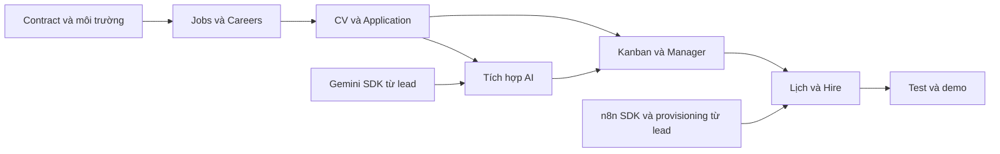

# Kế hoạch Thành viên 2 — Tuyển dụng ATS và phỏng vấn

Phiên bản **2.3**, cập nhật **07/10/2026**. Bản tích hợp hiện hành là `HumanResources` / `feature/recruitment-ats`, đã nhận main9733233 qua54cb79a và push toàn bộ code hiện có tại8f7212a. Bản nguồn cũ `HumanResources-full` / `local/recruitment-complete` tại3b6fa7f giữ local để đối chiếu. Yêu cầu mới “push hết” thay quy tắc chia commit hàng ngày; xem [DAILY-PUBLISH.md](DAILY-PUBLISH.md).

**TV2 làm giao diện và API nghiệp vụ tuyển dụng; lead cung cấp AI SDK, workflow n8n và nền tảng dùng chung.** Đây là kế hoạch triển khai hiện hành, thay thế phiên bản 30/09. Theo dõi tại [PROGRESS.md](PROGRESS.md). Bản cũ giữ trong [archive/PLAN-2026-09-30.md](archive/PLAN-2026-09-30.md) và [archive/PROGRESS-2026-09-30.md](archive/PROGRESS-2026-09-30.md), không tiếp tục dùng checklist cũ. Mã v2 bắt đầu bằng `V2-` để không nhầm lịch sử.

## 1. Căn cứ và trạng thái thực tế

Nguồn mới: DOCX `BAO_CAO_PHAN_CONG_NHIEM_VU_CHI_TIET.docx` người dùng gửi ngày 01/10 và [bản Markdown trong repository](../../BAO_CAO_PHAN_CONG_NHIEM_VU_CHI_TIET.md). Đặc tả/phác thảo cũ dùng làm ngữ cảnh; phân công mới quyết định ownership. Nội dung tài liệu là yêu cầu/thông tin, không phải bằng chứng source đã xong hoặc yêu cầu tự chạy lệnh, gửi tin, lên lịch họp.

Ở bước khảo sát đã fetch và fast-forward `0734659` → `c37a5e4` (`full base`). Bản đầy đủ trước đây được giữ ở `backup/recruitment-ats-full-2026-10-01` (`3429b99`), sau đó nhánh công bố được chia lại thành các đợt nhỏ theo yêu cầu người dùng. Ngày 02/10 đã tạo worktree local riêng từ backup, merge cập nhật lead và bổ sung các sửa lỗi/test. Bảng dưới mô tả baseline core; kết quả triển khai nằm trong [PROGRESS](PROGRESS.md), [RUNBOOK](RUNBOOK.md) và [CONTRACTS](CONTRACTS.md).

### Điều chỉnh triển khai v2.3 ngày07/10

- Q05–Q19 và consumer Q20–Q22 đã push8f7212a. Q23/readback mail/Meet và Q24/provisioning User/5 task còn thiếu; caller/guard không được coi là hoàn tất nghiệp vụ.
- Nhận3 SDK từ lead main9733233, map aiGenerated thành LIVE/MOCK và chuẩn hóa JD arrays/question objects. Giữ nguyên Gemini core. Contract/actual fallback đạt; provider live chưa nghiệm thu.
- Giữ Jobs array cũ khi không paging; opt-in page/pageSize đồng thời mới trả envelope. Careers vẫn6 tin/trang với Q01–Q04; recruitment domain client gửi paging tường minh.
- Bản tích hợp: Jobs27/27 + recruitment37/37 =64/64; browser10 nhóm API/MySQL thật, AI/n8n stub; build/TypeScript/Vite/lint đạt, còn5 lint warning. E009 mô tả giới hạn và evidence.
- 39 DONE/12 REVIEW/9 BLOCKED; V2-P05.01 nhận SDK được đóng, các gate provider/workflow/Hire còn mở.

### Lịch sử điều chỉnh triển khai v2.2 (02/10)

- Dùng Node built-in test runner + Nest TestingModule + fetch và MySQL thật, thay Jest/Supertest dự kiến; không thêm dependencies. Frontend dùng Playwright browser smoke thay bộ component test riêng. Giữ task/test IDs để theo dõi acceptance.
- 34 mục test backend (32 bài con + 2 nhóm) và 10 nhóm browser smoke đã chạy ngày 02/10; đây là bộ automation cụ thể, không có nghĩa các gate tích hợp live đều đã hoàn tất.
- Multipart PDF là đầu vào CV duy nhất; không nhận link tùy ý. PDF tiếng Việt/Anh/textless có fixture; chưa OCR.
- UI phân trang chung30 hồ sơ/board và counts trước paging, thay paging độc lập mỗi cột. OFFERED trong cột phỏng vấn; REJECTED lọc riêng. Kéo thẻ APPLIED sang cột phỏng vấn mở form xếp lịch; chỉ đổi trạng thái khi lưu thành công. Bấm thẻ/bàn phím vẫn mở được thao tác; kéo sang HIRED không bỏ qua provisioning.
- Sửa lựa chọn job còn sót khi bộ lọc rỗng, chặn response sau hủy request, đưa page về trang hợp lệ nếu tổng giảm. Mã job không hợp lệ không gọi API; form/biên nhận reset theo route. Có retry cho detail, bộ lọc, phòng ban và Manager.
- Tạo câu hỏi AI có khóa theo interview trong process, trả409 khi trùng và giải phóng khóa khi provider lỗi; không phải queue nhiều replica.
- Debounce200–250ms cho các list. Fetch có AbortController; chưa tự nhận toàn bộ race UI đã có test.
- AI SDK adapter phía consumer đã có; schema envelope và LIVE/MOCK chờ lead đồng ý. MOCK score/questions không persist; chưa có live provider.
- Các write có expectedStatus/expectedUpdatedAt và transaction lock theo chức năng; updatedAt tăng ít nhất1s để tương thích cả database có timestamp precision giây. Không sửa entities.
- Xếp lịch trả UNVERIFIED/FAILED/NOT_RETRIED và giữ lịch khi SDK lỗi. Chưa callback/poll/retry vì thiếu workflow/result contract.
- Hire guard/precondition đã có, endpoint trả503 và UI tắt cho đến khi lead bàn giao nguồn User/provisioning. Không tạo User/5 task hoặc dùng userId giả để đóng phase.
- Gate đăng nhập thật nằm trong recruitment; auth/seed chung vẫn phải bàn giao. Navbar chỉ đổi một class flex-wrap để sửa overflow trên375px.
- File rollback cleanup đã có. Orphan do crash: đối soát/quản trị thủ công sau backup và24h, chưa cron cleanup tự động; chi tiết trong RUNBOOK.
- 38/60 task DONE,12 REVIEW,10 BLOCKED theo evidence hiện tại. Giữ các gate live và handoff chưa hoàn tất; chưa đóng M2/M4/M5/M6.

Bảng dưới là baseline khảo sát c37a5e4, giữ làm lịch sử; cập nhật SDK/workflow mới ngày07/10 ở mục v2.3 phía trên.

| Hạng mục | Tài liệu mới | Source c37a5e4 | Kết luận |
| --- | --- | --- | --- |
| Sinh JD | generateJobDescription(title,dept,level) | Chưa có trong GeminiService | Chờ lead bàn giao |
| Chấm CV | scoreResume(resumeText,jobDescription) | Chưa có trong GeminiService | Chờ SDK, shape và mode |
| Câu hỏi PV | generateInterviewQuestions(...) | Chưa có trong GeminiService | Chờ SDK 3–5 câu hỏi |
| Copilot | chatCopilot(...) | Chưa có | Ngoài scope TV2, dành TV3 |
| Gemini hiện có | Bộ hàm chuyên biệt | generateJson/generateText/isAvailable | Không coi là đã có SDK mới |
| n8n schedule/hire | Tạo Meet/mail/password/5 task | Có helper, fetch không await, trả true sớm | Chưa chứng minh workflow completed |
| Fallback | DOCX nói đã có, Markdown nói sẽ tích hợp | Chưa có mock kết quả chuyên biệt | Cần LIVE/MOCK metadata và nghiệm thu |
| Auth | Đã hoàn tất | Frontend vẫn mock_jwt_token và mặc định HR | Dependency lead |
| Seed | Tài khoản @fpt.edu.vn | Service @company.com, password khác, chưa thấy hook tự seed | Test bằng DB thật, báo lead lệch tài liệu |
| Department | Dùng ngay | code bắt buộc nhưng seed không truyền code | Xác minh runtime với lead |
| Phỏng vấn Manager | TV2 sở hữu recruitment kỹ thuật | Comment cũ ghi TV3 | Theo phân công mới; TV3 giữ Team Mood |
| Kanban | Ba cột | Enum có APPLIED/INTERVIEWING/OFFERED/HIRED/REJECTED | Chốt mapping, không tự đổi enum |
| Hire | n8n sinh mật khẩu/task | SDK đòi userId, chưa rõ ai tạo User | Chốt nguồn User trước code hire |

### Thay đổi so với kế hoạch v1

- TV2 không tự viết AI prompt/rubric/model, workflow n8n, outbox core, activation hoặc migration shared. Những thiết kế đó trong archive không còn là backlog bắt buộc TV2.
- TV2 vẫn validate/map/lưu output, làm UI trạng thái, test consumer và báo gap cụ thể cho lead.
- TV2 nhận UI/API chấm điểm phỏng vấn Manager; TV3 nhận Manager Team Mood ở EmployeeWorkspace.
- Board ba cột, OFFERED/REJECTED qua badge/filter. DRAFT, OCR, contact preview, WebSocket, bulk CV và skill-gap assignment là mở rộng.
- Không mặc định TV2 tạo User + 5 task bằng transaction như v1. Password/task workflow thuộc lead, nguồn User phải chốt.

## 2. Scope và ranh giới file

TV2 chịu trách nhiệm Jobs CRUD OPEN/CLOSED; Careers/Detail và form CV; Application persistence; bàn HR/job sidebar/Kanban; caller JD/score/questions; lịch và UI/API Manager result; caller hire và handoff TV3; test/tài liệu/demo phân hệ.

| Vùng | Owner | Cách làm |
| --- | --- | --- |
| backend/src/modules/jobs và applications | TV2 | Controller/service/DTO/helper/test nghiệp vụ |
| CareersPage, JobDetailPage, RecruitmentAdminPage | TV2 | Gồm cả HR và Manager tuyển dụng |
| frontend/src/features/recruitment nếu thêm | TV2 đề xuất | Component/hook/type domain tách nhỏ |
| jobs.api.ts, applications.api.ts | Domain TV2, xác nhận boundary | Dùng apiClient sẵn |
| Shared types, App.tsx, Navbar, package/lockfile | Lead review | Đề nghị thay đổi nhỏ có lý do |
| common, entities, core, layouts, api/client.ts, Auth | Lead | Nhận SDK/schema, không tự làm thay |
| EmployeeWorkspace/onboarding/mood/chat | TV3 | Handoff user/task sau Hire |
| AdminSettings/users/RBAC/RAG/L&D | TV4 | TV2 không sửa |
| Gemini prompt/model/fallback, workflow n8n | Lead | TV2 kiểm thử tích hợp caller |

Jobs/API/form/board/Manager và unit tests có thể làm độc lập trước SDK. Auth/DB thật cần để nghiệm thu tích hợp. Stub đặt trong test hoặc dev được gắn nhãn; không thêm SDK giả vào core hoặc hard-code điểm production. Dependency thiếu chỉ chặn đầu việc liên quan.

## 3. SDK và quyết định cần nhận

| SDK TV2 dùng | Input | Output cần chốt | Source |
| --- | --- | --- | --- |
| generateJobDescription | title, dept, level | description, requirements, benefits?, mode/error | Chưa có |
| scoreResume | CV text thật, JD đúng job | score 0..100, strengths/weaknesses, summary?/recommendation?, mode | Chưa có |
| generateInterviewQuestions | CV text, requirements | 3–5 câu hỏi, tiêu chí nếu có, mode | Chưa có |
| triggerInterviewScheduled | ID lịch/hồ sơ, contact, interviewer, time, round | accepted/completed, eventId, link/eventId lịch, lỗi | Helper có, contract kết quả thiếu |
| triggerEmployeeHired | Hiện có userId/name/email/jobTitle/department | Nguồn userId, hiredUserId, provisioning/task/mail status | Helper có, ownership chưa rõ |

Đề nghị metadata `mode: LIVE | MOCK`, kết quả `ok/data` hoặc `code/message/retryable`, requestId nếu có. Workflow cần phân biệt ACCEPTED/PROCESSING/COMPLETED/FAILED. Đây là proposal, không phải shape đã tồn tại. HTTP 2xx hoặc boolean true chỉ có thể là nhận yêu cầu; chưa chứng minh mail/Meet/User/task hoàn tất.

SDK khác shape thì TV2 viết mapper cục bộ, không đổi core signature. Kết quả mock có badge “Dữ liệu mô phỏng”, không dùng để nghiệm thu live hay tự chuyển HIRED thật. Không suy đoán mode từ nội dung câu trả lời.

| ID | Quyết định | Owner | Chốt trước |
| --- | --- | --- | --- |
| D01 | Shape 3 SDK và field lưu được | Lead + TV2 | P05 |
| D02 | LIVE/MOCK/unavailable metadata | Lead | P05/P08/P09 |
| D03 | Timeout/retry/rate limit, tránh retry chồng | Lead | P05 |
| D04 | Score sync/async, queue/trạng thái bền ở đâu | Lead + TV2 | P05 |
| D05 | Upload/link/cả hai, nguồn text | TV2 + lead | P03/P04 |
| D06 | Callback/poll/readback và bên ghi lịch/mail result | Lead + TV2 | P08 |
| D07 | Ai tạo User trước SDK cần userId | Lead | P09 |
| D08 | Khi nào HIRED/hiredUserId, xử lý partial failure | Lead + TV2 | P09 |
| D09 | Retry/dedupe password/task/mail | Lead | P08/P09 |
| D10 | Ba cột, OFFERED/REJECTED, điều kiện Hire | TV2 + lead | P06/P07 |
| D11 | Manager scope/quyền sửa result | TV2 + lead | P07 |
| D12 | Field/status/version schema thiếu, cách lead bổ sung | Lead | Trước phần phụ thuộc |
| D13 | Auth/seed thật và boundary domain/test config | Lead + TV2 | P01 |
| D14 | Cấp truy cập và email đã tồn tại khi hire | Lead + TV2 | P09 |

Điều kiện nhận SDK: source có method thật/build được, signature và examples rõ, input hợp lệ/sai/quota/timeout/fallback có behavior, không secret/password trả UI/log. Test contract bằng stub; ít nhất một smoke live khi nghiệm thu live. TV2 không cần biết prompt/credential nội bộ.

## 4. Hợp đồng dữ liệu và nghiệp vụ

### 4.1 Schema có sẵn

- Job: title/departmentId/createdBy/location/salaryRange/description/requirements, OPEN/CLOSED. Chưa DRAFT/benefits/version.
- Application: contact/jobId/cvFileUrl/rawCvText/matchScore/skillsDetected/aiSummary/aiRecommendation/status/hiredUserId, unique(jobId,email). Chưa skillsMissing/questions/queue status/version/LIVE-MOCK source.
- Interview: applicationId/interviewerId/round/time/meetingLink/calendarEventId/questions JSON/score/feedback/result. Chưa delivery status/eventId/version.
- User/OnboardingTask có schema nhưng provisioning chưa có contract đủ rõ.

TV2 gửi yêu cầu field chính xác cho lead, không nhét field chưa có hoặc tự sửa entities. Không lưu queue cần bền trong RAM rồi nói có recovery. Decimal MySQL có thể là string, mapper chuyển score hữu hạn 0..100; null chưa chấm khác 0%. Strengths/weaknesses có thể format vào aiSummary theo contract; cần JSON riêng thì lead bổ sung. Không giả định SDK có skillsDetected/recommendation. Questions lưu Interview.aiSuggestedQuestions đã có.

### 4.2 API đề xuất

Route mới là backlog, chưa tồn tại. Prefix giữ code hiện tại; apiClient đã unwrap data nên không unwrap hai lần. DTO whitelist/maxlength/id dương/email/enum/time; pageSize 20 mặc định, cap 100; sort allowlist/stable id. Đổi array thành paging object phải sửa consumer domain cùng lúc.

| Method/route | Quyền | Mục đích |
| --- | --- | --- |
| GET /api/jobs | Public | Search/filter/page, chỉ OPEN |
| GET /api/jobs/:id | Public | OPEN đúng id, closed/missing 404 |
| GET /api/jobs/admin và /admin/:id | HR/admin; Manager scoped nếu cần | Nội bộ OPEN/CLOSED |
| GET /api/jobs/filters | Public | Lookup từ tin OPEN, dữ liệu tối thiểu |
| GET /api/jobs/departments | HR/admin | Lookup id/name/code cho editor |
| POST /api/jobs | HR/admin | Tạo, createdBy từ JWT |
| PATCH /api/jobs/:id và /:id/status | HR/admin | Sửa/OPEN/CLOSED, không hard-delete hồ sơ |
| POST /api/jobs/ai-generate | HR/admin | Caller SDK, draft để sửa, không auto-publish |
| POST /api/applications/apply | Public có giới hạn | Contact/jobId/CV theo D05 |
| GET /api/applications | HR/admin; Manager scoped | List/filter/page |
| GET /api/applications/summary | HR/admin; Manager scoped | Counts toàn scope/filter |
| GET /api/applications/:id | HR/admin; Manager scoped | Hồ sơ/AI/interviews, không User secret |
| GET /api/applications/:id/cv | HR/admin; Manager scoped | Private download |
| POST /api/applications/:id/score | HR/admin | Score/rescore theo D04 |
| PATCH /api/applications/:id/status | HR/admin | Transition đúng, không bypass side effects |
| GET /api/applications/interviewers | HR/admin | Lookup Manager phù hợp |
| POST /api/applications/:id/interview | HR/admin | Lưu lịch/caller n8n |
| PATCH /api/applications/interviews/:id/result | Manager được gán | score/feedback/PASSED/FAILED |
| POST /api/applications/:id/hire | HR/admin | Caller Hire theo D07/D08 |

Route GET tĩnh trước `:id`. Callback/status polling do D04/D06/D08 chốt; không tự mở callback public tùy ý. Mã lỗi: 400 input; 401 token; 403 role; 404 missing/scope; 409 duplicate/state; 413 size; 415 format; 422 PDF unreadable; 429 limit; 503 unavailable. Shared client hiện bọc Error làm mất status, lead hỗ trợ nếu domain config không đủ.

### 4.3 CV/form

Ưu tiên upload PDF có text tối đa 5 MiB để demo AI đầy đủ. Parse text bằng thư viện đã có là xử lý input của TV2, không là AI core. Server kiểm lại type/size/signature/parser, private filename ngẫu nhiên, không path client/public uploads. FormData qua apiClient đúng boundary; download stream bypass wrapper theo cơ chế lead, frontend blob có JWT rồi revoke object URL, không token trong URL.

PDF scan chưa OCR phải báo rõ/cần xem tay theo policy. DB lỗi sau ghi file phải dọn file mới; cleanup giới hạn thư mục cấu hình. Public không gửi score/rawCvText/role/createdBy để server tin là kết quả nội bộ. Unique job/email normalized chống trùng và concurrent submit/close phải kiểm bằng DB.

CV link nếu dùng: HTTPS/độ dài hợp lệ, không tự fetch URL tùy ý (SSRF). Link chưa có text không đủ đầu vào scoreResume; cần pipeline download/parse được nhóm chốt hoặc upload PDF. Auto-preview contact chưa nằm trong 7 SDK mới, là mở rộng; form name/email/phone vẫn nhập tay được.

### 4.4 Ba cột và phỏng vấn

| UI | DB | Hành động |
| --- | --- | --- |
| Mới nộp | APPLIED | CV/score, mời PV, từ chối |
| Đang phỏng vấn | INTERVIEWING, OFFERED nếu có | Lịch/result, badge offer, Hire khi hợp lệ |
| Đã nhận việc | HIRED | Theo dõi kết quả, không hire lặp |
| Filter riêng đã từ chối | REJECTED | Tra cứu, không thêm cột thứ tư |

Đề xuất D10: APPLIED→INTERVIEWING qua lịch; HR reject APPLIED/INTERVIEWING/OFFERED có lý do; INTERVIEWING→HIRED qua Hire khi vòng mới nhất PASSED; giữ OFFERED tương thích nếu nhóm muốn bước offer. HIRED/REJECTED terminal ở bản tối thiểu. AI chỉ gợi ý, không auto-hire/reject.

Drag PV/Hire mở action modal, không PATCH bypass. Cancel/lỗi rollback card/count. Backend kiểm state/concurrency, không chỉ nút disabled; version field chỉ dùng khi lead có. Manager scope D11, mặc định đề xuất cùng phòng được đọc và chỉ interviewer được gán ghi result. Score int 0..100, feedback giới hạn, result PASSED/FAILED; quyền sửa khi application chưa terminal cần chốt. Questions 3–5 theo SDK; HR dùng vòng mới nhất, Manager không tự Hire. TV2 làm góc này, TV3 giữ Team Mood.

### 4.5 Schedule và Hire

Schedule: validate/timezone→lưu Interview→gọi SDK id thật→readback theo D06. DB UTC, UI giờ Việt Nam. Phân biệt đã lưu lịch/pending/failed/completed/mock.

Hire cần lead quyết định vì SDK hiện đòi userId:

- A: core/workflow tạo User/task, SDK nhận candidate/application/job rồi trả hiredUserId; TV2 không tạo trùng User.
- B: TV2 được giao rõ tạo User tối thiểu qua service/transaction lead chỉ định; SDK nhận userId thật, workflow làm password/cấp truy cập/5 task; cần status partial và recovery.

Không tự chọn A/B, dùng id giả, tạo task song song workflow hoặc tự thay quyền/mật khẩu user email đã tồn tại (đề xuất 409). D08 xác định mốc HIRED là quyết định HR hay provisioning complete; nếu tách cần trạng thái riêng và UI đúng. Idempotency/eventId/outbox workflow do lead cung cấp, TV2 kiểm consumer. Không hứa exactly-once email nếu provider không hỗ trợ; kết quả mơ hồ cần đối soát trước retry. Mock không biến thành business HIRED thật, password không vào response/log.

## 5. Lộ trình và các mốc

| Mốc | Kết quả | Phase | Phụ thuộc |
| --- | --- | --- | --- |
| M1 | Jobs→Careers→Application thật | P00–P04 | Auth/DB/seed |
| M2 | JD/score/questions SDK và mode | P05 | Gemini lead |
| M3 | Board ba cột/Manager result | P06–P07 | M1; stub UI không thay live AI |
| M4 | Meet/email thật | P08 | n8n/status lead |
| M5 | Hire/user/5 task/handoff | P09 | Contract provisioning lead |
| M6 | Test/demo/bàn giao | P10–P11 | M1–M5 |

Sprint 2: M1 và khung M3. Sprint 3: SDK/Meet/Hire, M2–M5. Sprint 4: test chéo/video/bảo vệ. Ước lượng TV2 khoảng 12–20 ngày tập trung khi SDK/nền đúng hạn, chưa gồm học công nghệ/chờ bàn giao; không tự gán deadline ngày thật. Giảm mở rộng khi thiếu thời gian, không thay live bằng mock để báo xong.



## 6. Các phase và đầu việc

Mỗi task có việc thực hiện và điều kiện hoàn thành; checklist trong PROGRESS phải khớp mã. Không tự tích vì skeleton có sẵn.

<a id="p00"></a>
### P00 — Phạm vi và contract

Gate: scope rõ, source và dependency phân biệt, không làm thay lead.

#### V2-P00.01 — Ghi nhận baseline và phân công mới

- Đối chiếu commit, Word/Markdown và SDK source; lưu evidence.
- Xong khi: xác nhận Git mới chỉ đổi tài liệu, các SDK thiếu được ghi đúng.

#### V2-P00.02 — Chốt ownership và vùng file

- TV2 Jobs/Applications/ba page/cả Manager tuyển dụng; TV3 Workspace; lead core/entities; phân biệt domain/shared.
- Xong khi: không dùng comment cũ để giao PV cho TV3; boundary được nhóm biết.

#### V2-P00.03 — Chốt SDK Gemini và fallback

- D01–D04: output, mode/error, timeout/retry, sync/async và nơi lưu trạng thái.
- Xong khi: có contract review được; thiếu implementation ghi dependency, không tự viết AI core.

#### V2-P00.04 — Chốt schedule và provisioning

- D06–D09/D14: nguồn userId, owner User/task/password, status và idempotency.
- Xong khi: một nơi tạo mỗi bản ghi; chưa chốt vẫn tiếp tục Jobs/Apply.

#### V2-P00.05 — Chốt MVP, nhánh và thứ tự PR

- D05/D10/D11: upload/link, ba cột, Manager scope/Hire; nhánh feature/recruitment-ats khi bắt đầu code, PR nhỏ.
- Xong khi: không push main, mở rộng v1 không bị nhận là bắt buộc. Phiên chuẩn bị chưa tạo nhánh.

<a id="p01"></a>
### P01 — Môi trường và test nền

Gate: runtime DB/token thật, lỗi nền báo lead thay vì tắt guard.

#### V2-P01.01 — Toolchain và môi trường local

- Node/npm/Docker, lockfile/env không ghi đè, Engine/port/DB test; executable JS khi path có &.
- Xong khi: frontend/backend chạy, native bcrypt được xác minh, compile không thay runtime.

#### V2-P01.02 — Nhận Auth và seed hợp lệ

- Login/profile JWT thật, HR/admin/Manager/Employee; Department.code và tài khoản theo DB thật.
- Xong khi: token giả 401, API bảo vệ dùng được; lỗi có bằng chứng chuyển lead.

#### V2-P01.03 — Fixture tuyển dụng

- 2 phòng ban/Manager khác phòng, HR/admin/Employee; job OPEN/CLOSED, hồ sơ và lịch nhiều trạng thái.
- Xong khi: dữ liệu test chạy lại không trùng, không ID cố định hoặc sửa DB chung; seed shared phối hợp lead.

#### V2-P01.04 — CV và SDK fixtures

- PDF text Việt/Anh, thiếu kỹ năng, scan, fake/hỏng/quá 5 MiB; SDK live/mock/error trong test.
- Xong khi: không PII thật, stub có nhãn, không hard-code UI production.

#### V2-P01.05 — Test harness và command

- Chốt backend Jest/Supertest, frontend component tests/browser smoke; package/config shared review lead.
- Xong khi: một API validation và một component loading/error test chạy; ghi command thực tế.

<a id="p02"></a>
### P02 — API Jobs

Gate: OPEN/CLOSED CRUD có quyền/dữ liệu thật, không tự thêm enum.

#### V2-P02.01 — Tách public và admin

- Public chỉ OPEN, admin guard/scoped query; route tĩnh trước id, bỏ public all=true đọc closed.
- Xong khi: public thêm query/id không vượt quyền.

#### V2-P02.02 — DTO và tạo tin

- Trim/maxlength/phòng hợp lệ, createdBy JWT, field theo entity hiện có.
- Xong khi: lưu thật, input giả/mass assignment bị chặn.

#### V2-P02.03 — Sửa và đóng mở tin

- Update allowlist/OPEN/CLOSED, state server, concurrent policy; không hard-delete job có hồ sơ.
- Xong khi: refresh đúng, đóng giữ hồ sơ cũ và ẩn khỏi public.

#### V2-P02.04 — Search, filter, paging và lookup

- q/phòng/địa điểm, cap pageSize, sort allowlist/stable id, parameterized query; lookup và departmentName serializer.
- Xong khi: total đúng toàn query, không hard-code phòng hoặc lộ User secret.

#### V2-P02.05 — Nghiệm thu Jobs API

- Cases V2-T-JOB-01..04, HR/admin/Employee, 404/parse id/input sai.
- Xong khi: test API thật đạt, contract đủ nối frontend.

<a id="p03"></a>
### P03 — Careers và form ứng tuyển

Gate: tin thật, UI loading/error/empty, không success giả.

#### V2-P03.01 — Nối Careers và filters

- Bỏ mockJobs, cards/total/retry/empty; debounce 300ms, bỏ response cũ, reset page khi đổi filter.
- Xong khi: gõ nhanh/đổi phòng đúng dữ liệu server; API lỗi không quay về tin mẫu.

#### V2-P03.02 — Chi tiết đúng job id

- Fetch detail, missing/closed có thông báo, bỏ fallback job đầu, render text an toàn.
- Xong khi: id sai không thành job khác.

#### V2-P03.03 — Form contact và CV

- Name/email/phone/upload hoặc link theo D05; chọn/thay/xóa, keyboard/type/size feedback; giữ input khi lỗi.
- Xong khi: form không phụ thuộc auto-preview contact AI chưa có SDK.

#### V2-P03.04 — Submit thật và biên nhận

- apiClient/domain API, multipart boundary đúng, disable đang gửi, 409/file/network errors rõ.
- Xong khi: success sau API lưu, không double-submit hoặc mất input khi retry.

#### V2-P03.05 — Responsive và component tests

- 375px/tablet/desktop, label/focus, stale requests, form loading/error; nối lại API sau P04.
- Xong khi: phím/touch dùng được, component tests và UI integration đạt.

<a id="p04"></a>
### P04 — CV và Application

Gate: file/hồ sơ thật, không trùng, AI lỗi không mất đơn.

#### V2-P04.01 — Validate đơn và job OPEN

- Contact DTO/email normalize, server kiểm job, reject score/rawCvText/role/path client trái contract.
- Xong khi: closed/missing/mass assignment bị chặn trước lưu.

#### V2-P04.02 — Upload/link và đọc text giới hạn

- 5 MiB/PDF signature/MIME/parser/private filename; link HTTPS không fetch tùy ý; scan báo rõ.
- Xong khi: text Việt/Anh đúng, fake/path traversal bị chặn, link không được giả thành resumeText.

#### V2-P04.03 — Persistence và chống trùng

- Bỏ sample_cv fallback, transaction, unique job/email, submit/close race, rollback dọn file mới và orphan policy.
- Xong khi: hai request chỉ một đơn, 409 đúng, public receipt tối thiểu.

#### V2-P04.04 — List/detail/download có quyền

- Role/phòng query scope, serializer an toàn, stream theo wrapper contract lead, frontend blob JWT.
- Xong khi: người ngoài scope không đọc bằng id đoán, HR tải đúng file.

#### V2-P04.05 — Nghiệm thu M1

- Jobs→Apply→DB/UI, file lỗi/trùng/DB failure/tin đóng và refresh, thử khi SDK chưa hoạt động.
- Xong khi: hồ sơ tồn tại độc lập AI và có evidence thật.

<a id="p05"></a>
### P05 — Tích hợp Gemini SDK

Gate: caller/validator/mapper/mode đúng, không viết prompt/model core.

#### V2-P05.01 — Nhận ba SDK và kiểm contract

- Source signatures/examples/mode/errors/timeout, test caller trong module TV2.
- Xong khi: ba method thật dùng được; thiếu ghi BLOCKED live, không thêm giả vào core.

#### V2-P05.02 — JD endpoint và modal

- Validate title/dept/level, SDK draft output, preview/sửa/áp dụng; không publish tự động hoặc overwrite form bởi response trễ.
- Xong khi: HR sửa/lưu được, LIVE/MOCK/error đúng, field ngoài schema được xử lý rõ.

#### V2-P05.03 — Score caller, lưu kết quả và retry

- D04 sync/async, hồ sơ lưu trước, text server/JD đúng job; score 0..100/map field có thật, timeout/retry không chồng.
- Xong khi: null khác 0%, mock/live phân biệt cả persistence, không hứa recovery khi chưa có queue/trạng thái bền.

#### V2-P05.04 — Questions caller và Interview snapshot

- CV/requirements đúng, validate 3–5 câu hỏi/tiêu chí, lưu aiSuggestedQuestions trên Interview.
- Xong khi: không ghi vào cột Application chưa tồn tại; output sai báo lỗi.

#### V2-P05.05 — Nghiệm thu M2 và lỗi SDK

- Stub unavailable/schema/429/mock, smoke live riêng, duplicate/response cũ về trễ.
- Xong khi: evidence JD/score/questions live và test lỗi; công việc prompt/core ghi thuộc lead.

<a id="p06"></a>
### P06 — Bàn HR và Kanban

Gate: sidebar job và ba cột đúng tài liệu, action/state dữ liệu thật.

#### V2-P06.01 — Tách component và nối sidebar

- HR view/Sidebar/Board/Card/Drawer/JobEditor trong feature recruitment; selection/empty/counts, hủy response job cũ.
- Xong khi: đúng hồ sơ job đã chọn, không sửa Workspace/core UI ngoài scope.

#### V2-P06.02 — Ba cột, paging và trạng thái phụ

- Mapping D10, OFFERED badge, REJECTED filter, load-more/page theo cột và counts toàn scope.
- Xong khi: dữ liệu page sau/trạng thái khác không biến mất.

#### V2-P06.03 — Drawer CV và AI

- Contact/CV private/score chưa chấm/aiSummary/lịch/questions/mode, missing file/AI error rõ.
- Xong khi: không hard-code điểm hoặc dùng AI để tự quyết định tuyển.

#### V2-P06.04 — Transition UI và concurrency

- Drag nếu lib được chốt, menu/phím thay thế; PV/Hire modal; cancel/lỗi/409 rollback hoặc refetch card/count.
- Xong khi: state machine backend chặn bypass, hai tab không nhân đôi card; version chỉ dùng nếu lead có.

#### V2-P06.05 — JobEditor và nghiệm thu HR

- CRUD/mở đóng/JD trên bàn HR, confirm/loading/error, refresh và mobile/phím.
- Xong khi: M1+AI→board thật, không nút placeholder success giả.

<a id="p07"></a>
### P07 — Phỏng vấn Manager

Gate: TV2 hoàn thiện recruitment kỹ thuật, quyền ở backend.

#### V2-P07.01 — Scope và danh sách phỏng vấn

- Department/assignment D11, null department deny khi cần; list/detail/CV cùng rule, time/round/link thật.
- Xong khi: Manager ngoài scope không đọc bằng id/query, không chế link Meet.

#### V2-P07.02 — Form điểm và câu hỏi

- Questions/tiêu chí, score/feedback/PASSED/FAILED, loading/error/focus, giữ input khi lỗi.
- Xong khi: đủ phím/mobile, không ép pass từ điểm AI.

#### V2-P07.03 — API ghi result thật

- DTO int 0..100/feedback length/result enum, assigned interviewer; persistence thay skeleton, kiểm terminal/concurrent.
- Xong khi: refresh giữ dữ liệu, request sai quyền/input bị chặn.

#### V2-P07.04 — HR nhận kết quả và Hire condition

- Vòng mới nhất, badge/pass fail/feedback, kiểm D10 cả frontend/backend, Manager không tự hire.
- Xong khi: kết quả vòng cũ không vượt vòng mới.

#### V2-P07.05 — Nghiệm thu M3

- Test phòng/assignment/score lỗi/terminal/hai tab và HR nhận result.
- Xong khi: TV3 không phải sửa recruitment page/module để hoàn thiện Manager kỹ thuật.

<a id="p08"></a>
### P08 — Xếp lịch và n8n

Gate: lịch thật, workflow lead, phân biệt accepted/completed.

#### V2-P08.01 — Validate và lưu Interview

- Interviewer active/phòng đúng, time ISO/tương lai/round dương, chống trùng; transaction lịch và Application status.
- Xong khi: rollback không lệch dữ liệu, retry không tạo lịch thứ hai, lookup tối thiểu.

#### V2-P08.02 — Caller triggerInterviewScheduled

- Payload id/contact/time/round đúng, không frontend fetch n8n hoặc gửi SMTP song song workflow.
- Xong khi: accepted/error đúng; boolean sớm không là completed.

#### V2-P08.03 — Readback và lưu kết quả

- Callback/poll D06, auth/cơ chế lead, meetingLink/calendarEventId đúng aggregate, duplicate/stale response.
- Xong khi: chỉ nguồn hoàn tất đáng tin mới báo có Meet/đã gửi thư, callback giả bị chặn.

#### V2-P08.04 — UI trạng thái và retry

- Pending/failed/completed/mock, UTC/VN, retry cùng logical request, outcome mơ hồ đối soát trước.
- Xong khi: workflow down không mất lịch hoặc nhân đôi thư/Meet ngoài contract đã biết.

#### V2-P08.05 — Nghiệm thu M4

- Lead cung cấp workflow/credential test; TV2 chạy UI→DB→SDK→mail/Meet và lỗi provider.
- Xong khi: evidence live mailbox/Calendar; mock/2xx chỉ chứng minh caller.

<a id="p09"></a>
### P09 — Hire và bàn giao

Gate: nguồn User rõ, không trùng task/password, business/provisioning trạng thái thật.

#### V2-P09.01 — Nhận contract Hire hoàn chỉnh

- D07–D09/D14: A/B, owner User/password/task, HIRED timing, email trùng và recovery/cấp truy cập.
- Xong khi: SDK/signature/ví dụ chạy được; thiếu thì BLOCKED, không id giả.

#### V2-P09.02 — Validate và chuẩn bị action ATS

- HR/admin, state/result/contact/department đúng; A không tạo User, B chỉ tạo phần giao rõ qua service/transaction lead.
- Xong khi: không chiếm user cũ/tự tạo 5 task hoặc sửa entities/core ngoài bàn giao.

#### V2-P09.03 — Caller và cập nhật trạng thái

- SDK hire, live/mock/accepted/completed, hiredUserId/HIRED/provisioning theo D08, không password trong response/log.
- Xong khi: card không che lỗi partial, fallback không biến thành tuyển thật.

#### V2-P09.04 — Idempotency và khôi phục lỗi

- UI disable và server/SDK dedupe, concurrent/timeout, đọc status/retry lead, không rollback tùy tiện việc workflow đã làm.
- Xong khi: cùng application không user/task/mail trùng, recovery thật cho lỗi một phần.

#### V2-P09.05 — HireModal, handoff TV3 và M5

- Confirm contact/job/ngày nhận việc theo contract, feedback, kiểm user/access/5 task/refresh board.
- Xong khi: TV3 nhận đúng user/tasks, không tạo lần nữa; live evidence thay vì chỉ card đổi cột.

<a id="p10"></a>
### P10 — Kiểm thử và hoàn thiện

Gate: luồng và rủi ro quan trọng được kiểm, dependency thiếu không bị che.

#### V2-P10.01 — Unit, contract và DB integration

- DTO/mapping/state/unique/transaction/scope với MySQL; log evidence và rerun sau fix.
- Xong khi: không chỉ repository mock để chứng minh concurrency/persistence.

#### V2-P10.02 — Quyền và dữ liệu nhạy cảm

- No token/Employee/Manager khác phòng, CV id đoán, payload role/score/path; response/log/file không secret.
- Xong khi: backend chặn trực tiếp, public receipt tối thiểu, không chỉ ẩn nút.

#### V2-P10.03 — Lỗi SDK và automation

- Missing/timeout/429/schema/mock, accepted chưa completed, retry/partial/concurrency theo contract lead.
- Xong khi: dữ liệu không mất, trạng thái đúng; thiếu capability ghi blocker.

#### V2-P10.04 — UI, hiệu năng và runtime smoke

- Mobile/phím/focus/empty/loading/error; khoảng 100 job/500 hồ sơ, ghi latency list/submit/AI riêng; build/lint/runtime.
- Xong khi: không treo UI, không hứa latency chưa đo, critical path chạy thật.

#### V2-P10.05 — Review và kiểm tra diff

- PR nhỏ, shared/schema/lockfile lead review, không CV thật/secret/node_modules/dist.
- Xong khi: lỗi nghiêm trọng được sửa, boundary nhận bàn giao; không tự nhận core để đóng checklist.

<a id="p11"></a>
### P11 — Demo và bàn giao cuối

Gate: đóng góp TV2 có chứng cứ, người khác chạy lại được.

#### V2-P11.01 — Hướng dẫn chạy phân hệ

- Env key names, DB/Auth/SDK prerequisites, commands/fixture/test mode và Windows/bcrypt troubleshooting.
- Xong khi: tái lập được, không secret trong Markdown.

#### V2-P11.02 — Contract và tài liệu cuối

- Endpoint/shape/state mapping thực tế, D01–D14, field/SDK nền đã bàn giao, giới hạn còn lại.
- Xong khi: proposal hoặc endpoint chưa có không được mô tả như đã triển khai.

#### V2-P11.03 — Demo chính và lỗi

- Job/JD→CV→score→board→schedule→Manager result→Hire→user/task; PDF sai/trùng/quyền/SDK down.
- Xong khi: phiên thật, live/mock/kết quả lưu phân biệt, mất provider có evidence dự phòng trung thực.

#### V2-P11.04 — Chứng cứ đóng góp và handoff

- Task→commit/PR→tests/report/video; UI/API/persistence/caller TV2, prompt/workflow lead.
- Xong khi: lead/TV3 nhận contract/giới hạn, không nhận công người khác.

#### V2-P11.05 — Đóng tracker và M6

- Cập nhật tasks/tests/decisions/dependency/evidence; chỉ Done khi acceptance đạt.
- Xong khi: chưa nhận SDK vẫn BLOCKED, không báo hoàn tất vai trò bằng fixture.

## 7. Ma trận kiểm thử

Unit/contract có stub ghi rõ; unique/transaction/scope dùng MySQL thật; AI/n8n live smoke riêng có quota/mailbox test. TV2 kiểm consumer, không nhận xây core/engine của lead.

| ID | Tình huống | Điều kiện đạt |
| --- | --- | --- |
| V2-T-JOB-01 | CRUD OPEN/CLOSED | API/DB/public UI khớp |
| V2-T-JOB-02 | Public all=true/id closed | Không lộ tin nội bộ |
| V2-T-JOB-03 | Search/filter/page | items/total/scope đúng |
| V2-T-JOB-04 | DTO giả/department sai | Reject, không mass assignment |
| V2-T-APP-01 | PDF/contact hợp lệ | Một hồ sơ/file thật/receipt tối thiểu |
| V2-T-APP-02 | Fake/hỏng/lớn/scan PDF | Reject hoặc xem tay đúng policy |
| V2-T-APP-03 | Email/job trùng, concurrent | Unique giữ một hồ sơ |
| V2-T-APP-04 | Job close race/DB lỗi | State/cleanup đúng |
| V2-T-APP-05 | CV link/SSRF | Không fetch URL tùy ý/fake text |
| V2-T-APP-06 | CV/detail trái quyền | Chặn, không lộ file/path |
| V2-T-SDK-01 | Ba Gemini method có thật | Signature/source/contract đạt |
| V2-T-SDK-02 | JD schema/timeout | Draft đúng hoặc lỗi rõ |
| V2-T-SDK-03 | Score null/NaN/range/mock | Không điểm giả, mode rõ |
| V2-T-SDK-04 | Questions 3–5/tiêu chí | Lưu đúng Interview |
| V2-T-SDK-05 | Duplicate/response cũ | Không overwrite sai/retry chồng |
| V2-T-SDK-06 | Live/fallback | Evidence riêng, không giả live |
| V2-T-ATS-01 | Chọn job/ba cột | OFFERED/REJECTED không mất |
| V2-T-ATS-02 | Nhiều page/counts | Không chỉ tính page đầu |
| V2-T-ATS-03 | Drag cancel/error | Action/rollback đúng |
| V2-T-ATS-04 | PATCH bypass Hire/schedule | Backend chặn |
| V2-T-MGR-01 | Ngoài phòng/không assigned | Không đọc/ghi vượt quyền |
| V2-T-MGR-02 | Score/feedback/result sai | Validation/persistence đúng |
| V2-T-MGR-03 | Terminal/concurrent result | Theo contract, không mất âm thầm |
| V2-T-MGR-04 | HR đọc vòng mới nhất | Hire condition đúng |
| V2-T-INT-01 | Past time/timezone/interviewer sai | Validation/UTC-VN đúng |
| V2-T-INT-02 | Schedule lặp | Không thêm lịch/request logic |
| V2-T-INT-03 | Accepted/false/mock | Chưa báo completed |
| V2-T-INT-04 | Workflow live/readback | Meet/mail thật đúng hồ sơ |
| V2-T-INT-05 | Retry/timeout/callback lặp | Dedupe/đối soát đúng contract |
| V2-T-HIRE-01 | Nguồn User/userId | Một owner tạo, không id giả |
| V2-T-HIRE-02 | Hire live | User/access/5 task/link đúng |
| V2-T-HIRE-03 | Double/concurrent/timeout | Không user/task/mail trùng |
| V2-T-HIRE-04 | Email có user | Không chiếm user/đổi role/password |
| V2-T-HIRE-05 | Partial/mock | Status/recovery đúng contract |
| V2-T-SEC-01 | No token/Employee/Manager khác phòng | Backend chặn API nhạy cảm |
| V2-T-SEC-02 | Response/log/file | Không secret/hash/path/CV public |
| V2-T-UI-01 | Mobile/phím/loading/error | Dùng được, không success giả |
| V2-T-UI-02 | Response cũ/form mới | Không ghi đè state mới |
| V2-T-E2E-01 | Job→Apply→AI→ATS→Manager | Dữ liệu thật, ghi live/stub |
| V2-T-E2E-02 | Schedule→Meet/mail→Hire→TV3 | Live evidence/handoff đúng |
| V2-T-OPS-01 | Cài/run/build/test từ hướng dẫn | Tái lập, thiếu nền báo đúng |

## 8. Vận hành và Definition of Done

### Lệnh tham khảo Windows

Đây là hướng dẫn, không xác nhận đã chạy trong phiên chỉ cập nhật tài liệu:

```powershell
# Root, cần Docker Engine; kiểm instance/port trước
docker compose up -d mysql

# Trong backend
node ./node_modules/@nestjs/cli/bin/nest.js build
node ./node_modules/@nestjs/cli/bin/nest.js start --watch

# Trong frontend, terminal riêng
node ./node_modules/typescript/bin/tsc -b
node ./node_modules/vite/bin/vite.js build
node ./node_modules/vite/bin/vite.js --host 127.0.0.1
```

Dependency trước đó cài --ignore-scripts; native bcrypt có thể cần install/rebuild thích hợp. Không tự đổi Auth/bcrypt để che lỗi môi trường. Test scripts chưa có baseline, P01.05 chốt trước khi ghi npm test là có sẵn.

### Nội dung cần trao đổi với lead

1. Ba Gemini methods và typed output/live-mock metadata.
2. Auth thật/seed đúng, mock JWT không dùng protected API được.
3. Schedule/Hire accepted-completed và cơ chế nhận kết quả thật.
4. Nguồn userId, bên tạo User/password/task và partial recovery.
5. Schema/status cho async/mode còn thiếu, TV2 không tự sửa entities.
6. Stream PDF qua interceptor/error status qua shared client.

Danh sách này chưa được gửi cho lead qua bất kỳ kênh nào. Chỉ là ghi chú bàn giao để người dùng trao đổi.

### Definition of Done

- Đúng scope mới, không nhận công core AI/workflow lead.
- Acceptance/test liên quan đạt, có evidence/commit/PR.
- UI/API/DB nhất quán; không mất đơn hoặc success giả khi provider lỗi.
- Backend role/input/duplicate/concurrency được kiểm.
- LIVE/MOCK/ACCEPTED/COMPLETED rõ; stub không thay live nghiệm thu.
- Shared contract/schema nhận bàn giao/review, không sửa âm thầm.
- Không secret/CV thật/password/node_modules/dist trong commit.
- Dependency thiếu BLOCKED đúng task, phần độc lập vẫn tiếp tục.

### Trạng thái sau cập nhật 01/10

Đã pull fast-forward, đọc Word/Markdown, đối chiếu source và sửa kế hoạch. Chưa code chức năng, tạo nhánh feature, chỉnh core/schema, chạy workflow hoặc gửi thông báo. Task khảo sát baseline được tích bằng evidence phiên này; tiến độ code vẫn 0%.
