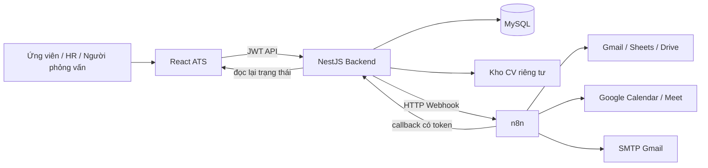

# TV2 — Tổng quan ATS tuyển dụng, phỏng vấn và Offer

Tài liệu này giải thích phần việc của Thành viên 2 cho lead: kiến trúc, bốn workflow n8n, dữ liệu đi qua hệ thống như thế nào, cách chạy thử và bằng chứng kiểm tra đầu cuối.

## 1. Phạm vi và nguyên tắc

TV2 phụ trách phân hệ tuyển dụng ATS từ lúc HR mở vị trí đến lúc ứng viên nhận Offer. Phần này gồm giao diện React, API NestJS, MySQL, lưu CV riêng tư và các workflow n8n kết nối Gmail, Google Form, Google Drive, Google Calendar/Meet và SMTP.

Hai việc **không nằm trong n8n**:

- Backend vẫn là nơi chấm CV bằng `scoreResume`.
- Backend vẫn là nơi tạo JD bằng `generateJobDescription`.

n8n chỉ nhận sự kiện, chuẩn hóa dữ liệu, gọi API Backend, tạo lịch, gửi thư, chờ thời gian và đọc lại trạng thái. Quyền, trạng thái tuyển dụng, chống trùng và điều kiện phát hành Offer vẫn do Backend kiểm tra.

## 2. Bốn workflow đang dùng

| Thứ tự | Nghiệp vụ | ID n8n | Node | Trạng thái |
|---|---|---|---:|---|
| 01 | Đồng bộ vị trí tuyển dụng vào Google Form | `hrTv2JobSyncV2` | 14 | Đang dùng |
| 02 | Tiếp nhận CV đa kênh và gửi thư xác nhận | `hrTv2IntakeV2` | 13 | Đang dùng |
| 03 | Xếp lịch phỏng vấn, Google Meet và thư mời | `hrTv2InterviewV2` | 18 | Đang dùng |
| 04 | Phát hành Offer và nhắc hạn 24–48 giờ | `hrTv2OfferV2` | 15 | Đang dùng |

Các bản cũ/bản thử đã được giữ lại nhưng tắt để không trùng webhook. Workflow 03 dùng đường dẫn `interview-schedule`, workflow 04 dùng `offer-issued`; mỗi đường dẫn chỉ có một workflow đang nhận.

## 3. Sơ đồ dữ liệu



Backend/MySQL là nguồn dữ liệu nghiệp vụ chuẩn. n8n không tự quyết định hồ sơ đạt hay không đạt; n8n báo lại kết quả tích hợp để ATS hiển thị.

## 4. Luồng 01 — Đồng bộ vị trí vào Form

Khi danh sách vị trí mở thay đổi, workflow 01 lấy các Job `OPEN` từ Backend, tạo chuỗi lựa chọn dạng `JOB-0003 – Tên công việc`, cập nhật dropdown Google Form và kiểm tra kết quả. Ngoài webhook `jobs-changed`, workflow có nhánh dự phòng đồng bộ mỗi 5 phút.

Mục đích của mã `JOB-xxxx` là để ứng viên chọn vị trí dễ hiểu, còn n8n tách phần số ở đầu lựa chọn thành `jobId` gửi về Backend. Google Sheet phản hồi giữ nguyên chuỗi lựa chọn và link CV Drive.

## 5. Luồng 02 — Tiếp nhận CV đa kênh

### Nhánh Gmail

1. Theo dõi email chưa đọc có tiêu đề chứa `JOB-` và có file PDF/PNG/JPG/WEBP.
2. Tách mã vị trí, người gửi, email, số điện thoại và file đính kèm.
3. Kiểm tra đúng một file CV hợp lệ.

### Nhánh Google Form

1. Google Form tự ghi một dòng mới vào Google Sheet phản hồi.
2. n8n đọc mã vị trí, tên, email, số điện thoại và URL file Drive.
3. n8n tải CV từ Drive bằng credential Google Drive.

Hai nhánh nhập vào cùng phần xử lý:

4. Kiểm tra thông tin ứng viên, `jobId` và đuôi file.
5. Gửi multipart `cv` vào `POST /api/recruitment/intake` bằng Header Auth.
6. Backend trả HTTP 201 khi tạo hồ sơ mới.
7. Nếu Backend báo hồ sơ trùng, n8n không gửi lại thư.
8. Nếu hồ sơ mới, n8n soạn và gửi thư xác nhận qua SMTP.
9. n8n gọi callback lưu `messageId` và trạng thái `SMTP_ACCEPTED` vào ATS.
10. Email Gmail được đánh dấu đã đọc sau khi xử lý.

Google Sheet chỉ là nơi trung gian lưu câu trả lời Form. HR không cần nhập tay Sheet. CV thật được lưu ở Drive và n8n tải xuống trước khi gửi Backend.

## 6. Luồng 03 — Xếp lịch, Meet và ICS

1. HR kéo ứng viên sang cột phỏng vấn và lưu lịch trên ATS.
2. Backend lưu Interview rồi gửi webhook `interview-schedule` sang n8n.
3. n8n kiểm tra capability callback và claim yêu cầu để chống chạy trùng.
4. n8n lấy payload đã lưu từ Backend.
5. Tạo Google Calendar event dài 45 phút, có ứng viên và người phỏng vấn.
6. Chờ Google tạo conference rồi đọc lại event.
7. Xác minh event ID, thời gian và link Meet thật.
8. Callback lưu link Meet/trạng thái Calendar về ATS.
9. Tạo thư mời và file `interview-<round>.ics`.
10. Gửi cùng thư và ICS cho ứng viên và người phỏng vấn.
11. Xác minh SMTP đã nhận đủ hai địa chỉ.
12. Callback lưu trạng thái gửi thư về ATS.
13. Nhánh lỗi Calendar và SMTP lưu lỗi có cấu trúc, không gửi link Meet giả.

File ICS là lời mời lịch điện tử để nhập vào Google Calendar, Outlook hoặc Apple Calendar. Sự kiện Google Calendar được tạo trực tiếp là bằng chứng chính; ICS là bản đính kèm cho hai người nhận.

## 7. Luồng 04 — Offer và thời hạn 48 giờ

Điều kiện phát hành: vòng phỏng vấn mới nhất của ứng viên phải có kết quả `PASSED`. HR nhập vị trí nhận việc, mức lương và ngày bắt đầu.

1. ATS gửi webhook `offer-issued`.
2. n8n kiểm tra token và claim Offer.
3. n8n lấy nội dung Offer từ Backend.
4. Gửi thư Offer HTML có link `/offers/<token>` cho ứng viên.
5. Callback lưu message ID và thời điểm bắt đầu hạn 48 giờ.
6. Wait đến mốc 24 giờ.
7. Đọc lại trạng thái Offer từ Backend.
8. Nếu chưa phản hồi, gửi email nhắc ứng viên và báo HR.
9. Callback lưu kết quả nhắc.
10. Wait đến mốc 48 giờ.
11. Nếu vẫn chưa phản hồi, Backend đóng Offer hết hạn.
12. n8n báo HR và lưu trạng thái thông báo.

Ứng viên mở trang Offer không cần đăng nhập. Backend khóa phản hồi để không thể đồng ý và từ chối đồng thời. Nếu ứng viên đã phản hồi trước mốc 24 giờ, workflow bỏ qua thư nhắc. Nếu ứng viên đã chấp nhận, workflow không đóng Offer ở mốc 48 giờ.

## 8. Quyền và dữ liệu chuẩn

| Tác vụ | Người có quyền |
|---|---|
| Tạo/sửa/đóng/mở vị trí | HR, SUPERADMIN |
| Xem và xử lý hồ sơ | HR, SUPERADMIN; Manager theo phòng |
| Xếp lịch | HR, SUPERADMIN |
| Ghi điểm phỏng vấn | Đúng Manager/người được giao vòng đó |
| Phát hành Offer | HR, SUPERADMIN khi vòng mới nhất đạt |
| Chấp nhận/từ chối Offer | Ứng viên sở hữu token |

Điểm AI chỉ là thông tin tham khảo. Điểm phỏng vấn, trạng thái Offer và điều kiện tuyển là dữ liệu nghiệp vụ do Backend kiểm tra.

## 9. Cách chạy local

Từ thư mục `HumanResources`:

```powershell
docker compose up -d mysql
powershell -NoProfile -ExecutionPolicy Bypass -File .\scripts\start-n8n-local.ps1
```

Backend:

```powershell
cd .\backend
npm run start:dev
```

Frontend:

```powershell
cd .\frontend
npm run dev -- --host 127.0.0.1
```

Các URL chính:

- ATS: `http://127.0.0.1:5173/admin/recruitment`
- n8n: `http://localhost:5678`
- Workflow 01: `http://localhost:5678/workflow/hrTv2JobSyncV2`
- Workflow 02: `http://localhost:5678/workflow/hrTv2IntakeV2`
- Workflow 03: `http://localhost:5678/workflow/hrTv2InterviewV2`
- Workflow 04: `http://localhost:5678/workflow/hrTv2OfferV2`

Credential Google Calendar, Gmail, Sheets và Drive phải được kết nối trong đúng profile n8n. SMTP dùng Gmail HR đã cấu hình.

## 10. Kết quả kiểm tra đầu cuối đã thực hiện

Ngày 16/10/2026, trên môi trường local:

- **Luồng 02:** Gmail và Google Form đều vào ATS; Backend trả 201; CV PDF/JPG được lưu; email xác nhận đến hộp thư; bản ghi trùng không tạo hồ sơ/thư mới.
- **Luồng 03:** ATS có vòng 1, Google Meet được tạo, Calendar có sự kiện 22:00 ngày 16/10/2026, email mời có `interview-1.ics`, link Meet và trạng thái SMTP được lưu về ATS.
- **Luồng 04:** Offer được gửi với trạng thái `SMTP_ACCEPTED`; ứng viên mẫu mở link và đồng ý; ATS hiển thị `Đã đồng ý nhận việc`; n8n đang chờ mốc 24 giờ như thiết kế.

Các lần chạy live được lưu trong lịch sử Executions của n8n. Bộ test engine riêng đã kiểm tra thêm nhánh trùng, callback token sai, ICS hai người nhận và các mốc 24/48 giờ bằng thời gian rút ngắn trong harness. Không dùng test harness để giả làm email thật.

## 11. Những điều cần nói rõ khi demo

- n8n không chấm CV và không viết JD.
- `SMTP_ACCEPTED` nghĩa là máy chủ gửi thư đã nhận thư, không phải bằng chứng chắc chắn thư nằm trong Inbox.
- Workflow Wait phải giữ nguyên profile n8n và dịch vụ n8n hoạt động để tiếp tục đúng giờ.
- Chỉ một workflow được Publish cho mỗi webhook.
- Hồ sơ thật và credential không đưa vào file JSON/commit.
- Nút tuyển dụng chỉ mở sau khi ứng viên đã chấp nhận Offer và vòng phỏng vấn mới nhất đạt.

Tài liệu chi tiết theo từng luồng nằm ở `BA-WORKFLOW-TV2.md`, `DANH-SACH-LUONG-TV2.md`, `GOOGLE-FORM-JOB-SYNC.md` và `N8N-NHIN-HINH-HIEU-TUNG-NODE.md`.
